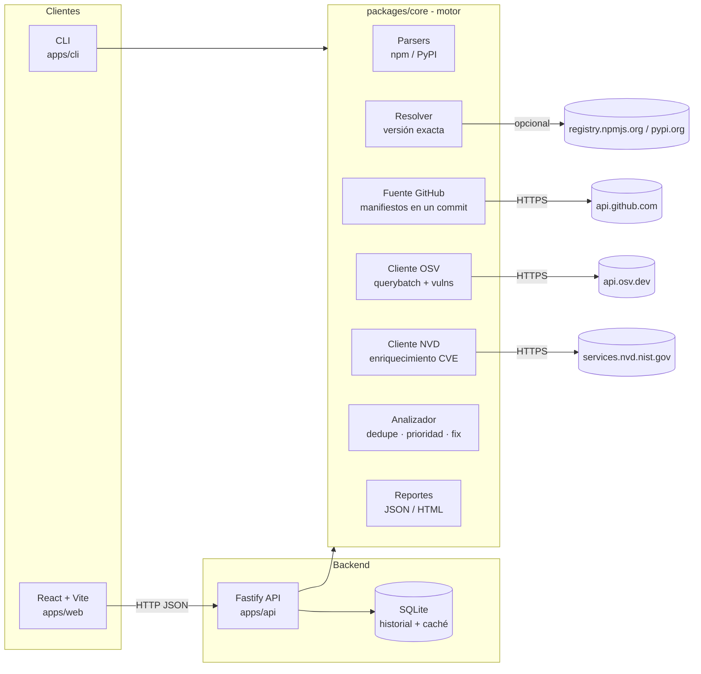
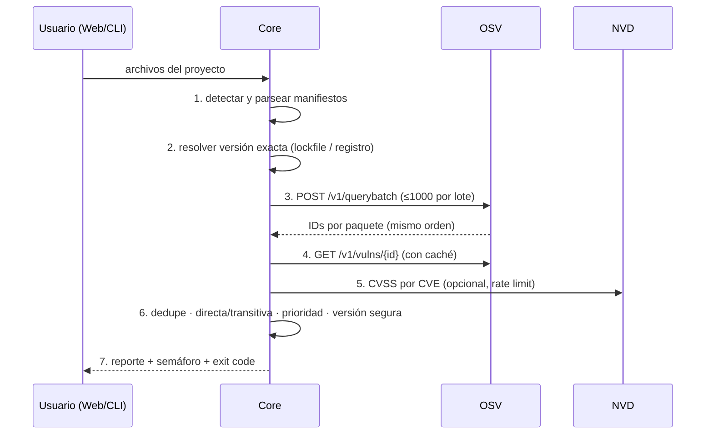

# Escáner de dependencias vulnerables: análisis y arquitectura

> Documento técnico base. Se deriva de `proyecto.md` (planteamiento) y define **qué se construye, con qué y cómo se organiza**.
> Estado: v0.1 implementada · Octubre 2026 · Despliegue: Railway (ver `docs/DESPLIEGUE.md`)

---

## 1. Análisis del proyecto

### 1.1 Objetivo

Construir una herramienta que:

1. Lea los manifiestos y lockfiles de un proyecto (`package.json`, `package-lock.json`, `requirements.txt`).
2. Determine la **versión exacta** de cada dependencia (directa y transitiva).
3. Consulte **OSV** en lote y, opcionalmente, enriquezca con **NVD** por ID de CVE.
4. Aplique **lógica propia** (deduplicación, priorización, versión mínima segura, semáforo de riesgo).
5. Genere un reporte (JSON / HTML / interfaz web) y un **código de salida ≠ 0** si hay vulnerabilidades críticas (uso en CI).

### 1.2 Qué aporta el proyecto (vs. OSV-Scanner / npm audit)

La justificación académica es el **motor propio** y la **medición contra herramientas existentes**:

| Componente                                                                         | Responsable         |
| ---------------------------------------------------------------------------------- | ------------------- |
| Publicar vulnerabilidades                                                          | OSV / NVD (externo) |
| Parsers de `requirements.txt` y `package.json` (rangos, `-r`, comentarios, extras) | **Equipo**          |
| Resolver versión exacta y comparar rangos (semver / PEP 440)                       | **Equipo**          |
| Deduplicar CVE ↔ GHSA (misma falla con varios alias)                               | **Equipo**          |
| Separar directa vs. transitiva y priorizar por severidad                           | **Equipo**          |
| Sugerir versión mínima segura y avisar de salto mayor                              | **Equipo**          |
| Reporte, semáforo de riesgo, interfaz web                                          | **Equipo**          |
| Benchmark contra `npm audit` y `osv-scanner`                                       | **Equipo**          |

### 1.3 Requisitos funcionales

| ID    | Requisito                                                                                                                                                                                                                     |
| ----- | ----------------------------------------------------------------------------------------------------------------------------------------------------------------------------------------------------------------------------- |
| RF-01 | Detectar automáticamente los archivos soportados en una carpeta, en archivos subidos o en un repo público de GitHub (en un commit exacto).                                                                                    |
| RF-02 | Parsear `package.json` + `package-lock.json` (v2/v3) y `requirements.txt` (con `-r`, comentarios, extras, marcadores).                                                                                                        |
| RF-03 | Marcar como **"versión no determinable"** las dependencias sin lockfile o con rango; opcionalmente estimar contra el registro npm/PyPI indicando que es estimación.                                                           |
| RF-04 | Consultar `POST /v1/querybatch` de OSV en lotes de ≤ 1000.                                                                                                                                                                    |
| RF-05 | Obtener detalle con `GET /v1/vulns/{id}` (con caché).                                                                                                                                                                         |
| RF-06 | Enriquecer con NVD por CVE (CVSS, descripción), respetando el rate limit (5 req/30 s sin key, 50 con key).                                                                                                                    |
| RF-07 | Deduplicar por alias (CVE/GHSA/PYSEC).                                                                                                                                                                                        |
| RF-08 | Calcular versión mínima segura y si implica **salto de versión mayor**.                                                                                                                                                       |
| RF-09 | Clasificar riesgo en semáforo: 🔴 crítica/alta · 🟡 media · 🟢 baja/sin hallazgos.                                                                                                                                            |
| RF-10 | Exportar reporte en JSON y HTML; mostrarlo en la interfaz web.                                                                                                                                                                |
| RF-11 | CLI con código de salida configurable (`--fail-on critical                                                                                                                                                                    | high | medium`). |
| RF-12 | Guardar historial de escaneos con fecha (las bases cambian a diario).                                                                                                                                                         |
| RF-13 | Login con Google y con GitHub; vincular ambas cuentas a un mismo usuario.                                                                                                                                                     |
| RF-14 | Listar los repos de la cuenta de GitHub conectada (incluidos privados y de organizaciones) y escanearlos con un clic.                                                                                                         |
| RF-15 | Por cada hallazgo: versión recomendada, todas las versiones seguras de la librería, comandos para aplicar la solución (incluye `overrides` para transitivas) y mitigaciones/parches si se sigue usando la versión vulnerable. |
| RF-16 | Descargar el reporte en HTML y en PDF.                                                                                                                                                                                        |

### 1.4 Requisitos no funcionales

- **Mínimas dependencias** en el motor: usar `fetch` nativo de Node, sin SDKs externos.
- **Reproducibilidad**: cada escaneo guarda fecha, commit analizado y versión del escáner.
- **Respeto de límites** de API (rate limiting + reintentos con backoff).
- **Caché local** de detalles de vulnerabilidades para no repetir llamadas.
- **Portabilidad**: corre en Windows, Linux y macOS.
- **Herramientas de desarrollo**: solo **Visual Studio Code** + terminal. Nada de IDEs externos (ni IntelliJ, ni Visual Studio, ni Eclipse).

### 1.5 Limitaciones declaradas

- Detecta versiones con fallas conocidas, **no** si el código usa la función vulnerable (habrá alertas no explotables).
- Solo detecta lo ya publicado.
- Sin lockfile baja la precisión.
- Requiere internet y disponibilidad de OSV/NVD.

---

## 2. Stack tecnológico

### 2.1 Resumen

| Capa                  | Lenguaje   | Framework / herramienta                         | Motivo                                                                                                                                    |
| --------------------- | ---------- | ----------------------------------------------- | ----------------------------------------------------------------------------------------------------------------------------------------- |
| **Frontend**          | TypeScript | **React 19 + Vite**                             | Requisito del proyecto; Vite es rápido y no necesita IDE.                                                                                 |
| UI                    | —          | Tailwind CSS + componentes propios              | Estilos sin dependencias pesadas.                                                                                                         |
| Estado / datos        | —          | TanStack Query                                  | Manejo de peticiones, caché y estados de carga.                                                                                           |
| Gráficas              | —          | Recharts                                        | Semáforo y distribución por severidad.                                                                                                    |
| **Backend (API)**     | TypeScript | **Node.js 24 LTS + Fastify**                    | Mismo lenguaje en todo el proyecto; `fetch` nativo (el documento lo recomienda); Fastify es ligero, rápido y con validación por esquemas. |
| **Motor del escáner** | TypeScript | Librería propia sin framework (`packages/core`) | Es la parte evaluable; se reutiliza en API y CLI.                                                                                         |
| **CLI**               | TypeScript | `node:util` `parseArgs` (nativo)                | Sin dependencias; ideal para CI.                                                                                                          |
| Persistencia          | SQL        | **SQLite** (`node:sqlite`, nativo en Node 24)   | Historial de escaneos y caché de vulnerabilidades sin instalar servidor de BD.                                                            |
| Validación            | —          | JSON Schema de Fastify + guardas de tipo        | Valida entradas de la API sin dependencias extra; las respuestas de OSV/NVD se verifican con guardas en el core.                          |
| Tests                 | TypeScript | **Vitest 4**                                    | Un solo runner para core, API y CLI.                                                                                                      |
| Calidad               | —          | ESLint + Prettier                               | Integración directa con VS Code.                                                                                                          |
| Monorepo              | —          | **npm workspaces**                              | Nativo de npm, sin herramientas extra.                                                                                                    |
| CI                    | YAML       | GitHub Actions                                  | Ejecuta tests y el propio escáner sobre el repo.                                                                                          |
| **Despliegue**        | —          | **Railway** (Dockerfile + volumen)              | Un servicio: la API sirve la web; SQLite en volumen persistente `/data`.                                                                  |

### 2.2 ¿Por qué Node.js y no Python / Java / .NET para el backend?

- **Un solo lenguaje (TypeScript)** en frontend, backend y motor → la web importa los tipos del core con `import type`, sin duplicar modelos.
- `fetch` nativo y SQLite nativo en Node 24: **el motor no necesita dependencias externas**, tal como sugiere el planteamiento.
- El ecosistema npm es uno de los dos objetivos del escáner; el equipo trabajará con `package-lock.json` de forma natural.
- **Java/Spring o .NET** se descartan: su flujo cómodo depende de IntelliJ / Visual Studio, lo que choca con la restricción de usar solo VS Code.
- **Python/FastAPI** sería válido, pero obliga a mantener dos lenguajes y duplicar modelos.

### 2.3 Entorno de desarrollo (solo VS Code)

Extensiones recomendadas (se dejan en `.vscode/extensions.json`):

- `dbaeumer.vscode-eslint` — ESLint
- `esbenp.prettier-vscode` — Prettier
- `vitest.explorer` — ejecutar tests desde VS Code
- `bradlc.vscode-tailwindcss` — Tailwind IntelliSense
- `humao.rest-client` — probar la API con archivos `.http` (sin Postman)
- `qwtel.sqlite-viewer` — ver la base SQLite
- `github.vscode-github-actions` — editar workflows

Depuración con `.vscode/launch.json` (Node + Chrome), sin herramientas externas.

---

## 3. Arquitectura

### 3.1 Estilo

**Monorepo modular con arquitectura hexagonal (puertos y adaptadores) en el motor.**

- El **núcleo** (`core`) contiene la lógica de dominio y no conoce HTTP, SQLite ni React.
- Las fuentes externas (OSV, NVD, registros npm/PyPI) son **adaptadores** detrás de interfaces → se pueden simular en tests y cambiar sin tocar el dominio.
- **API**, **CLI** y **Web** son _entradas_ que usan el mismo núcleo.

### 3.2 Diagrama de componentes



### 3.3 Flujo de un escaneo (pipeline)



### 3.4 Modelo de datos principal (dominio)

```ts
type Ecosystem = "npm" | "PyPI";

interface Dependency {
  name: string;
  ecosystem: Ecosystem;
  declared: string; // "^4.17.0", ">=2.0,<3"
  resolved: string | null; // "4.17.21" o null si no determinable
  resolution: "lockfile" | "registry-estimate" | "exact-pin" | "unknown";
  direct: boolean;
  path: string[]; // cadena de dependencia (transitivas)
  sourceFile: string;
}

interface Vulnerability {
  id: string; // ID canónico tras deduplicar
  aliases: string[]; // CVE-…, GHSA-…, PYSEC-…
  summary: string;
  severity: "critical" | "high" | "medium" | "low" | "unknown";
  cvss?: number;
  fixedIn: string[];
  references: string[];
}

interface Finding {
  dependency: Dependency;
  vulnerabilities: Vulnerability[];
  minSafeVersion: string | null;
  majorBump: boolean;
  risk: "red" | "yellow" | "green";
}

interface ScanReport {
  scannedAt: string; // ISO 8601
  scannerVersion: string;
  target: { name: string; commit?: string };
  summary: Record<Vulnerability["severity"], number>;
  findings: Finding[];
  warnings: string[]; // p. ej. "sin lockfile"
}
```

### 3.5 API REST (Fastify)

| Método   | Ruta                                      | Descripción                                                                                                                                                                   |
| -------- | ----------------------------------------- | ----------------------------------------------------------------------------------------------------------------------------------------------------------------------------- |
| `POST`   | `/api/scans`                              | JSON `{ files: [{path, content}] }` o `{ github: "owner/repo[@ref]" }` + `options` (`estimate`, `enrichNvd`, `includeDev`). Devuelve el `ScanReport` con `id`. Límite por IP. |
| `GET`    | `/api/scans?limit&offset`                 | Historial (resumen de cada escaneo).                                                                                                                                          |
| `GET`    | `/api/scans/:id`                          | Reporte completo.                                                                                                                                                             |
| `GET`    | `/api/scans/:id/report.html`              | Reporte HTML autocontenido.                                                                                                                                                   |
| `DELETE` | `/api/scans/:id`                          | Elimina un escaneo.                                                                                                                                                           |
| `GET`    | `/api/vulns/:id`                          | Detalle OSV de una vulnerabilidad (con caché).                                                                                                                                |
| `GET`    | `/api/scans/:id/report.html?download=1`   | Descarga del reporte HTML.                                                                                                                                                    |
| `GET`    | `/api/scans/:id/report.pdf`               | Descarga del reporte PDF (pdfkit, generado en el servidor).                                                                                                                   |
| `GET`    | `/api/auth/me`                            | Usuario actual, proveedores configurados y estado de GitHub.                                                                                                                  |
| `GET`    | `/api/auth/:provider/login` · `/callback` | OAuth con `google` o `github`.                                                                                                                                                |
| `POST`   | `/api/auth/logout`                        | Cierra la sesión.                                                                                                                                                             |
| `DELETE` | `/api/auth/github`                        | Desconecta GitHub (borra el token guardado).                                                                                                                                  |
| `GET`    | `/api/github/repos?page`                  | Repos del usuario conectado.                                                                                                                                                  |

**Privacidad**: cada escaneo tiene dueño (cuenta o sesión anónima por cookie). El historial muestra solo los propios;
los escaneos de repos privados solo los puede abrir su dueño. El resto se puede compartir por enlace.
| `GET` | `/api/health` | Estado del servicio y de la base (healthcheck de Railway). |

Los archivos se suben como JSON (el navegador lee solo los manifiestos), así no hace falta `multipart`.

### 3.6 Pantallas del frontend (React)

1. **Nuevo escaneo** — arrastrar archivos o una carpeta (se filtran los manifiestos en el navegador) o indicar un repo de GitHub.
2. **Resultado** — semáforo global, conteo por severidad, tabla filtrable (directa/transitiva, severidad, ecosistema), versión segura sugerida y aviso de salto mayor.
3. **Detalle de vulnerabilidad** — panel lateral con alias, CVSS y su origen, versiones corregidas, descripción y referencias.
4. **Historial y comparación** — escaneos anteriores con fecha; al comparar dos se ven fallas nuevas, corregidas y persistentes.
5. **Mis repos de GitHub** — lista de repos de la cuenta conectada, con filtro, rama/tag opcional y botón Escanear.
6. **Solución por hallazgo** — panel lateral con la recomendación, las opciones (mínima, misma versión mayor, más nueva), todas las versiones seguras, comandos con botón de copiar, fragmento `overrides`, mitigaciones y parches.
7. **Login** con Google o GitHub, y menú de usuario.
8. **Cómo funciona** — pipeline y limitaciones declaradas.

El enrutado es por hash (`#/scan/:id`), así el servidor no necesita reglas especiales.

---

## 4. Estructura de carpetas

```
.
├── .claude/skills/            # skills del proyecto: generar-codigo, generar-docs
├── .vscode/                   # extensiones recomendadas, depuración y tareas
├── .github/workflows/ci.yml   # lint, typecheck, tests, build y depscan sobre el repo
├── Dockerfile · railway.json  # despliegue en Railway
├── package.json               # npm workspaces + scripts
├── tsconfig.base.json · vitest.config.ts · eslint.config.js
│
├── packages/core/             # ⭐ motor (cero dependencias de runtime)
│   ├── src/
│   │   ├── domain/types.ts    # Dependency, Vulnerability, Finding, ScanReport
│   │   ├── versions/          # semver.ts y pep440.ts (implementación propia)
│   │   ├── parsers/npm/       # package-json.ts, lockfile.ts (v1/v2/v3, workspaces)
│   │   ├── parsers/pypi/      # requirements.ts (-r, -c, -e, extras, marcadores, hashes)
│   │   ├── resolver/          # versión exacta: lockfile → pin → estimación → desconocida
│   │   ├── sources/           # ports.ts + adaptadores osv/, nvd/, registry/, github/ y http.ts
│   │   ├── analysis/          # cvss.ts, affected.ts, analyze.ts, remediation.ts, cwe-guidance.ts
│   │   ├── report/            # html.ts y text.ts
│   │   ├── project/files.ts   # qué archivos son manifiestos; lectura de carpetas
│   │   └── scan.ts            # orquestador del pipeline
│   └── test/                  # pruebas sin internet (fuentes simuladas)
│
├── apps/api/                  # Fastify: app.ts, db.ts (node:sqlite), auth/ (OAuth, sesiones), report/pdf.ts + test/
├── apps/cli/                  # depscan [carpeta] | --github owner/repo
├── apps/web/                  # React + Vite + Tailwind: pages/, components/, lib/
│
├── benchmark/                 # repos.json (commits fijos), run.ts, results/AAAA-MM-DD/
└── docs/                      # ARQUITECTURA.md, DESPLIEGUE.md, decisiones/, informe/
```

---

## 5. Decisiones clave (ADR resumidos)

| #      | Decisión                                                         | Alternativa descartada                     | Razón                                                                                     |
| ------ | ---------------------------------------------------------------- | ------------------------------------------ | ----------------------------------------------------------------------------------------- |
| ADR-01 | OSV como fuente principal                                        | NVD por nombre de paquete                  | Cobertura CPE pobre en npm/Go; OSV soporta lote de 1000.                                  |
| ADR-02 | NVD solo por CVE y opcional                                      | NVD obligatorio                            | Rate limit bajo (5/30 s sin key).                                                         |
| ADR-03 | Comparadores semver/PEP 440 propios                              | Librería `semver`                          | Es parte evaluable del trabajo; se validan con tests contra casos de la librería oficial. |
| ADR-04 | TypeScript en todo el stack                                      | Python o Java en backend                   | Tipos compartidos, un solo lenguaje, solo VS Code.                                        |
| ADR-05 | Fastify                                                          | Express / NestJS                           | Más ligero que NestJS, más moderno y validado por esquemas que Express.                   |
| ADR-06 | SQLite nativo en volumen de Railway                              | PostgreSQL                                 | Sin servidor que instalar; suficiente para historial y caché con una réplica.             |
| ADR-08 | Un solo servicio en Railway (la API sirve la web)                | Web y API separadas                        | Un dominio, sin CORS, un solo despliegue.                                                 |
| ADR-09 | Escaneo de repos de GitHub por commit                            | Solo subir archivos                        | En un servidor no hay carpeta local; el commit hace el escaneo reproducible.              |
| ADR-10 | OAuth propio (Google + GitHub), sesión por cookie, token cifrado | Passport / Auth.js                         | Dos proveedores no justifican otra dependencia; control total de la seguridad.            |
| ADR-11 | Versiones seguras evaluadas contra todos los avisos del paquete  | Usar solo la "versión corregida" del aviso | Una versión corregida para una falla puede tener otra.                                    |
| ADR-12 | PDF con pdfkit en el servidor                                    | Chrome headless (Puppeteer)                | Sin navegador en el contenedor: imagen más liviana para Railway.                          |
| ADR-07 | Hexagonal en `core`                                              | Lógica dentro de la API                    | Permite CLI, tests con fuentes simuladas y benchmark reproducible.                        |

---

## 6. Estrategia de pruebas y evaluación

**Pruebas automáticas (Vitest)**

- Unitarias: parsers (casos raros de `requirements.txt`), comparadores de versiones, deduplicación, versión segura.
- Integración: pipeline completo con respuestas OSV/NVD **grabadas** (fixtures), sin internet.
- API: rutas completas con `app.inject` y base SQLite en memoria.
- Frontend: pendiente (verificado con typecheck y build; se puede sumar Testing Library).
- Meta de cobertura: ≥ 80 % en `packages/core`.

**Benchmark (evitar pruebas falsas)**

1. Elegir 5–10 repos open source con lockfile; fijar el **commit exacto** en `benchmark/repos.json`.
2. Ejecutar el escáner propio, `npm audit` y `osv-scanner` sobre los mismos commits, **el mismo día**.
3. Comparar: hallazgos comunes, solo propios, faltantes.
4. Revisar a mano una muestra de diferencias leyendo el aviso original → aciertos vs falsos positivos.
5. Guardar todo en `benchmark/results/AAAA-MM-DD/`.

---

## 7. Plan de trabajo (fases)

| Fase | Entregable                                                                              | Estado                                          |
| ---- | --------------------------------------------------------------------------------------- | ----------------------------------------------- |
| 0    | Monorepo, configuración VS Code, CI, lint                                               | ✅                                              |
| 1    | Parsers npm + PyPI y comparadores de versiones (con tests)                              | ✅                                              |
| 2    | Cliente OSV (lote + detalle + caché) y orquestador                                      | ✅                                              |
| 3    | Análisis: dedupe, prioridad, versión segura, semáforo                                   | ✅                                              |
| 4    | CLI + reporte JSON/HTML + exit code                                                     | ✅                                              |
| 5    | API Fastify + SQLite (historial)                                                        | ✅                                              |
| 6    | Frontend React (escaneo, resultado, detalle, historial, comparación)                    | ✅                                              |
| 7    | Enriquecimiento NVD                                                                     | ✅                                              |
| 8    | Benchmark (script y primera corrida)                                                    | ✅ Falta la revisión manual y el informe final  |
| 9    | Despliegue en Railway                                                                   | Configurado. Falta crear el proyecto en Railway |
| 10   | Remediación: versiones seguras verificadas, comandos, overrides, mitigaciones y parches | ✅                                              |
| 11   | Login con Google/GitHub e importación de repos (incluidos privados)                     | ✅ Código listo. Faltan las keys OAuth          |
| 12   | Reporte descargable en HTML y PDF                                                       | ✅                                              |

## 8. Requisitos para empezar

- **Node.js 24 LTS** (incluye `fetch`, `node:sqlite` y ejecución nativa de TypeScript para el benchmark).
- **Visual Studio Code** con las extensiones de la sección 2.3 (se sugieren al abrir la carpeta).
- **Git**.
- Opcional: `osv-scanner` en el PATH para la columna de comparación del benchmark; API key de NVD en `.env`.

```bash
npm install
npm run dev          # API (3000) + web (5173) con recarga
npm test             # pruebas
npm run build        # compila todo
npm start            # producción local: API + web en http://localhost:3000
npm run scan -- . --fail-on high          # CLI sobre una carpeta
npm run scan -- --github OWASP/NodeGoat   # CLI sobre un repo
npm run benchmark    # comparación con npm audit / osv-scanner
```
