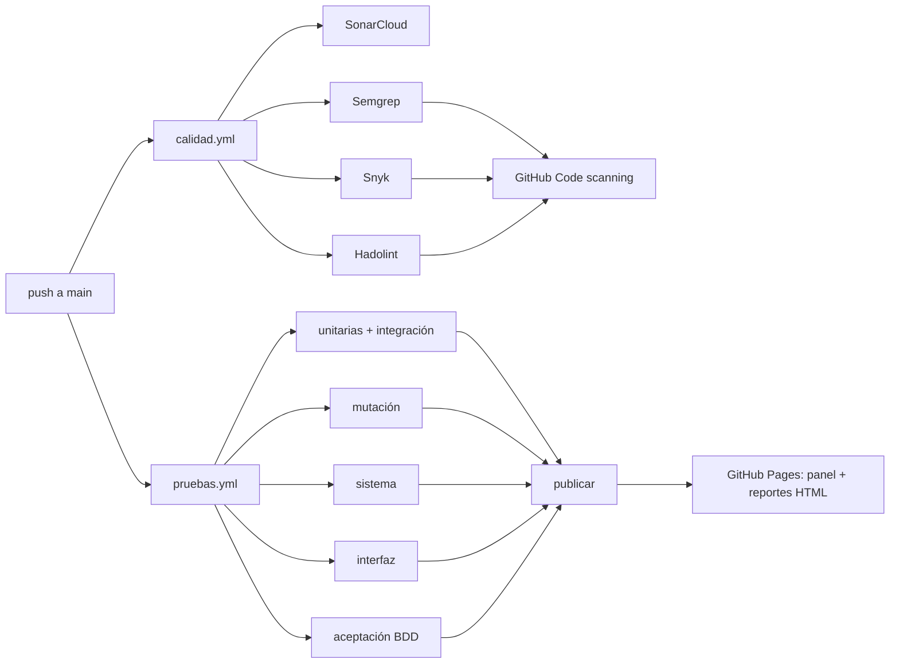

# Automatización de pruebas y análisis estático: DepScan (Unidad 2)

Esta guía responde a los entregables de la unidad 2. Para cada uno indica qué herramienta se usa, dónde está el código, cómo se ejecuta y dónde se ve el reporte, más un guion para demostrarlo en la presentación.

| Entregable | Herramienta | Resultado (20/11/2026) | Reporte publicado |
|---|---|---|---|
| Análisis estático | SonarCloud, Semgrep, Snyk, Hadolint | Semgrep ✅ · Snyk ✅ · Hadolint ✅ · Sonar ⚠️ (token, ver §2) | [Code scanning][cs] · [SonarCloud][sonar] |
| Pruebas unitarias | Vitest + cobertura v8 | **149/149** · líneas 92,5 % · ramas 77,0 % | [/unitarias][p-unit] · [/cobertura][p-cov] |
| Pruebas de mutación | Stryker | **61,1 %** (1577 de 2582 mutantes eliminados) | [/mutacion][p-mut] |
| Pruebas de integración | Vitest + Fastify inject + HTTP local | **12/12** | [/unitarias][p-unit] (proyecto *integracion*) |
| Pruebas de sistema | Vitest contra el servidor real | **20/20** | [/sistema][p-sis] |
| Pruebas de interfaz de usuario | Playwright (escritorio + móvil) | **14/14**, con video y traza | [/ui][p-ui] |
| Pruebas de aceptación de usuario | Gherkin en español + playwright-bdd | **11/11** escenarios | [/aceptacion][p-bdd] |

**Panel con todo:** <https://angelhc123.github.io/Dep_Test/>. Se regenera en cada push a `main`.

[pages]: https://angelhc123.github.io/Dep_Test/
[p-unit]: https://angelhc123.github.io/Dep_Test/unitarias/
[p-cov]: https://angelhc123.github.io/Dep_Test/cobertura/
[p-mut]: https://angelhc123.github.io/Dep_Test/mutacion/
[p-sis]: https://angelhc123.github.io/Dep_Test/sistema/
[p-ui]: https://angelhc123.github.io/Dep_Test/ui/
[p-bdd]: https://angelhc123.github.io/Dep_Test/aceptacion/
[cs]: https://github.com/Angelhc123/Dep_Test/security/code-scanning
[sonar]: https://sonarcloud.io/project/overview?id=Angelhc123_Dep_Test
[wf-pruebas]: https://github.com/Angelhc123/Dep_Test/actions/workflows/pruebas.yml
[wf-calidad]: https://github.com/Angelhc123/Dep_Test/actions/workflows/calidad.yml

---

## 1. Cómo está automatizado

Hay dos workflows y ambos se disparan solos en cada push a `main` (también en pull requests):



| Workflow | Archivo | Qué hace |
|---|---|---|
| **Calidad** | `.github/workflows/calidad.yml` | Ejecuta SonarCloud, Semgrep, Snyk Code, Snyk Open Source y Hadolint. Sube los SARIF a *Security → Code scanning*. |
| **Pruebas y reportes** | `.github/workflows/pruebas.yml` | Corre un job por tipo de prueba en paralelo. Cada job guarda su reporte HTML como artefacto, y el job `publicar` los reúne en GitHub Pages y escribe una tabla resumen en la ejecución. |
| CI | `.github/workflows/ci.yml` | Corre lint, typecheck, las pruebas y el build, y DepScan se escanea a sí mismo. |

Es el mismo patrón de los laboratorios: lab05 publica `mutation/`, lab06 publica videos de UI y lab08 publica `bdd/`. La diferencia es que aquí todo vive en un solo repositorio y en un solo panel.

### Entorno de prueba reproducible

Las pruebas de sistema, UI y aceptación levantan DepScan **completo**: API Fastify, SQLite en disco y la web compilada. Lo hacen con `tests/support/servidor-pruebas.mjs`. Lo único simulado es internet: OSV y los registros npm/PyPI responden con datos fijos (`tests/support/datos-prueba.mjs`). Así el resultado siempre es el mismo (lodash 4.17.15 → 4.17.21, django 3.2.0 → 3.2.19) y no cambia cuando OSV publica avisos nuevos.

Proyectos de ejemplo en `tests/fixtures/`:

| Carpeta | Contenido | Resultado esperado |
|---|---|---|
| `proyecto-demo` | npm (lockfile) + PyPI | 2 de 3 vulnerables, riesgo alto |
| `proyecto-python` | `requirements.txt` | 1 de 1 vulnerable |
| `proyecto-seguro` | lodash 4.17.21 | 0 vulnerables, sin riesgo relevante |

---

## 2. Análisis estático (Sonar, Semgrep, Snyk)

| Herramienta | Qué analiza | Dónde ver el resultado |
|---|---|---|
| SonarCloud | Bugs, code smells, duplicación, cobertura (lee `coverage/lcov.info`) | [sonarcloud.io/project/overview?id=Angelhc123_Dep_Test][sonar] |
| Semgrep | SAST con las reglas `--config=auto` | [Code scanning, filtro Semgrep](https://github.com/Angelhc123/Dep_Test/security/code-scanning?query=tool%3ASemgrep) |
| Snyk Code | SAST | [Code scanning, filtro Snyk](https://github.com/Angelhc123/Dep_Test/security/code-scanning?query=tool%3ASnyk) |
| Snyk Open Source | Dependencias vulnerables | Igual que Snyk Code, más el artefacto `snyk-reportes` |
| Hadolint | `Dockerfile` (infraestructura como código) | Code scanning, categoría `hadolint-iac` |

Configuración: `sonar-project.properties` y `.github/workflows/calidad.yml`. Hay más detalle en `docs/CALIDAD.md`.

> ⚠️ **SonarCloud está fallando (verificado el 20/11/2026):** el log muestra `Error status returned by url [https://api.sonarcloud.io/analysis/engine]: 403`. El código está bien; el problema es el **token**, que está vencido, fue revocado o no tiene permiso sobre el proyecto. Para arreglarlo:
> 1. En SonarCloud, entra a *My Account → Security* y genera un token nuevo.
> 2. En GitHub, entra a *Settings → Secrets and variables → Actions*, edita `SONAR_TOKEN` y pega el token.
> 3. Ve a *Actions → Calidad → Re-run jobs*.
>
> Revisa también que en SonarCloud el *Automatic Analysis* esté **desactivado** (*Administration → Analysis Method*), porque si está activo choca con el análisis desde CI.

---

## 3. Pruebas unitarias y de mutación

**Unitarias.** Son 149 pruebas en `packages/core/test/*.test.ts` y cubren:
- los parsers de `package.json`, `package-lock.json` y `requirements.txt`;
- la comparación de versiones semver y PEP 440;
- el cálculo de CVSS;
- la decisión de si una versión está afectada;
- la deduplicación de avisos y la remediación verificada.

Usan dobles de prueba en lugar de OSV.

```bash
npm run test:unit
npm run test:coverage        # todas, con cobertura y umbral (80 % líneas/funciones, 65 % ramas)
```

**Mutación.** Stryker (`stryker.config.mjs`) muta la lógica del core: versiones, parsers, resolver y análisis. Después vuelve a correr las pruebas. Un mutante **eliminado** quiere decir que alguna prueba detectó el cambio; uno que **sobrevive** marca un caso que ninguna prueba verifica.

```bash
npm run test:mutation        # ≈5 min → reports/mutation/index.html
```

| Carpeta | Puntaje |
|---|---|
| `versions/` | 67,8 % |
| `analysis/` | 60,4 % |
| `parsers/` | 57,5 % |
| `resolver/` | 42,0 % |
| **Total** | **61,1 %** |

El umbral que rompe el build es 50 %. Que el total sea 61 % aunque la cobertura de líneas sea 92 % muestra la idea central de las pruebas de mutación: **ejecutar una línea no es lo mismo que verificar su resultado**. El reporte señala exactamente qué condiciones faltan probar, y `resolver/` es lo primero a reforzar.

## 4. Pruebas de integración y de sistema

**Integración** (`apps/api/test/`, 12 pruebas). Arman los componentes reales y los prueban juntos:
- `api.test.ts`: la API Fastify junto con SQLite en memoria, las sesiones, el OAuth de GitHub (simulado) y la privacidad de los escaneos.
- `integracion-fuentes.test.ts`: los clientes **HTTP reales** `OsvClient` y `RegistryClient` contra un servidor local que imita OSV, con la caché **SQLite real**. Verifica cuatro cosas:
  - todas las dependencias van en *un* lote;
  - el segundo escaneo sale de la caché;
  - la caché sobrevive a reabrir la base;
  - hay reintento ante un `503`.

```bash
npm run test:integration
```

**Sistema** (`tests/sistema/`, 20 pruebas). DepScan **compilado** corre como proceso aparte y se le habla solo por HTTP, igual que un cliente real. Cubre:
- la disponibilidad y la entrega de la SPA;
- las cabeceras de seguridad;
- el flujo completo: escanear, ver la solución, revisar el historial, exportar HTML/PDF y borrar;
- la validación de entradas;
- la **persistencia tras reiniciar el servidor**;
- el **rate limit (429)**;
- el **log estructurado JSON**;
- la CLI con sus códigos de salida.

```bash
npm run build && npm run test:system
```

## 5. Pruebas de interfaz de usuario

Son 7 pruebas en `tests/ui/escaneo.spec.ts` y Playwright corre cada una en **Chromium de escritorio y en un Pixel 7**, lo que da 14 ejecuciones. Recorren el flujo de la web:
- el botón queda deshabilitado mientras no hay archivos;
- subir los manifiestos muestra el resultado;
- el panel *Ver solución* propone 4.17.21;
- el buscador filtra los hallazgos;
- se puede descargar el HTML;
- el historial permite eliminar con confirmación;
- la navegación funciona.

Cada prueba graba **video**, **traza** y **captura**, que se ven desde el reporte con *View trace*.

```bash
npm run build && npx playwright install chromium
npm run test:ui              # reports/ui/index.html
npx playwright test --ui     # modo visual interactivo (ideal para demostrar en vivo)
```

## 6. Pruebas de aceptación de usuario (BDD)

Las historias están escritas en **Gherkin en español**, en `tests/aceptacion/features/`. Hay un archivo por caso de uso del FD03, y los pasos están en `tests/aceptacion/steps/pasos.ts`.

| Feature | Caso de uso | Escenarios |
|---|---|---|
| `cu01-revisar-proyecto.feature` | CU-01 Revisar un proyecto subiendo sus archivos | Esquema con 3 ejemplos (rojo/rojo/verde) + sin archivos |
| `cu04-ver-solucion.feature` | CU-04 Ver la solución de una librería | lodash → 4.17.21, django → 3.2.19 |
| `cu05-descargar-informe.feature` | CU-05 Descargar el informe | HTML y PDF |
| `cu08-historial.feature` | CU-08 Consultar y eliminar revisiones | Historial propio, privacidad entre visitantes, eliminar |

Ejemplo:

```gherkin
# language: es
Esquema del escenario: El semáforo refleja el riesgo del proyecto
  Dado que estoy en la página "Nuevo escaneo"
  Cuando subo los archivos del proyecto "<proyecto>"
  Y presiono "Escanear"
  Entonces veo el semáforo "<semaforo>"
```

```bash
npm run build && npm run test:acceptance    # reports/bdd/index.html (reporte Cucumber)
```

---

## 7. Cómo demostrarlo en la presentación (≈4 minutos)

**Antes de presentar:**
- Abre en pestañas el [panel][pages], la [última ejecución de Pruebas y reportes][wf-pruebas] y [Code scanning][cs].
- Si quieres demo en vivo, deja corrido `npm run build` en tu máquina.

1. **Automatización (30 s).** Abre *Actions → Pruebas y reportes → última ejecución*.
   - Muestra los 6 jobs en verde que corren en paralelo.
   - Baja hasta el **Summary**: está la tabla con los resultados de cada tipo de prueba, generada por el pipeline.
   - Frase: *"Nadie corre esto a mano: cada push dispara todo y publica los reportes."*
2. **Panel (30 s).** Abre el [panel][pages]. Las tarjetas muestran el total de pruebas, 0 fallidas, la cobertura y el puntaje de mutación, y la tabla explica qué verifica cada tipo.
3. **Análisis estático (40 s).** Abre *Security → Code scanning* y filtra por Semgrep y luego por Snyk. Luego abre SonarCloud (Quality Gate, code smells, duplicación).
4. **Mutación (40 s).** Abre [/mutacion][p-mut], entra a `versions/semver.ts` y muestra un mutante que sobrevive (en rojo).
   - Explica: *"Stryker alteró esta condición y ninguna prueba lo notó: ahí falta un caso."*
   - Remata con: *"Cobertura 92 %, mutación 61 %: la cobertura sola engaña."*
5. **Interfaz (40 s).** Abre [/ui][p-ui], elige *"Ver solución abre el panel…"* y reproduce el **video**. Si sobra tiempo, abre *View trace* y recorre paso a paso.
   - Alternativa en vivo: `npx playwright test --ui`, que muestra el navegador ejecutando la prueba.
6. **Aceptación (40 s).** Abre [/aceptacion][p-bdd], despliega `cu01-revisar-proyecto.feature` y muestra los pasos en español en verde. Después enseña el `.feature` en el repo.
   - Mensaje: *"El criterio de aceptación del FD03 es una prueba ejecutable."*
7. **Sistema (20 s).** Abre [/sistema][p-sis] y señala tres pruebas:
   - *"el historial sobrevive a un reinicio"*;
   - *"limita los escaneos por IP (429)"*;
   - *"registra cada petición en el log JSON"*.

   Las tres enlazan con los aspectos no funcionales que se evaluarán después.

**Respaldo sin internet:**
- Corre `npm run test:e2e` en local y abre `reports/ui/index.html`, `reports/bdd/index.html` y `reports/mutation/index.html` directamente.
- `npm run test:resumen` imprime la misma tabla de resultados en la terminal.

---

## 8. Requisito único para que el panel se publique

En GitHub, entra a **Settings → Pages → Build and deployment → Source** y elige **GitHub Actions**. Esto ya estaba así, porque el panel anterior se publicaba de la misma forma. El workflow `pages.yml` se reemplazó por el job `publicar` de `pruebas.yml`.
