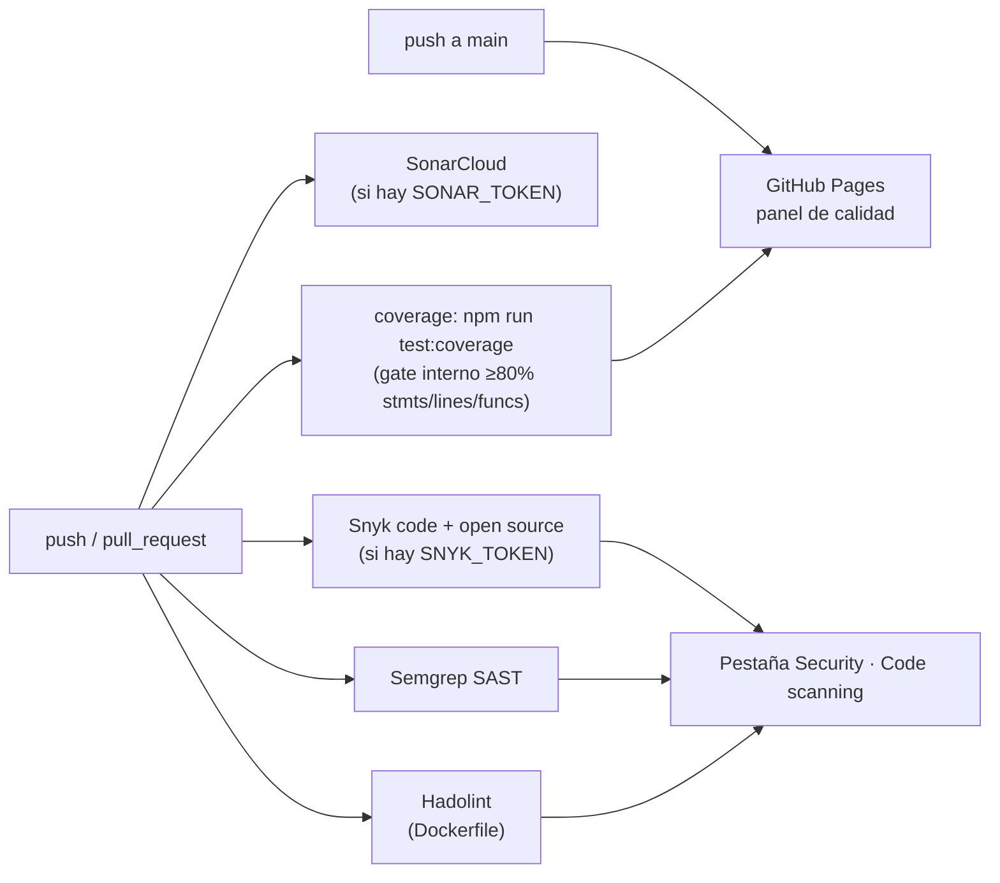

# Calidad: cobertura, SonarCloud, Snyk, Semgrep y GitHub Pages

DepScan aplica sobre **su propio código** las prácticas de los laboratorios de calidad del curso
(pruebas estáticas con SonarQube/SonarCloud, Snyk y Semgrep, y análisis estático de infraestructura):
no se modifica lógica de negocio, se agregan pruebas y se conecta el proyecto a esas herramientas.



## Qué se agregó

| Pieza | Archivo | Qué hace |
| --- | --- | --- |
| Cobertura con gate | `vitest.config.ts` | `coverage.thresholds`: falla si statements/lines/functions < 80% o branches < 65%. |
| Tests nuevos | `packages/core/test/{http,osv-client,nvd-client,registry-client,github-source,files,types}.test.ts` | Cubren los adaptadores HTTP y de fuentes externas (antes sin pruebas), subiendo la cobertura del proyecto de ~80% a ~89% (statements). |
| Workflow de calidad | `.github/workflows/calidad.yml` | Corre en cada push/PR: tests+cobertura, SonarCloud, Snyk, Semgrep y Hadolint (Dockerfile). |
| Config de SonarCloud | `sonar-project.properties` | Organización, project key, fuentes/tests y ruta del `lcov.info` para que Sonar lea la cobertura real. |
| GitHub Pages | `.github/workflows/pages.yml`, `scripts/pages-index.js` | En cada push a `main`: publica el reporte HTML de cobertura, el reporte de depscan sobre sí mismo, y enlaces a SonarCloud/Code Scanning. |

## Configuración pendiente (una sola vez, desde GitHub.com)

Los workflows ya están escritos pero varias piezas requieren una cuenta externa y secretos que
**solo el dueño del repositorio puede crear** (no se pueden generar automáticamente):

1. **GitHub Pages**: `Settings → Pages → Build and deployment → Source: GitHub Actions`.
   Sin este paso el workflow `pages.yml` falla al desplegar aunque el build funcione.
2. **SonarCloud** (opcional, pero recomendado para el gate de cobertura ≥80% en código nuevo):
   - Crear el proyecto en <https://sonarcloud.io/projects/create> importando este repo de GitHub.
   - Si SonarCloud asigna una organización/project key distintas a `angelhc123` / `Angelhc123_Dep_Test`,
     actualizar `sonar-project.properties` y `scripts/pages-index.js` con los valores reales.
   - Generar un token en *My Account → Security* y guardarlo como secreto del repo:
     `Settings → Secrets and variables → Actions → New repository secret → SONAR_TOKEN`.
   - El job de SonarCloud en `calidad.yml` solo corre si existe `SONAR_TOKEN` (si no, se omite sin fallar el workflow).
3. **Snyk** (opcional): generar un token en <https://app.snyk.io/account> y guardarlo como
   secreto `SNYK_TOKEN`. El job solo corre si el secreto existe.
4. **Semgrep y Hadolint**: no requieren cuenta ni token — usan reglas públicas (`--config=auto` y
   el linter de Dockerfile respectivamente) y publican sus hallazgos como SARIF en la pestaña
   **Security → Code scanning** del repositorio.

## Comandos locales

```bash
npm run test:coverage   # tests + reporte de cobertura (coverage/index.html)
node scripts/pages-index.js > site/index.html   # regenerar el panel localmente (requiere coverage/ ya generado)
```
