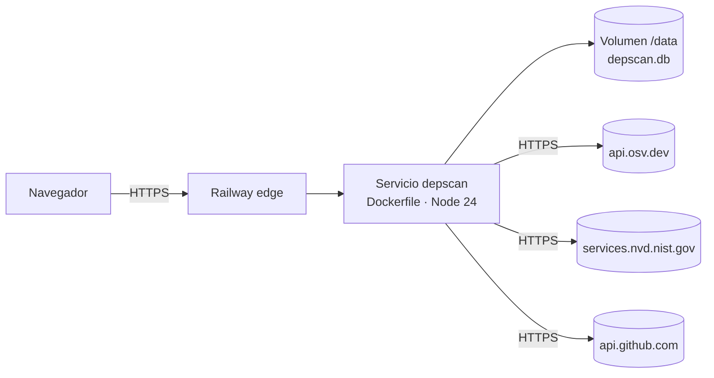

# Despliegue en Railway

depscan se despliega como **un solo servicio**: la API (Fastify) atiende `/api/*` y sirve el build de React en `/`.
La base SQLite y la caché de OSV/NVD viven en un **volumen** para no perderse entre despliegues.



## Archivos que usa Railway

| Archivo         | Para qué                                                                                                     |
| --------------- | ------------------------------------------------------------------------------------------------------------ |
| `Dockerfile`    | Build multi-etapa: compila core, API y web; la imagen final solo lleva `dist/` y dependencias de producción. |
| `railway.json`  | Builder Dockerfile, healthcheck en `/api/health`, política de reinicio y rutas que disparan redeploy.        |
| `.dockerignore` | Evita subir `node_modules`, `dist`, `.git`, docs, etc.                                                       |

## Pasos (solo navegador + VS Code)

1. **Subir el código a GitHub** (desde VS Code: panel _Source Control_ → _Publish to GitHub_).
2. En [railway.com](https://railway.com) → **New Project** → **Deploy from GitHub repo** → elegir el repo.
   Railway detecta `railway.json` y construye con el `Dockerfile`.
3. **Agregar un volumen**: en el servicio → _Settings_ → _Volumes_ → _Add volume_ → mount path **`/data`**.
   (Railway expone `RAILWAY_VOLUME_MOUNT_PATH`; la app también la lee si falta `DATA_DIR`.)
4. **Variables** (_Variables_ del servicio):

   | Variable                                    | Valor                                                                     | Obligatoria                               |
   | ------------------------------------------- | ------------------------------------------------------------------------- | ----------------------------------------- |
   | `DATA_DIR`                                  | `/data`                                                                   | Ya viene en el Dockerfile                 |
   | `NVD_API_KEY`                               | key gratuita de [NVD](https://nvd.nist.gov/developers/request-an-api-key) | No (sube el límite de 5 a 50 req/30 s)    |
   | `GITHUB_TOKEN`                              | token _fine-grained_ sin permisos (solo repos públicos)                   | No (sube de 60 a 5000 req/h)              |
   | `SCAN_RATE_LIMIT`                           | escaneos por IP y minuto (por defecto 20)                                 | No                                        |
   | `LOG_LEVEL`                                 | `info` / `warn` / `debug`                                                 | No                                        |
   | `SESSION_SECRET`                            | cadena aleatoria larga (cifra los tokens de GitHub guardados)             | Sí, si se activa el login                 |
   | `GOOGLE_CLIENT_ID` / `GOOGLE_CLIENT_SECRET` | credenciales OAuth de Google (ver abajo)                                  | No (sin ellas no aparece el botón)        |
   | `GITHUB_CLIENT_ID` / `GITHUB_CLIENT_SECRET` | credenciales de la OAuth App de GitHub (ver abajo)                        | No (sin ellas no aparece el botón)        |
   | `PUBLIC_URL`                                | `https://<dominio>`                                                       | No (se deduce de `RAILWAY_PUBLIC_DOMAIN`) |

   `PORT` lo inyecta Railway; no hay que definirla.

5. **Generar dominio**: _Settings_ → _Networking_ → _Generate Domain_.
6. Verificar: `https://<dominio>/api/health` debe responder `{"status":"ok",...}`.

Cada `git push` a la rama conectada vuelve a desplegar. Railway espera a que `/api/health` responda antes de
enrutar tráfico a la versión nueva y envía `SIGTERM` a la anterior; el servidor cierra conexiones y la base ordenadamente.

## Configurar el login (cuando se tengan las keys)

Sin estas variables la app funciona igual, solo que sin botones de login. Con el dominio ya generado:

**Google**

1. [Google Cloud Console](https://console.cloud.google.com/) → _APIs y servicios_ → _Pantalla de consentimiento de OAuth_
   (tipo externo; scopes `openid`, `email`, `profile`).
2. _Credenciales_ → _Crear credenciales_ → _ID de cliente de OAuth_ → tipo _Aplicación web_.
3. URI de redirección autorizada: `https://<dominio>/api/auth/google/callback`
   (y `http://localhost:3000/api/auth/google/callback` para pruebas locales).
4. Copiar el ID y el secreto a `GOOGLE_CLIENT_ID` y `GOOGLE_CLIENT_SECRET`.

**GitHub**

1. GitHub → _Settings_ → _Developer settings_ → _OAuth Apps_ → _New OAuth App_.
2. Homepage URL: `https://<dominio>` · Authorization callback URL: `https://<dominio>/api/auth/github/callback`.
3. Generar un _client secret_ y copiar ambos a `GITHUB_CLIENT_ID` y `GITHUB_CLIENT_SECRET`.
4. Para repos de organizaciones, cada organización debe aprobar la OAuth App (GitHub lo pide al conectarse).

Para desarrollo local se necesita otra OAuth App de GitHub con callback en `http://localhost:3000`; GitHub admite una
sola URL por app.

**Seguridad del login**: flujo _authorization code_ con `state` (y PKCE en Google), sesión en cookie `HttpOnly`

- `SameSite=Lax` + `Secure` en HTTPS, sesión nueva tras autenticarse, token de GitHub cifrado con AES-256-GCM y
  redirecciones de vuelta solo a rutas internas. Los escaneos de repos privados solo los ve su dueño.

## Notas

- **Una réplica**: SQLite no admite varias instancias escribiendo el mismo archivo. Para escalar horizontalmente
  habría que pasar a PostgreSQL (Railway lo ofrece como plugin); el acceso a datos está aislado en `apps/api/src/db.ts`.
- El contenedor corre como root porque los volúmenes de Railway se montan con dueño root.
- La caché de vulnerabilidades (24 h) y de registros (1 h) está en la misma base; se purga sola cada 6 h.
- Sin volumen la app funciona, pero el historial se pierde en cada despliegue.

## Probar la imagen localmente (opcional)

Si tienes Docker Desktop:

```bash
docker build -t depscan .
docker run --rm -p 3000:3000 -v depscan-data:/data depscan
```

Sin Docker, el equivalente es `npm run build && npm start`.
