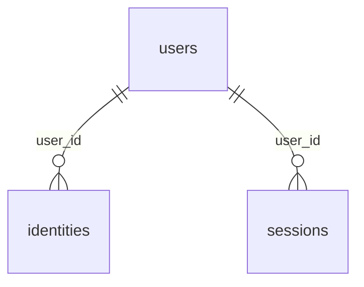

# Diccionario de datos – DepScan

> Archivo generado automáticamente por `scripts/diccionario-datos.js` (workflow *Diccionario de datos*). No editar a mano:
> las descripciones se mantienen en el script y la estructura se lee del esquema real de SQLite.

- **Motor:** SQLite (módulo nativo `node:sqlite`), archivo `$DATA_DIR/depscan.db`
- **Versión del esquema (PRAGMA user_version):** 2
- **Tablas:** 5

## Resumen

| Tabla | Descripción | Columnas |
|---|---|---|
| [scans](#scans) | Historial de escaneos. Guarda el resumen para el listado y el reporte completo en JSON. | 10 |
| [cache](#cache) | Caché persistente de respuestas de OSV, NVD y los registros npm/PyPI. | 3 |
| [users](#users) | Cuentas de usuario creadas al iniciar sesión con Google o GitHub. | 5 |
| [identities](#identities) | Proveedores de identidad vinculados a cada usuario (una cuenta puede tener Google y GitHub). | 8 |
| [sessions](#sessions) | Sesiones de navegador (anónimas o de usuario), referenciadas por la cookie de sesión. | 5 |

## scans

Historial de escaneos. Guarda el resumen para el listado y el reporte completo en JSON.

| Columna | Tipo | Nulo | Por defecto | Clave | Descripción |
|---|---|---|---|---|---|
| id | TEXT | No |  | PK | Identificador del escaneo (UUID). |
| created_at | TEXT | No |  |  | Fecha y hora del escaneo (ISO 8601, UTC). |
| target_name | TEXT | No |  |  | Nombre del proyecto escaneado (repositorio o archivo de manifiesto). |
| source | TEXT | No |  |  | Origen del escaneo: github, upload o directory. |
| commit_sha | TEXT | Sí |  |  | Commit analizado cuando el origen es un repositorio. |
| risk | TEXT | No |  |  | Semáforo de riesgo global: red, yellow o green. |
| summary_json | TEXT | No |  |  | Resumen del escaneo (conteos por severidad y riesgo) en JSON. |
| report_json | TEXT | No |  |  | Reporte completo (dependencias, vulnerabilidades y remediaciones) en JSON. |
| owner | TEXT | Sí |  |  | Dueño del escaneo: "user:<id>" o "anon:<sesión>". |
| private | INTEGER | No | 0 |  | 1 si proviene de un repositorio privado (solo lo ve su dueño); 0 si no. |

**Índices**

| Índice | Columnas | Único |
|---|---|---|
| scans_owner | owner, created_at DESC | No |
| scans_created_at | created_at DESC | No |

## cache

Caché persistente de respuestas de OSV, NVD y los registros npm/PyPI.

| Columna | Tipo | Nulo | Por defecto | Clave | Descripción |
|---|---|---|---|---|---|
| key | TEXT | No |  | PK | Clave de la entrada (fuente y consulta). |
| value | TEXT | No |  |  | Respuesta almacenada. |
| expires_at | INTEGER | No |  |  | Expiración en milisegundos desde época Unix. |

## users

Cuentas de usuario creadas al iniciar sesión con Google o GitHub.

| Columna | Tipo | Nulo | Por defecto | Clave | Descripción |
|---|---|---|---|---|---|
| id | TEXT | No |  | PK | Identificador del usuario (UUID). |
| email | TEXT | Sí |  |  | Correo electrónico informado por el proveedor. |
| name | TEXT | Sí |  |  | Nombre visible. |
| avatar_url | TEXT | Sí |  |  | URL de la foto de perfil. |
| created_at | TEXT | No |  |  | Fecha de registro (ISO 8601, UTC). |

## identities

Proveedores de identidad vinculados a cada usuario (una cuenta puede tener Google y GitHub).

| Columna | Tipo | Nulo | Por defecto | Clave | Descripción |
|---|---|---|---|---|---|
| provider | TEXT | No |  | PK | Proveedor de identidad: google o github. |
| provider_user_id | TEXT | No |  | PK | Identificador del usuario dentro del proveedor. |
| user_id | TEXT | No |  | FK → users(id) ON DELETE CASCADE | Usuario de DepScan al que pertenece la identidad. |
| login | TEXT | Sí |  |  | Nombre de usuario en el proveedor (p. ej., login de GitHub). |
| email | TEXT | Sí |  |  | Correo informado por el proveedor. |
| access_token_enc | TEXT | Sí |  |  | Token de acceso cifrado con AES-256-GCM (solo GitHub, para leer repositorios). |
| scopes | TEXT | Sí |  |  | Permisos OAuth concedidos. |
| updated_at | TEXT | No |  |  | Última actualización (ISO 8601, UTC). |

**Índices**

| Índice | Columnas | Único |
|---|---|---|
| identities_user | user_id | No |

## sessions

Sesiones de navegador (anónimas o de usuario), referenciadas por la cookie de sesión.

| Columna | Tipo | Nulo | Por defecto | Clave | Descripción |
|---|---|---|---|---|---|
| id | TEXT | No |  | PK | Identificador aleatorio de la sesión (valor de la cookie). |
| user_id | TEXT | Sí |  | FK → users(id) ON DELETE CASCADE | Usuario autenticado; NULL si la sesión es anónima. |
| created_at | INTEGER | No |  |  | Creación en milisegundos desde época Unix. |
| expires_at | INTEGER | No |  |  | Expiración en milisegundos desde época Unix. |
| data | TEXT | No | '{}' |  | Datos auxiliares de la sesión en JSON (p. ej., estado OAuth). |

## Relaciones

