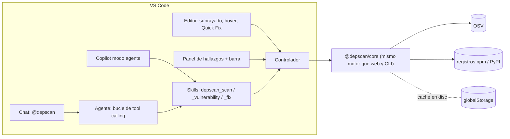

# Reto: plugin de VS Code con skills y agente

El enunciado pedía *"integrar su aplicación con otras 03 aplicaciones… **o crear un plugin en VSCode, junto con skills y agente**"*. DepScan resuelve el reto con la segunda opción.

| Pieza pedida | Qué construimos | Dónde |
|---|---|---|
| **Plugin de VS Code** | Extensión *DepScan*: subraya las librerías vulnerables, muestra el detalle al pasar el mouse, ofrece un Quick Fix a la versión segura verificada, y agrega un panel lateral, la barra de estado y el reporte HTML. | `apps/vscode/` |
| **Skills** | 3 herramientas para la IA del editor (*Language Model Tools*): `depscan_scan`, `depscan_vulnerability` y `depscan_fix`. Además, una skill de Claude Code (`revisar-dependencias`). | `apps/vscode/src/agente.ts`, `.claude/skills/revisar-dependencias/SKILL.md` |
| **Agente** | `@depscan` en el chat de VS Code, con `/scan`, `/fix`, `/explain` y preguntas libres. Usa un bucle de *tool calling*: el modelo decide qué skill usar, la extensión la ejecuta y le devuelve el resultado. | `apps/vscode/src/agente.ts` |

**Descarga:** el `.vsix` se genera y publica solo, en cada push, en <https://angelhc123.github.io/Dep_Test/extension/>.

## Arquitectura

La extensión **reutiliza el mismo motor** (`packages/core`) que la web, la API y la CLI. Es un *adaptador de entrada* más de la arquitectura hexagonal: no se duplicó ninguna lógica de análisis.



| Archivo | Responsabilidad |
|---|---|
| `src/manifiestos.ts` | Lógica pura: ubicar la dependencia en el archivo y reescribir su versión. **17 pruebas unitarias**, 100 % de líneas. |
| `src/motor.ts` | Une el core con OSV y los registros, y mantiene la caché persistente en disco. |
| `src/controlador.ts` | Escanea el workspace y publica los diagnósticos, la barra de estado y el reporte. Coloca las dependencias directas en `package.json` aunque la versión salga del lockfile. |
| `src/proveedores.ts` | Hover, Quick Fix y árbol de hallazgos. |
| `src/agente.ts` | Las skills y el agente `@depscan`. |

## Pruebas

| Tipo | Qué verifica | Resultado |
|---|---|---|
| Unitarias (Vitest) | `manifiestos.ts`: ubicación en package.json, lockfile y requirements; conservar `^`/`~`; marcadores PEP 508; mensajes. | 17/17 |
| **E2E en un VS Code real** (`@vscode/test-electron`) | 8 pruebas, todas sobre `test/e2e/proyecto`:<br>• subrayado de lodash (alta) y django (crítica);<br>• hover;<br>• Quick Fix y reescaneo al guardar;<br>• skills `depscan_scan` y `depscan_vulnerability` invocadas con `vscode.lm.invokeTool`;<br>• "Actualizar todas", que deja el semáforo en verde;<br>• registro del agente. | 8/8 |

En CI (job *Extensión VS Code* de `pruebas.yml`), VS Code corre en una pantalla virtual (`xvfb-run`). El resultado aparece en el panel de GitHub Pages y el `.vsix` se publica para descargar.

```bash
npm run test:e2e -w depscan-vscode     # abre un VS Code de prueba y corre las 8 pruebas
npm run package  -w depscan-vscode     # genera apps/vscode/depscan.vsix
```

## Instalar

```bash
code --install-extension apps/vscode/depscan.vsix
```

También se puede desde VS Code: *Extensiones → ⋯ → Instalar desde VSIX…*. Requiere VS Code 1.99 o superior. Para usar el agente con preguntas libres hace falta un modelo de chat activo (GitHub Copilot). `/scan` y `/fix` funcionan sin modelo.

## Demo para la presentación (≈4 minutos)

**Preparación:** un proyecto con librerías vulnerables. Sirve `tests/fixtures/proyecto-demo` (lodash 4.17.15 y django 3.2.0) o cualquiera de los repos de prueba del benchmark (NodeGoat, nodejs-goof…).

1. **Subrayado (40 s).** Abre la carpeta del proyecto en VS Code. La barra de estado muestra *"🛡 DepScan: 2 vulnerables"* en rojo. Abre `package.json`: `lodash` está subrayado. Pasa el mouse para mostrar el CVE, la severidad, el enlace a OSV y la versión segura **verificada**.
2. **Quick Fix (30 s).** Pulsa `Ctrl+.` sobre lodash y elige *"DepScan: actualizar lodash a 4.17.21 (versión segura verificada)"*. Guarda: DepScan reescanea solo. Con lockfile, después del `npm install` el subrayado desaparece.
3. **Panel (20 s).** Abre el ícono del escudo en la barra lateral: muestra los hallazgos por severidad. Al hacer clic en una vulnerabilidad se abre OSV.
4. **Agente (90 s).**
   - En el chat escribe `@depscan /scan`: aparece la tabla priorizada.
   - Luego `@depscan /explain CVE-2021-23337`: lo explica en lenguaje simple usando la skill `depscan_vulnerability`.
   - Luego `@depscan /fix`: aparecen botones *"Actualizar … a …"*.
   - Cierra con una pregunta libre: *"@depscan ¿qué debería corregir primero y por qué?"*. Aquí el agente decide solo qué skills llamar.
5. **Skills en Copilot (30 s).** En modo *Agent* de Copilot, escribe *"revisa si mis dependencias tienen vulnerabilidades #depscanScan"*. Copilot usa la skill de DepScan.
6. **Evidencia (20 s).** Abre el panel de GitHub Pages en la fila *Extensión VS Code (e2e) 8/8* y muestra la página de descarga del `.vsix`.

**Mensaje clave:** *"El mismo motor que probamos con 250 pruebas automatizadas ahora vive en el editor: el desarrollador ve la vulnerabilidad donde la escribe, y un agente de IA la explica y la corrige con datos reales de OSV, sin inventar CVE."*
