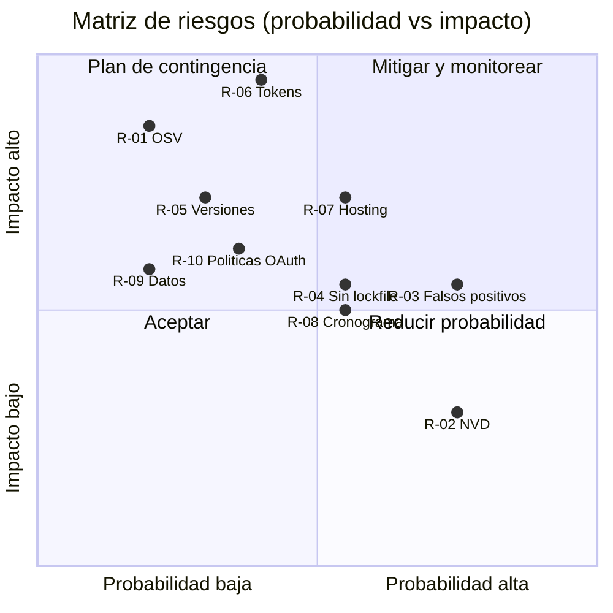
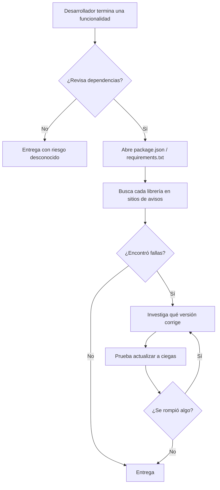
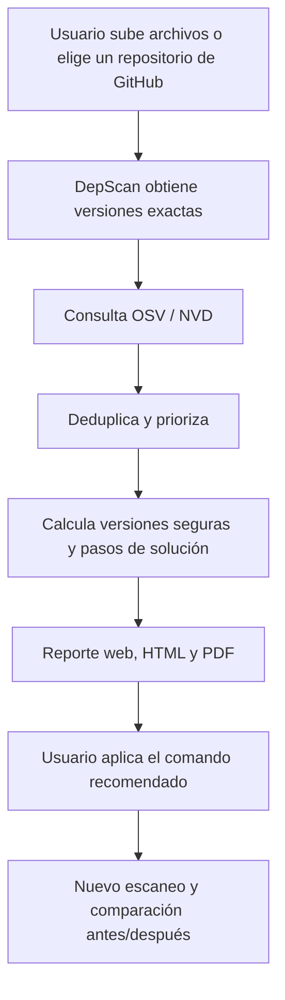
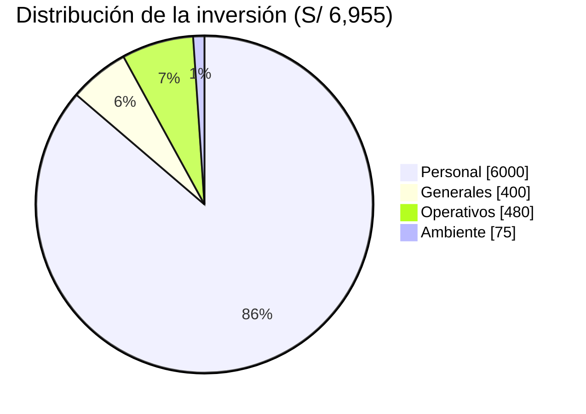
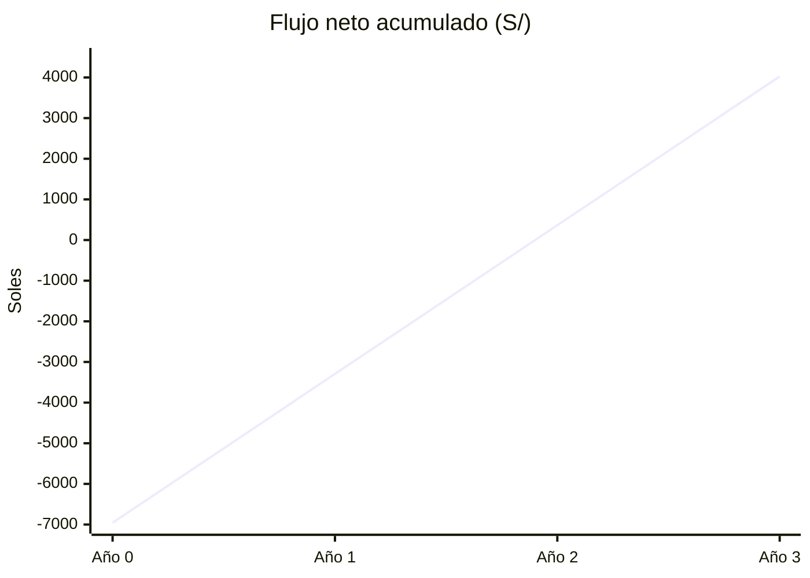

UNIVERSIDAD PRIVADA DE TACNA

FACULTAD DE INGENIERIA

Escuela Profesional de Ingeniería de Sistemas

**DepScan: Sistema Web de Detección y Remediación de Dependencias Vulnerables**

**Integrante:**

Angel Gadiel Hernandez Cruz

Tacna – Perú

2026

---

## INDICE GENERAL

- 1. Descripción del Proyecto
- 2. Riesgos
- 3. Análisis de la Situación actual
- 4. Estudio de Factibilidad
    - 4.1 Factibilidad Técnica
    - 4.2 Factibilidad económica
    - 4.3 Factibilidad Operativa
    - 4.4 Factibilidad Legal
    - 4.5 Factibilidad Social
    - 4.6 Factibilidad Ambiental
- 5. Análisis Financiero
- 6. Conclusiones
- BIBLIOGRAFÍA
- WEBGRAFÍA

---

# 1. Descripción del Proyecto

**Nombre del proyecto:** DepScan: Sistema Web de Detección y Remediación de Dependencias Vulnerables.

**Duración:** 16 semanas (semestre académico 2026-II, agosto – diciembre de 2026).

**Descripción general.** El software moderno se construye sobre librerías de terceros: un proyecto web promedio en npm incorpora cientos de paquetes, la mayoría de ellos de forma *transitiva* (dependencias de dependencias). Cuando una de esas librerías tiene una vulnerabilidad publicada y el equipo no lo advierte, la aplicación queda expuesta aunque su propio código sea correcto. El caso de referencia es Equifax (2017): un componente sin actualizar (Apache Struts, CVE-2017-5638) permitió la filtración de datos de unos 147 millones de personas, a pesar de que el parche existía dos meses antes del ataque.

DepScan es un sistema web que **lee los archivos de dependencias de un proyecto** (`package.json`, `package-lock.json` y `requirements.txt`), determina la **versión exacta** de cada librería, la cruza con las bases públicas de vulnerabilidades **OSV** (Google) y **NVD** (NIST) y, a partir de esa información, **prioriza los riesgos y propone soluciones concretas**: la versión segura recomendada, todas las versiones seguras de la librería, los comandos para aplicar la actualización y medidas de mitigación cuando no es posible actualizar. El resultado se presenta en una interfaz web y en reportes descargables en HTML y PDF.

**Objetivo general.** Desarrollar un sistema web que detecte dependencias con vulnerabilidades conocidas en proyectos npm y PyPI y proponga acciones de remediación verificadas, reduciendo el tiempo y la incertidumbre de la revisión manual.

**Objetivos específicos.**

| N.º | Objetivo específico | Indicador de logro |
|---|---|---|
| OE1 | Implementar un motor propio que interprete manifiestos y lockfiles y resuelva versiones exactas, incluidas dependencias transitivas. | Soporte de lockfile npm v1, v2 y v3, *workspaces* y `requirements.txt` con `-r`, extras y marcadores. |
| OE2 | Consultar OSV en lote y enriquecer opcionalmente con NVD, deduplicando avisos repetidos (CVE, GHSA, PYSEC). | Una consulta en lote de hasta 1000 paquetes; cero avisos duplicados en el reporte. |
| OE3 | Calcular, para cada librería vulnerable, la versión segura recomendada y todas las alternativas seguras. | Versiones evaluadas contra **todos** los avisos publicados del paquete. |
| OE4 | Ofrecer una interfaz web con inicio de sesión (Google y GitHub), historial y reportes HTML/PDF. | Flujo completo probado en producción. |
| OE5 | Validar los resultados frente a herramientas reconocidas. | Benchmark reproducible contra `npm audit` sobre repositorios fijados en un commit. |

**Alcance resumido.** Ecosistemas npm y PyPI; fuentes OSV y NVD; uso vía web, línea de comandos (CLI) e integración continua; despliegue en la nube (Railway). Quedan fuera del alcance: el descubrimiento de vulnerabilidades nuevas (*zero-day*), el análisis de alcanzabilidad del código vulnerable y otros ecosistemas (Maven, Go, Cargo).

# 2. Riesgos

Se identificaron los riesgos del proyecto y se valoraron con una escala de probabilidad (P) e impacto (I) de 1 a 5. La exposición es P × I: **alta** de 15 a 25, **media** de 8 a 14 y **baja** de 1 a 7.

| ID | Riesgo | Tipo | P | I | Exposición | Estrategia de respuesta |
|---|---|---|---|---|---|---|
| R-01 | Indisponibilidad o cambios en la API de OSV | Técnico / externo | 2 | 5 | 10 Media | Caché local de 24 h, reintentos con espera exponencial y adaptadores aislados (puertos) que permiten cambiar de fuente. |
| R-02 | Límite de uso de NVD (5 solicitudes por 30 s sin clave) | Técnico / externo | 4 | 2 | 8 Media | NVD es opcional; limitador de tasa y API key gratuita (50 solicitudes por 30 s). |
| R-03 | Falsos positivos: alertas sobre código que no se ejecuta | Calidad | 4 | 3 | 12 Media | Declaración explícita de la limitación, separación directa/transitiva y desarrollo/producción, y priorización por severidad. |
| R-04 | Versiones no determinables por falta de lockfile | Calidad | 3 | 3 | 9 Media | Advertencia visible y estimación opcional contra el registro, marcada como tal. |
| R-05 | Errores en la comparación de versiones (semver / PEP 440) | Técnico | 2 | 4 | 8 Media | Implementación propia con casos de las especificaciones oficiales y 97 pruebas automatizadas. |
| R-06 | Exposición de tokens OAuth de los usuarios | Seguridad | 2 | 5 | 10 Media | Tokens cifrados con AES-256-GCM, sesión en cookie `HttpOnly`, `state` y PKCE en OAuth. |
| R-07 | Vencimiento o impago del plan de hosting | Operativo | 3 | 4 | 12 Media | Presupuesto mensual previsto; imagen Docker portable a otro proveedor. |
| R-08 | Retraso en el cronograma por carga académica | Gestión | 3 | 3 | 9 Media | Iteraciones cortas por fase RUP y priorización MoSCoW de requerimientos. |
| R-09 | Pérdida de datos del historial | Operativo | 2 | 3 | 6 Baja | Volumen persistente en Railway; el historial es regenerable volviendo a escanear. |
| R-10 | Cambios en las políticas de Google o GitHub para apps OAuth | Legal / externo | 2 | 3 | 6 Baja | El sistema funciona sin inicio de sesión; los proveedores son opcionales. |

**Matriz de exposición de riesgos**

La matriz ubica cada riesgo según su probabilidad e impacto; los cuadrantes superiores concentran los riesgos que requieren seguimiento continuo.

# 3. Análisis de la Situación actual

**Situación actual.** En los proyectos de software de la Escuela Profesional de Ingeniería de Sistemas, y en muchos equipos pequeños de desarrollo, la revisión de dependencias se hace de una de estas formas:

1. **No se hace**: el proyecto se entrega con las versiones que se instalaron el primer día.
2. **Manualmente**: se buscan las librerías una por una en sitios web de avisos de seguridad, lo que es lento y no cubre las dependencias transitivas.
3. **Con herramientas por consola** (`npm audit`, `pip-audit`, OSV-Scanner): son útiles, pero cada una cubre un solo ecosistema o entrega listas extensas en inglés, sin explicar qué versión elegir ni qué hacer si no se puede actualizar.

**Proceso actual (manual)**

**Problemas identificados**

| Problema | Consecuencia |
|---|---|
| Las dependencias transitivas no se ven en `package.json`. | La mayoría de los paquetes instalados nunca se revisan (en el proyecto NodeGoat, 1091 paquetes frente a una decena de dependencias declaradas). |
| Un mismo fallo aparece con varios identificadores (CVE, GHSA, PYSEC). | Reportes inflados y difíciles de priorizar. |
| La "versión corregida" de un aviso puede tener otra falla. | Se actualiza a una versión que sigue siendo vulnerable. |
| No hay guía cuando no existe corrección. | El equipo no sabe cómo protegerse mientras tanto. |
| No hay evidencia documentada de la revisión. | No se puede demostrar el estado de seguridad ante un docente, cliente o auditor. |

**Proceso propuesto con DepScan**

# 4. Estudio de Factibilidad

El estudio evalúa si el proyecto puede realizarse con los recursos disponibles y si su operación es sostenible. Se analizan seis dimensiones; cada una concluye con un dictamen.

## 4.1 Factibilidad Técnica

**Recursos tecnológicos requeridos y disponibles**

| Recurso | Especificación | Disponibilidad |
|---|---|---|
| Equipo de desarrollo | Laptop con 16 GB de RAM, Windows 10 | Disponible (propio) |
| Entorno de desarrollo | Visual Studio Code, sin IDE adicional | Gratuito |
| Lenguaje y entorno de ejecución | TypeScript 5.9 sobre Node.js 24 LTS | Gratuito, código abierto |
| Frontend | React 19, Vite 7, Tailwind CSS 4 | Gratuito, código abierto |
| Backend | Fastify 5, SQLite nativo de Node (`node:sqlite`) | Gratuito, código abierto |
| Pruebas | Vitest 4 | Gratuito |
| Control de versiones | Git + GitHub | Gratuito |
| Fuentes de datos | API de OSV (sin clave) y API de NVD (clave gratuita) | Públicas y gratuitas |
| Autenticación | OAuth 2.0 de Google y de GitHub | Gratuito |
| Despliegue | Railway (contenedor Docker + volumen persistente) | Plan Hobby, US$ 5/mes |

**Capacidades técnicas comprobadas**

- El motor procesa proyectos reales de más de 1000 dependencias (NodeGoat: 1091) en segundos, gracias a la consulta en lote de OSV (hasta 1000 paquetes por solicitud).
- La base de datos embebida SQLite elimina la necesidad de un servidor de base de datos aparte.
- El sistema ya fue desplegado y probado en producción en `https://deptest-production-7f98.up.railway.app`.

**Dictamen:** el proyecto es **técnicamente factible**. Todas las tecnologías son maduras, gratuitas o de bajo costo, y el autor tiene las competencias necesarias.

## 4.2 Factibilidad económica

Se estimaron los costos para el periodo de desarrollo (4 meses) y para la operación anual. Tipo de cambio de referencia: **US$ 1 = S/ 3.75**.

**a) Costos generales (materiales y equipos)**

| Concepto | Cantidad | Costo unitario (S/) | Total (S/) |
|---|---|---|---|
| Depreciación de laptop (uso durante 4 meses) | 1 | 300.00 | 300.00 |
| Útiles y material de oficina | 1 | 50.00 | 50.00 |
| Impresión y anillado de informes | 1 | 50.00 | 50.00 |
| **Subtotal** | | | **400.00** |

**b) Costos operativos durante el desarrollo**

| Concepto | Meses | Costo mensual (S/) | Total (S/) |
|---|---|---|---|
| Servicio de internet (prorrateado) | 4 | 80.00 | 320.00 |
| Energía eléctrica (prorrateada) | 4 | 40.00 | 160.00 |
| **Subtotal** | | | **480.00** |

**c) Costos del ambiente (infraestructura y software)**

| Concepto | Meses | Costo mensual (S/) | Total (S/) |
|---|---|---|---|
| Hosting Railway – plan Hobby (US$ 5) | 4 | 18.75 | 75.00 |
| Visual Studio Code, Node.js, React, Fastify, SQLite | 4 | 0.00 | 0.00 |
| GitHub (repositorio y GitHub Actions) | 4 | 0.00 | 0.00 |
| APIs OSV y NVD | 4 | 0.00 | 0.00 |
| Google Cloud (OAuth) y GitHub OAuth App | 4 | 0.00 | 0.00 |
| **Subtotal** | | | **75.00** |

**d) Costos de personal**

| Rol | Dedicación | Meses | Costo mensual (S/) | Total (S/) |
|---|---|---|---|---|
| Analista, desarrollador y documentador (autor) | 20 h/semana | 4 | 1,500.00 | 6,000.00 |
| **Subtotal** | | | | **6,000.00** |

**e) Costo total del desarrollo**

| Rubro | Total (S/) | % |
|---|---|---|
| Costos generales | 400.00 | 5.8 % |
| Costos operativos | 480.00 | 6.9 % |
| Costos del ambiente | 75.00 | 1.1 % |
| Costos de personal | 6,000.00 | 86.3 % |
| **Inversión total** | **6,955.00** | **100 %** |

**f) Costos de operación anual (después de la puesta en marcha)**

| Concepto | Costo mensual (S/) | Costo anual (S/) |
|---|---|---|
| Hosting Railway (plan + consumo estimado, US$ 12) | 45.00 | 540.00 |
| Mantenimiento y actualizaciones (10 h/mes × S/ 25) | 250.00 | 3,000.00 |
| **Total operación anual** | **295.00** | **3,540.00** |

**Dictamen:** el proyecto es **económicamente factible**. La inversión se concentra en horas de trabajo del propio autor y el costo de infraestructura es menor a S/ 50 mensuales.

## 4.3 Factibilidad Operativa

- **Facilidad de uso:** el usuario solo arrastra archivos o elige un repositorio; no necesita instalar nada.
- **Interfaz en español**, con semáforo de riesgo, explicaciones y pasos de solución con botón de copiar.
- **Integración con el flujo de trabajo:** inicio de sesión con las cuentas que el estudiante ya usa (Google o GitHub), importación directa de repositorios y una CLI para integración continua que devuelve código de error si hay fallas críticas.
- **Mantenimiento bajo:** un solo servicio en la nube, despliegue automático con cada `git push` y comprobación de salud (`/api/health`).

**Interesados que operan el sistema**

| Interesado | Uso | Capacitación necesaria |
|---|---|---|
| Estudiante / desarrollador | Escanear y corregir sus proyectos | Ninguna (interfaz guiada) |
| Docente / evaluador | Revisar reportes PDF de los proyectos | Ninguna |
| Administrador del sistema | Configurar variables y monitorear el despliegue | Lectura de `docs/DESPLIEGUE.md` |

**Dictamen:** **operativamente factible**.

## 4.4 Factibilidad Legal

| Aspecto | Análisis |
|---|---|
| Licencias de software | Todas las dependencias del sistema son de código abierto con licencias permisivas (MIT, Apache-2.0, ISC). Se verifica con el propio DepScan sobre su repositorio. |
| Datos de vulnerabilidades | OSV publica sus datos bajo CC-BY 4.0 y NVD es de dominio público (gobierno de EE. UU.); ambos permiten su uso con atribución, que el sistema muestra al pie de cada página. |
| Protección de datos personales | Se cumple la **Ley N.º 29733 (Ley de Protección de Datos Personales del Perú)** y su reglamento: solo se almacena nombre, correo y foto para identificar la cuenta, con finalidad informada en la pantalla de consentimiento; no se ceden datos a terceros. |
| Términos de Google y GitHub | La app cumple la *Google API Services User Data Policy* (aceptada al configurar OAuth) y los términos de GitHub para OAuth Apps. |
| Código de los usuarios | Solo se descargan los manifiestos (no el código fuente) y los escaneos de repositorios privados solo los ve su dueño. |

**Dictamen:** **legalmente factible**.

## 4.5 Factibilidad Social

- **Formación en seguridad:** el reporte explica cada falla y su solución en español, por lo que funciona también como herramienta de aprendizaje para estudiantes.
- **Cultura de desarrollo seguro:** facilita incorporar la revisión de dependencias como un paso habitual antes de cada entrega (recomendación OWASP Top 10 2021, categoría A06: *Vulnerable and Outdated Components*).
- **Acceso equitativo:** el sistema es web y gratuito para el usuario final; no requiere licencias comerciales.

**Dictamen:** **socialmente factible**, con impacto positivo en la formación profesional.

## 4.6 Factibilidad Ambiental

- **Sin consumo de papel:** los reportes son digitales (HTML y PDF).
- **Infraestructura compartida en la nube:** un único contenedor pequeño en lugar de servidores dedicados; la caché evita repetir consultas a internet.
- **Impacto indirecto positivo:** al prevenir incidentes de seguridad se evitan horas de recuperación y reprocesamiento.
- El único impacto es el consumo eléctrico del equipo del desarrollador y del centro de datos, que es marginal.

**Dictamen:** **ambientalmente factible**, con impacto mínimo.

# 5. Análisis Financiero

**Supuestos**

| Supuesto | Valor |
|---|---|
| Horizonte de evaluación | 3 años |
| Tasa de descuento (costo de oportunidad) | 12 % anual |
| Inversión inicial (año 0) | S/ 6,955.00 |
| Costo de operación anual | S/ 3,540.00 |
| Beneficio anual estimado | S/ 7,200.00 |

**Estimación del beneficio.** El beneficio se calcula como **horas de revisión manual ahorradas**. Escenario conservador: 5 proyectos al mes × 4 horas ahorradas por proyecto × S/ 30 por hora = **S/ 600 mensuales = S/ 7,200 anuales**. No se incluye el costo evitado de un incidente de seguridad, que haría el resultado aún más favorable.

**Flujo de caja proyectado (S/)**

| Concepto | Año 0 | Año 1 | Año 2 | Año 3 |
|---|---|---|---|---|
| Ingresos / beneficios | – | 7,200.00 | 7,200.00 | 7,200.00 |
| Costos de operación | – | (3,540.00) | (3,540.00) | (3,540.00) |
| Inversión | (6,955.00) | – | – | – |
| **Flujo neto** | **(6,955.00)** | **3,660.00** | **3,660.00** | **3,660.00** |
| Flujo acumulado | (6,955.00) | (3,295.00) | 365.00 | 4,025.00 |
| Factor de descuento (12 %) | 1.0000 | 0.8929 | 0.7972 | 0.7118 |
| Flujo descontado | (6,955.00) | 3,267.86 | 2,917.73 | 2,605.11 |

**Indicadores financieros**

| Indicador | Fórmula | Resultado | Interpretación |
|---|---|---|---|
| **VAN** (Valor Actual Neto) | Σ flujos descontados − inversión | **S/ 1,834.70** | VAN > 0: el proyecto genera valor por encima del 12 % exigido. |
| **TIR** (Tasa Interna de Retorno) | Tasa que hace VAN = 0 | **≈ 26.8 %** | TIR > 12 %: el proyecto es rentable. |
| **B/C** (Relación Beneficio/Costo) | VA beneficios ÷ VA costos = 17,293.18 ÷ 15,458.48 | **1.12** | B/C > 1: cada sol invertido retorna S/ 1.12. |
| **Periodo de recuperación** | Inversión ÷ flujo neto anual | **≈ 1.9 años** (≈ 23 meses) | La inversión se recupera dentro del horizonte evaluado. |

# 6. Conclusiones

1. El proyecto es **técnicamente factible**: utiliza tecnologías maduras y gratuitas, y ya se encuentra desplegado y funcionando en producción.
2. Es **económicamente factible**: la inversión total es de **S/ 6,955.00**, concentrada en horas de trabajo del autor (86.3 %), con una operación anual de **S/ 3,540.00**.
3. El análisis financiero en un escenario conservador arroja **VAN de S/ 1,834.70, TIR de 26.8 % y B/C de 1.12**, con recuperación de la inversión en aproximadamente 1.9 años.
4. Es **operativa, legal, social y ambientalmente factible**: no requiere capacitación, cumple la Ley N.º 29733 y los términos de los proveedores, contribuye a la formación en desarrollo seguro y su impacto ambiental es mínimo.
5. Los riesgos identificados son de exposición media o baja y cuentan con estrategias de mitigación ya implementadas (caché, cifrado de tokens, pruebas automatizadas).

Por lo expuesto, **se recomienda ejecutar el proyecto**.

# BIBLIOGRAFÍA

- Sapag Chain, N., Sapag Chain, R., y Sapag Puelma, J. M. (2014). *Preparación y evaluación de proyectos* (6.ª ed.). McGraw-Hill.
- Sommerville, I. (2016). *Software engineering* (10.ª ed.). Pearson.
- U.S. Government Accountability Office. (2018). *Data protection: Actions taken by Equifax and federal agencies in response to the 2017 breach* (GAO-18-559). https://www.gao.gov/products/gao-18-559

# WEBGRAFÍA

- Congreso de la República del Perú. (2011, 3 de julio). *Ley N.º 29733, Ley de Protección de Datos Personales*. Diario Oficial El Peruano. https://www.gob.pe
- Google. (2026). *OSV: Open Source Vulnerabilities*. https://osv.dev
- National Institute of Standards and Technology. (2026). *National Vulnerability Database*. https://nvd.nist.gov
- OWASP Foundation. (2021). *OWASP Top 10: 2021*. https://owasp.org/Top10/
- Railway. (2026). *Pricing*. https://railway.com/pricing
