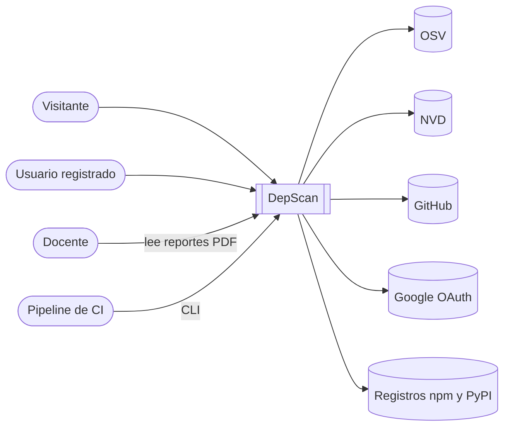
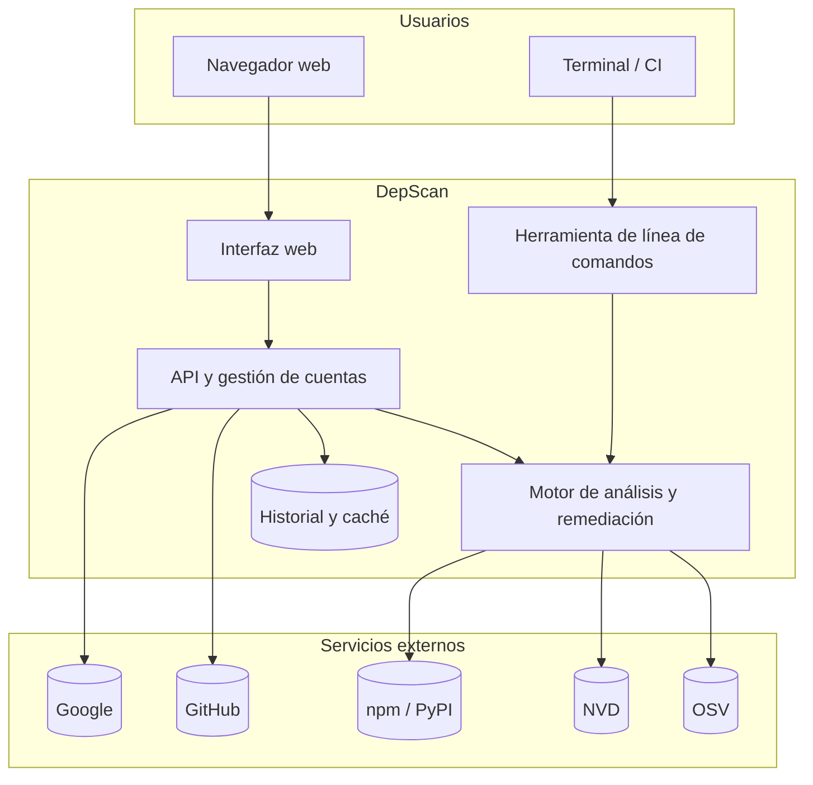
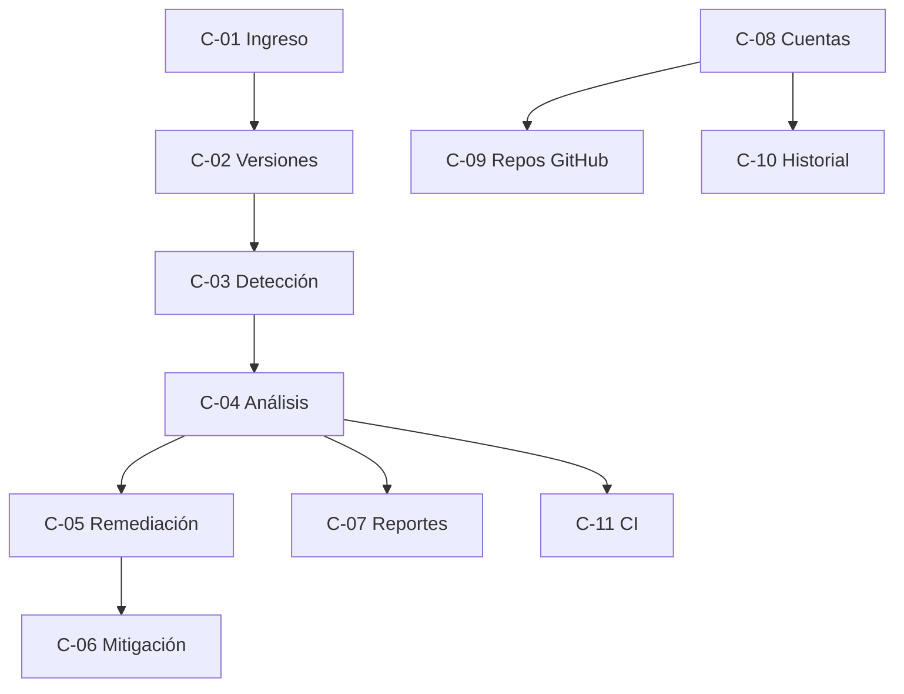

UNIVERSIDAD PRIVADA DE TACNA

FACULTAD DE INGENIERIA

Escuela Profesional de Ingeniería de Sistemas

**DepScan: Sistema Web de Detección y Remediación de Dependencias Vulnerables**

**Integrante:**

Angel Gadiel Hernandez Cruz

Tacna – Perú

2026

---

## INDICE GENERAL

- 1. Introducción
    - 1.1. Propósito
    - 1.2. Alcance
    - 1.3. Definiciones, Siglas y Abreviaturas
    - 1.4. Referencias
    - 1.5. Visión General
- 2. Posicionamiento
    - 2.1. Oportunidad de negocio
    - 2.2. Definición del problema
- 3. Descripción de los interesados y usuarios
    - 3.1. Resumen de los interesados
    - 3.2. Resumen de los usuarios
    - 3.3. Entorno de usuario
    - 3.4. Perfiles de los interesados
    - 3.5. Perfiles de los Usuarios
    - 3.6. Necesidades de los interesados y usuarios
- 4. Vista General del Producto
    - 4.1. Perspectiva del producto
    - 4.2. Resumen de capacidades
    - 4.3. Suposiciones y dependencias
    - 4.4. Costos y precios
    - 4.5. Licenciamiento e instalación
- 5. Características del producto
- 6. Restricciones
- 7. Rangos de calidad
- 8. Precedencia y Prioridad
- 9. Otros requerimientos del producto
    - a) Estándares legales
    - b) Estándares de comunicación
    - c) Estándares de cumplimiento de la plataforma
    - d) Estándares de calidad y seguridad
- CONCLUSIONES
- RECOMENDACIONES
- BIBLIOGRAFIA
- WEBGRAFIA

---

# 1. Introducción

## 1.1. Propósito

El presente documento define la **visión** del sistema DepScan: qué problema resuelve, para quién, qué capacidades ofrece, cuáles son sus límites y qué criterios de calidad debe cumplir. Su finalidad es establecer un entendimiento común entre el autor, los docentes evaluadores y los futuros usuarios, y servir de base para la especificación de requerimientos (FD03) y la arquitectura (FD04).

## 1.2. Alcance

DepScan es una aplicación web, acompañada de una herramienta de línea de comandos, que analiza las dependencias de proyectos de software, detecta las que tienen vulnerabilidades conocidas y propone cómo resolverlas.

**Dentro del alcance**

| Área | Incluye |
|---|---|
| Ecosistemas | **npm** (JavaScript/TypeScript) y **PyPI** (Python). |
| Archivos que interpreta | `package.json`, `package-lock.json` (v1, v2, v3 y *workspaces*), `npm-shrinkwrap.json`, `requirements*.txt` (con `-r`, extras, marcadores de entorno y *hashes*). |
| Formas de ingresar un proyecto | Subir archivos o una carpeta desde el navegador; indicar un repositorio de GitHub (público, o privado con la cuenta conectada); carpeta local mediante la CLI. |
| Fuentes de vulnerabilidades | **OSV** como fuente principal y **NVD** como enriquecimiento opcional del puntaje CVSS. |
| Análisis | Versión exacta de cada dependencia (directa y transitiva), deduplicación de avisos (CVE/GHSA/PYSEC), severidad, semáforo de riesgo y priorización. |
| Remediación | Versión recomendada, todas las versiones seguras, comandos de actualización (`npm install`, `npm update`, `overrides`, `pip install`), mitigaciones por tipo de falla (CWE) y enlaces a los parches. |
| Reportes | Vista web interactiva, reporte HTML y reporte PDF descargables. |
| Cuentas | Inicio de sesión con Google y GitHub, vinculación de ambas cuentas, historial por usuario, comparación de escaneos. |
| Integración continua | CLI con código de salida configurable para detener una entrega si hay fallas graves. |
| Despliegue | Servicio único en Railway con base de datos SQLite en volumen persistente. |

**Fuera del alcance (limitaciones declaradas)**

| Limitación | Justificación |
|---|---|
| No descubre vulnerabilidades nuevas (*zero-day*). | DepScan cruza versiones con avisos ya publicados; no analiza el código fuente de las librerías. |
| No determina si el código vulnerable se ejecuta realmente (análisis de alcanzabilidad). | Requiere análisis estático por lenguaje; puede generar alertas no explotables, que se declaran como tales. |
| Sin lockfile, la precisión disminuye. | Un rango como `^4.17.0` no indica la versión instalada; el sistema la marca como "no determinable" o la estima y lo advierte. |
| No cubre Maven, Go, Cargo, NuGet, Composer ni RubyGems. | Se priorizaron los dos ecosistemas más usados en la Escuela; la arquitectura permite agregarlos. |
| No aplica las correcciones automáticamente en el repositorio. | Modificar código de terceros sin revisión humana es riesgoso; el sistema entrega los pasos exactos. |
| Depende de internet y de la disponibilidad de OSV/NVD. | Se mitiga con caché de 24 horas. |
| El inicio de sesión con Google está en modo de prueba. | Solo los usuarios registrados como de prueba pueden ingresar hasta que Google verifique la aplicación. |

## 1.3. Definiciones, Siglas y Abreviaturas

| Término | Definición |
|---|---|
| Dependencia | Librería externa que un proyecto utiliza. |
| Dependencia directa | La declarada por el propio proyecto en su manifiesto. |
| Dependencia transitiva | La que se instala porque otra dependencia la necesita. |
| Manifiesto | Archivo que declara las dependencias (`package.json`, `requirements.txt`). |
| Lockfile | Archivo que fija la versión exacta instalada de cada dependencia (`package-lock.json`). |
| Vulnerabilidad | Falla de seguridad documentada en una versión de una librería. |
| CVE | *Common Vulnerabilities and Exposures*: identificador público de vulnerabilidades. |
| GHSA | *GitHub Security Advisory*: identificador de avisos de GitHub. |
| PYSEC | Identificador de avisos de la *Python Packaging Authority*. |
| CVSS | *Common Vulnerability Scoring System*: puntaje de 0 a 10 de la gravedad de una falla. |
| CWE | *Common Weakness Enumeration*: clasificación del tipo de debilidad (p. ej., CWE-79: XSS). |
| OSV | *Open Source Vulnerabilities*: base de datos abierta de Google. |
| NVD | *National Vulnerability Database* del NIST (EE. UU.). |
| SBOM | *Software Bill of Materials*: inventario de componentes de un software. |
| Remediación | Acción para eliminar o reducir el riesgo de una vulnerabilidad. |
| Mitigación | Medida temporal para reducir el riesgo sin actualizar. |
| semver | *Semantic Versioning*: esquema de versiones MAYOR.MENOR.PARCHE usado por npm. |
| PEP 440 | Estándar de versiones de Python. |
| OAuth 2.0 | Protocolo de autorización para iniciar sesión con cuentas de terceros. |
| CI | Integración continua: ejecución automática de verificaciones en cada cambio. |
| RUP | *Rational Unified Process*: metodología de desarrollo usada en este proyecto. |

## 1.4. Referencias

| Código | Documento |
|---|---|
| FD01 | Informe de Factibilidad de DepScan |
| FD03 | Informe de Especificación de Requerimientos de DepScan |
| FD04 | Informe de Arquitectura de Software de DepScan |
| — | `docs/ARQUITECTURA.md` y registros de decisiones (`docs/decisiones/`) del repositorio |
| — | Informe de benchmark `docs/informe/benchmark-2026-10-13.md` |
| — | OWASP Top 10 (2021), categoría A06: *Vulnerable and Outdated Components* |

## 1.5. Visión General

DepScan aspira a ser **la herramienta de referencia en la Escuela para revisar la seguridad de las dependencias** antes de cada entrega: rápida de usar, en español, que no se limite a enumerar fallas sino que **diga qué hacer**, y que deje evidencia en un reporte verificable.

**Declaración de visión**

> *Para* estudiantes y equipos de desarrollo que construyen proyectos con librerías de terceros, *quienes* necesitan saber si esas librerías son seguras y cómo corregirlas, *DepScan* es un sistema web de análisis de dependencias *que* detecta vulnerabilidades conocidas en npm y PyPI y entrega la versión segura y los pasos exactos para resolverlas. *A diferencia de* `npm audit` u OSV-Scanner, que trabajan por consola, cubren un solo ecosistema o solo listan fallas, *nuestro producto* unifica ambos ecosistemas, elimina avisos duplicados, verifica que la versión recomendada no tenga otras fallas y ofrece mitigaciones y reportes PDF en español.

# 2. Posicionamiento

## 2.1. Oportunidad de negocio

- **Crecimiento de los ataques a la cadena de suministro de software.** Los incidentes por componentes vulnerables (Equifax 2017, Log4Shell 2021) demostraron que una sola librería desactualizada compromete a toda la organización. OWASP ubica los "componentes vulnerables y desactualizados" en su Top 10.
- **Datos públicos y gratuitos.** OSV y NVD exponen APIs abiertas: el costo de obtener la información es cero, y el valor está en **procesarla bien** (versiones exactas, deduplicación, recomendaciones).
- **Brecha en las herramientas existentes.** Las alternativas gratuitas son de consola y en inglés; las comerciales (Snyk, Mend, Sonatype) tienen costos por desarrollador que no son accesibles para estudiantes ni para equipos pequeños.
- **Contexto académico.** Los cursos de la Escuela exigen calidad y seguridad del software; un reporte PDF verificable aporta evidencia objetiva para la evaluación.

**Posicionamiento frente a alternativas**

| Característica | npm audit | pip-audit | OSV-Scanner | Snyk (comercial) | **DepScan** |
|---|---|---|---|---|---|
| npm y PyPI en un solo análisis | No | No | Sí | Sí | **Sí** |
| Interfaz web | No | No | No | Sí | **Sí** |
| En español | No | No | No | No | **Sí** |
| Deduplica CVE/GHSA/PYSEC | Parcial | Parcial | Sí | Sí | **Sí** |
| Verifica que la versión recomendada no tenga otras fallas | No | No | No | Sí | **Sí** |
| Lista todas las versiones seguras | No | No | No | Parcial | **Sí** |
| Mitigaciones si no se puede actualizar | No | No | No | Parcial | **Sí** |
| Reporte PDF | No | No | No | De pago | **Sí** |
| Costo para el estudiante | Gratis | Gratis | Gratis | Plan gratuito limitado | **Gratis** |

## 2.2. Definición del problema

| Elemento | Descripción |
|---|---|
| **El problema de** | revisar manualmente si las librerías de un proyecto tienen vulnerabilidades conocidas y decidir cómo corregirlas |
| **afecta a** | estudiantes de Ingeniería de Sistemas, desarrolladores de equipos pequeños y docentes que evalúan proyectos |
| **cuyo impacto es** | proyectos entregados con fallas públicas explotables, horas perdidas investigando avisos dispersos, actualizaciones "a ciegas" que rompen la aplicación o siguen siendo vulnerables, y falta de evidencia del estado de seguridad |
| **una solución exitosa sería** | un sistema que, con solo subir los archivos o elegir un repositorio, muestre en segundos qué librerías están en riesgo, cuán grave es, a qué versión segura cambiar, cómo hacerlo y cómo protegerse mientras tanto, dejando un reporte descargable |

# 3. Descripción de los interesados y usuarios

## 3.1. Resumen de los interesados

| Interesado | Descripción | Responsabilidad |
|---|---|---|
| Autor del proyecto | Estudiante de Ingeniería de Sistemas, UPT | Análisis, diseño, desarrollo, pruebas, despliegue y documentación. |
| Docentes evaluadores | Docentes de los cursos de la Escuela | Validar requerimientos, revisar entregables y evaluar resultados. |
| Escuela Profesional de Ingeniería de Sistemas | Unidad académica | Beneficiaria institucional; puede adoptar la herramienta en sus cursos. |
| Proveedores de datos | Google (OSV), NIST (NVD), GitHub, registros npm y PyPI | Publicar avisos de seguridad y metadatos de paquetes. |

## 3.2. Resumen de los usuarios

| Usuario | Descripción | Interés principal |
|---|---|---|
| Visitante | Persona que usa la web sin iniciar sesión | Escanear un proyecto rápidamente. |
| Usuario registrado | Inicia sesión con Google o GitHub | Historial, repositorios privados y comparaciones. |
| Docente / evaluador | Revisa proyectos de estudiantes | Reporte PDF claro y verificable. |
| Pipeline de CI | Proceso automático (GitHub Actions) | Detener una entrega si hay fallas graves. |
| Administrador | Responsable del despliegue | Configurar claves y monitorear el servicio. |

## 3.3. Entorno de usuario

- **Dispositivo:** computadora o laptop con navegador moderno (Chrome, Edge, Firefox); la interfaz también se adapta a pantallas pequeñas.
- **Conectividad:** internet necesario (consultas a OSV/NVD y GitHub).
- **Frecuencia de uso:** antes de cada entrega o *release*, y de forma automática en cada `push` mediante CI.
- **Tiempo por tarea:** un escaneo típico tarda de 2 a 20 segundos según el tamaño del proyecto y si se calculan las soluciones.
- **Idioma:** español.

**Contexto de uso**

El siguiente diagrama muestra cómo DepScan se ubica entre los usuarios y los servicios externos que consulta.

## 3.4. Perfiles de los interesados

| Interesado | Perfil | Criterio de éxito |
|---|---|---|
| Autor | Conocimientos de desarrollo web, seguridad y TypeScript. | Sistema funcional en producción, documentado y medido. |
| Docente evaluador | Experto en ingeniería de software y gestión de proyectos. | Coherencia entre documentación RUP, código y resultados. |
| Escuela | Busca elevar la calidad y seguridad de los proyectos estudiantiles. | Herramienta gratuita y reutilizable en cursos. |

## 3.5. Perfiles de los Usuarios

| Usuario | Conocimiento técnico | Necesidad | Funcionalidades que usa |
|---|---|---|---|
| Visitante | Básico a intermedio | Saber rápido si su proyecto tiene riesgos | Subir archivos, resultados, solución, reporte |
| Usuario registrado | Intermedio | Revisar sus repositorios, incluso privados, y seguir la evolución | Login, repos de GitHub, historial, comparación |
| Docente | Avanzado en evaluación | Evidencia objetiva del estado de seguridad | Reporte PDF/HTML |
| Pipeline de CI | Automático | Bloquear entregas inseguras | CLI con `--fail-on` |
| Administrador | Avanzado | Mantener el servicio | Railway, variables, `/api/health` |

## 3.6. Necesidades de los interesados y usuarios

| Necesidad | Prioridad | Solución actual | Solución propuesta por DepScan |
|---|---|---|---|
| Conocer las librerías vulnerables, incluidas las transitivas | Alta | Búsqueda manual o consola | Análisis del lockfile completo con cadena de dependencia |
| Saber cuán grave es cada falla | Alta | Leer cada aviso | Severidad, CVSS y semáforo de riesgo |
| Saber a qué versión actualizar sin romper el proyecto | Alta | Prueba y error | Recomendación dentro de la misma versión mayor y aviso de salto mayor |
| No actualizar a otra versión vulnerable | Alta | No disponible | Verificación contra todos los avisos del paquete |
| Protegerse si no se puede actualizar | Media | No disponible | Mitigaciones del aviso y por tipo de falla, enlaces a parches |
| Evidencia para entregar | Media | Capturas de pantalla | Reportes HTML y PDF con fecha y commit |
| Revisar repositorios privados | Media | Clonar y ejecutar herramientas | Conexión con GitHub e importación en un clic |
| Automatizar la revisión | Media | Scripts propios | CLI para CI con código de salida |

# 4. Vista General del Producto

## 4.1. Perspectiva del producto

DepScan es un **producto independiente** que se apoya en servicios externos públicos. Se compone de un motor de análisis reutilizable, una API web, una interfaz web y una CLI.

**Bloques del producto**

## 4.2. Resumen de capacidades

| Beneficio para el usuario | Capacidad que lo permite |
|---|---|
| Ver en segundos el riesgo del proyecto | Escaneo en lote contra OSV y semáforo de riesgo |
| Revisar también lo que no se ve | Lectura del lockfile completo, con dependencias transitivas y su cadena |
| Reportes limpios, sin repeticiones | Deduplicación de CVE, GHSA y PYSEC |
| Saber exactamente qué hacer | Versión recomendada, opciones, comandos listos para copiar |
| Actualizar con confianza | Versiones verificadas contra todos los avisos conocidos |
| Plan B cuando no hay corrección | Mitigaciones y parches |
| Evidencia formal | Reportes HTML y PDF con fecha, commit y versión del escáner |
| Trabajar con sus repositorios | Login con GitHub e importación de repositorios privados |
| Seguir la evolución | Historial y comparación "antes / después" |
| Automatizar | CLI con umbral de severidad para CI |

## 4.3. Suposiciones y dependencias

| Tipo | Descripción |
|---|---|
| Suposición | Los proyectos analizados usan lockfile; si no, la precisión baja (advertido). |
| Suposición | Los avisos de OSV y NVD son correctos y se publican oportunamente. |
| Suposición | El usuario tiene una cuenta de Google o GitHub para las funciones de cuenta. |
| Dependencia | API de OSV (`api.osv.dev`), disponible y gratuita. |
| Dependencia | API de NVD (`services.nvd.nist.gov`), opcional. |
| Dependencia | API de GitHub y OAuth de Google y GitHub. |
| Dependencia | Registros `registry.npmjs.org` y `pypi.org` para listar versiones. |
| Dependencia | Plataforma Railway para el despliegue. |

## 4.4. Costos y precios

Los costos provienen del estudio de factibilidad (FD01). Tipo de cambio: US$ 1 = S/ 3.75.

| Concepto | Monto (S/) |
|---|---|
| Costos generales | 400.00 |
| Costos operativos de desarrollo | 480.00 |
| Costos del ambiente (4 meses) | 75.00 |
| Costos de personal | 6,000.00 |
| **Inversión total de desarrollo** | **6,955.00** |
| Costo de operación anual | 3,540.00 |

**Precio para el usuario.** DepScan se ofrece **gratuitamente** a estudiantes y a la Escuela. Como modelo de sostenibilidad futura se contempla un plan institucional opcional (estimado en S/ 50 mensuales por organización) que incluya clave NVD propia, mayor límite de escaneos y soporte.

## 4.5. Licenciamiento e instalación

- **Licencia propuesta:** MIT (código abierto), compatible con todas las dependencias usadas.
- **Uso en la nube:** sin instalación; se accede desde `https://deptest-production-7f98.up.railway.app`.
- **Instalación local:** requiere Node.js 24 y Visual Studio Code; se ejecutan `npm install`, `npm run build` y `npm start`.
- **Despliegue propio:** el repositorio incluye `Dockerfile` y `railway.json`; la guía está en `docs/DESPLIEGUE.md`.
- **Configuración:** variables de entorno (`SESSION_SECRET`, credenciales OAuth opcionales, `NVD_API_KEY` opcional).

# 5. Características del producto

| ID | Característica | Descripción | Prioridad |
|---|---|---|---|
| C-01 | Ingreso de proyectos | Subir archivos o carpeta, repositorio de GitHub o carpeta local por CLI. | Esencial |
| C-02 | Resolución de versiones | Versión exacta desde el lockfile; versiones fijas; estimación opcional. | Esencial |
| C-03 | Detección de vulnerabilidades | Consulta en lote a OSV y enriquecimiento opcional con NVD. | Esencial |
| C-04 | Análisis y priorización | Deduplicación, severidad CVSS, directa/transitiva, desarrollo/producción, semáforo. | Esencial |
| C-05 | Remediación | Versión recomendada, todas las versiones seguras, comandos y fragmentos. | Esencial |
| C-06 | Mitigación | Soluciones temporales del aviso, guía por CWE y parches. | Importante |
| C-07 | Reportes | Vista web, HTML y PDF descargables. | Esencial |
| C-08 | Cuentas | Login con Google y GitHub, vinculación, sesión segura. | Importante |
| C-09 | Repositorios de GitHub | Lista de repositorios del usuario e importación, incluidos privados. | Importante |
| C-10 | Historial y comparación | Escaneos guardados y comparación antes/después. | Deseable |
| C-11 | Integración continua | CLI con código de salida por umbral. | Importante |

# 6. Restricciones

| Tipo | Restricción |
|---|---|
| Tecnológica | Solo Visual Studio Code como entorno de desarrollo (sin otros IDE). |
| Tecnológica | Frontend en React; backend y motor en TypeScript sobre Node.js 24. |
| Infraestructura | Despliegue en Railway; una sola réplica, porque SQLite no admite escritores concurrentes. |
| Externa | Límite de NVD: 5 solicitudes/30 s sin clave, 50 con clave. |
| Externa | Límite de la API de GitHub: 60 solicitudes/hora sin token, 5000 con token. |
| Seguridad | Google OAuth en modo prueba: máximo 100 usuarios de prueba hasta su verificación. |
| Uso | Máximo 20 escaneos por minuto por dirección IP. |
| Tamaño | Hasta 200 archivos y 25 MB por escaneo subido; 15 MB por archivo. |
| Tiempo | Desarrollo en un semestre académico (16 semanas). |
| Presupuesto | Inversión menor a S/ 7,000. |

# 7. Rangos de calidad

| Atributo | Meta | Forma de verificación |
|---|---|---|
| Exactitud | Sin fallas omitidas frente a `npm audit` en los repositorios de prueba. | Benchmark reproducible (resultado: 0 diferencias no explicadas). |
| Rendimiento | Escaneo de 1000 dependencias en menos de 60 s, con soluciones. | Medición en NodeGoat (1091 dependencias, ~18 s). |
| Disponibilidad | 99 % mensual (dependiente de Railway). | Healthcheck `/api/health` y reinicio automático. |
| Usabilidad | Escaneo en un máximo de 3 acciones del usuario. | Prueba de recorrido en la interfaz. |
| Confiabilidad | 100 % de las pruebas automatizadas aprobadas antes de desplegar. | 97 pruebas en GitHub Actions. |
| Seguridad | Cero secretos en el repositorio; tokens cifrados. | Revisión antes del commit; AES-256-GCM. |
| Mantenibilidad | Motor sin dependencias externas y desacoplado. | Arquitectura de puertos y adaptadores (FD04). |

# 8. Precedencia y Prioridad

Se aplicó la técnica **MoSCoW**. El orden de construcción respetó las dependencias entre características: sin resolución de versiones no hay detección, y sin detección no hay remediación.

| Prioridad | Características |
|---|---|
| **Must** (debe tener) | C-01, C-02, C-03, C-04, C-05, C-07 |
| **Should** (debería tener) | C-06, C-08, C-09, C-11 |
| **Could** (podría tener) | C-10 |
| **Won't** (no en esta versión) | Otros ecosistemas, análisis de alcanzabilidad, corrección automática por *pull request* |

# 9. Otros requerimientos del producto

## a) Estándares legales

- **Ley N.º 29733**, Ley de Protección de Datos Personales del Perú, y su reglamento (D.S. N.º 016-2024-JUS): solo se tratan nombre, correo y foto, con consentimiento y finalidad informada.
- **Licencias de código abierto** (MIT, Apache-2.0, ISC) de las dependencias utilizadas.
- **Términos de uso de datos**: OSV (CC-BY 4.0, con atribución) y NVD (dominio público).
- **Google API Services User Data Policy** y términos de GitHub para OAuth Apps.

## b) Estándares de comunicación

- HTTPS obligatorio en producción (TLS provisto por Railway).
- API REST con formato JSON y códigos de estado HTTP estándar.
- OAuth 2.0 (RFC 6749) con PKCE (RFC 7636) y OpenID Connect para Google.
- Formato de avisos OSV (*OSV Schema*) y CVSS v3.1 (FIRST).

## c) Estándares de cumplimiento de la plataforma

- Node.js 24 LTS y navegadores con soporte de ES2022.
- Contenedor Docker basado en `node:24-alpine`.
- Versionado semántico (semver) para npm y PEP 440 para Python.

## d) Estándares de calidad y seguridad

- **ISO/IEC 25010** como marco de atributos de calidad (adecuación funcional, eficiencia, usabilidad, fiabilidad, seguridad, mantenibilidad, portabilidad).
- **OWASP Top 10 (2021)**, en especial A06 (componentes vulnerables), A07 (fallas de identificación y autenticación) y A02 (fallas criptográficas).
- **OWASP ASVS** como guía para sesiones, cookies y control de acceso.
- Pruebas automatizadas y verificación de dependencias del propio proyecto en cada integración.

# CONCLUSIONES

1. DepScan responde a un problema real y documentado: los componentes vulnerables son una de las principales causas de incidentes de seguridad (OWASP A06).
2. El producto se diferencia de las herramientas gratuitas existentes porque **no se limita a listar fallas**: verifica qué versiones son seguras, recomienda la de menor impacto, entrega los pasos exactos y ofrece mitigaciones, todo en español y con reportes formales.
3. El alcance está delimitado con claridad: npm y PyPI, fuentes OSV y NVD, y limitaciones declaradas (sin *zero-day*, sin análisis de alcanzabilidad, menor precisión sin lockfile).
4. Las restricciones técnicas y presupuestarias son compatibles con un semestre académico y con una inversión menor a S/ 7,000.

# RECOMENDACIONES

1. Usar siempre lockfile en los proyectos para obtener resultados exactos.
2. Integrar la CLI en GitHub Actions para revisar automáticamente cada cambio.
3. Solicitar una API key gratuita de NVD para obtener el puntaje CVSS oficial más rápido.
4. Completar la verificación de la app en Google para abrir el inicio de sesión a todos los usuarios.
5. En versiones futuras, agregar otros ecosistemas (Maven, Go) y generación automática de *pull requests* de actualización.

# BIBLIOGRAFIA

- Kruchten, P. (2003). *The Rational Unified Process: An Introduction* (3.ª ed.). Addison-Wesley.
- Sommerville, I. (2016). *Software Engineering* (10.ª ed.). Pearson.
- Pressman, R. y Maxim, B. (2020). *Ingeniería del software: un enfoque práctico* (9.ª ed.). McGraw-Hill.
- ISO/IEC 25010:2011. *Systems and software Quality Requirements and Evaluation (SQuaRE)*.
- U.S. Government Accountability Office (2018). *Data Protection: Actions Taken by Equifax and Federal Agencies in Response to the 2017 Breach* (GAO-18-559).

# WEBGRAFIA

- OSV – Open Source Vulnerabilities: https://osv.dev y https://google.github.io/osv.dev/api/
- NVD – National Vulnerability Database: https://nvd.nist.gov/developers
- OWASP Top 10 (2021): https://owasp.org/Top10/
- FIRST – CVSS v3.1 Specification: https://www.first.org/cvss/v3.1/specification-document
- Semantic Versioning 2.0.0: https://semver.org
- PEP 440 – Version Identification: https://peps.python.org/pep-0440/
- OAuth 2.0 (RFC 6749): https://datatracker.ietf.org/doc/html/rfc6749
- PKCE (RFC 7636): https://datatracker.ietf.org/doc/html/rfc7636
- Railway Docs: https://docs.railway.com
- Ley N.º 29733, Ley de Protección de Datos Personales. Diario Oficial *El Peruano*, 3 de julio de 2011 (consultar en https://www.gob.pe).
