UNIVERSIDAD PRIVADA DE TACNA

FACULTAD DE INGENIERIA

Escuela Profesional de Ingeniería de Sistemas

**DepScan: Sistema Web de Detección y Remediación de Dependencias Vulnerables**

**Integrante:**

Angel Gadiel Hernandez Cruz

Tacna – Perú

2026

---

## INDICE GENERAL

- 1. Introducción
- 2. Requerimientos Funcionales
- 3. Requerimientos No Funcionales
- 4. Reglas de Negocio
- 5. Perfiles de Usuario
- 6. Casos de Uso Principales
- 7. Conclusiones
- BIBLIOGRAFÍA
- WEBGRAFÍA

---

# 1. Introducción

Este documento describe, **en lenguaje sencillo**, todo lo que DepScan hará para sus usuarios. Está pensado para que cualquier persona —un estudiante, un docente o alguien sin formación técnica— entienda qué ofrece el sistema, cómo se usa y qué reglas sigue. Los detalles internos de construcción se explican en el Informe de Arquitectura (FD04).

**¿Qué es DepScan, en pocas palabras?**

Casi todos los programas se construyen usando "piezas" hechas por otras personas, llamadas **librerías** o **dependencias**. Es como construir una casa comprando puertas, ventanas y cerraduras a distintos fabricantes. Si uno de esos fabricantes descubre que cierto modelo de cerradura se abre fácilmente, lo publica en un aviso de seguridad; pero si el dueño de la casa no se entera, su casa sigue en riesgo.

DepScan hace ese trabajo de vigilancia: **revisa la lista de piezas de un proyecto, la compara con los avisos de seguridad publicados en el mundo y le dice al usuario qué piezas están en riesgo, qué tan grave es y cómo reemplazarlas** por una versión segura.

**Recorrido general del usuario**

El usuario entrega su proyecto, DepScan lo revisa y devuelve un informe con el riesgo y las soluciones.

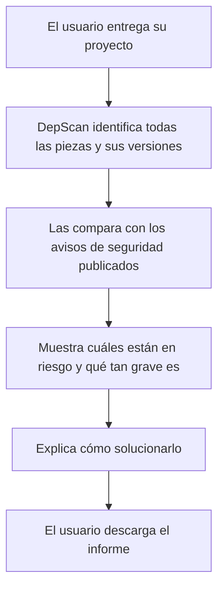

# 2. Requerimientos Funcionales

Los requerimientos funcionales indican **qué puede hacer el usuario con el sistema**. La prioridad sigue la escala: **Alta** (imprescindible), **Media** (importante) y **Baja** (deseable).

| ID | Requerimiento | Descripción para el usuario | Prioridad |
|---|---|---|---|
| RF-01 | Subir archivos del proyecto | El usuario puede arrastrar los archivos de su proyecto, o una carpeta completa, a la página. El sistema toma solo los archivos que necesita e ignora los demás. | Alta |
| RF-02 | Revisar un repositorio de GitHub | El usuario puede escribir la dirección de un proyecto publicado en GitHub para revisarlo sin descargarlo. | Alta |
| RF-03 | Identificar las piezas y sus versiones | El sistema descubre qué librerías usa el proyecto, incluidas las que llegan "de rebote" a través de otras, y qué versión exacta de cada una. | Alta |
| RF-04 | Buscar fallas de seguridad conocidas | El sistema compara cada librería con los avisos de seguridad publicados en bases de datos internacionales. | Alta |
| RF-05 | Evitar fallas repetidas | Si una misma falla aparece con varios nombres, el sistema la muestra una sola vez. | Alta |
| RF-06 | Mostrar un semáforo de riesgo | El sistema resume el estado del proyecto en rojo (riesgo alto), amarillo (medio) o verde (sin riesgo relevante), con el número de fallas por gravedad. | Alta |
| RF-07 | Ver el detalle de cada falla | El usuario puede abrir cualquier falla para leer en qué consiste, su gravedad, desde cuándo se conoce y dónde informarse más. | Media |
| RF-08 | Recomendar una versión segura | Para cada librería en riesgo, el sistema indica a qué versión cambiar, prefiriendo la que menos cambios obliga a hacer. | Alta |
| RF-09 | Mostrar todas las alternativas seguras | El sistema lista todas las versiones de esa misma librería que no tienen fallas conocidas. | Media |
| RF-10 | Explicar cómo aplicar la solución | El sistema muestra las instrucciones exactas para actualizar, con un botón para copiarlas. | Alta |
| RF-11 | Aconsejar qué hacer si no se puede actualizar | Si el usuario necesita seguir con la versión actual, el sistema le explica cómo protegerse mientras tanto y dónde está el arreglo oficial. | Media |
| RF-12 | Descargar el informe | El usuario puede descargar el resultado como página web (HTML) o como documento PDF. | Alta |
| RF-13 | Iniciar sesión | El usuario puede entrar con su cuenta de Google o de GitHub, y unir ambas en una sola cuenta. | Media |
| RF-14 | Ver y revisar mis repositorios | Con GitHub conectado, el usuario ve la lista de sus proyectos (también los privados) y los revisa con un clic. | Media |
| RF-15 | Consultar el historial | El usuario ve todas las revisiones que hizo, con fecha y resultado. | Media |
| RF-16 | Comparar dos revisiones | El usuario elige dos revisiones y ve qué fallas son nuevas, cuáles se corrigieron y cuáles siguen. | Baja |
| RF-17 | Eliminar una revisión | El usuario puede borrar una revisión de su historial. | Baja |
| RF-18 | Revisar automáticamente en cada cambio | Un equipo puede programar la revisión para que se ejecute sola cada vez que sube cambios, y que detenga la entrega si hay fallas graves. | Media |
| RF-19 | Estimar versiones cuando no hay registro exacto | Si el proyecto no indica la versión exacta instalada, el usuario puede pedir una estimación, que se marca claramente como tal. | Baja |
| RF-20 | Cerrar sesión y desconectar GitHub | El usuario puede salir de su cuenta y retirar el permiso de acceso a GitHub cuando quiera. | Media |

# 3. Requerimientos No Funcionales

Los requerimientos no funcionales describen **cómo debe comportarse el sistema**: rapidez, seguridad, facilidad de uso, etc.

| ID | Cualidad | Requerimiento |
|---|---|---|
| RNF-01 | Rapidez | Un proyecto con mil librerías se revisa en menos de un minuto, incluyendo las soluciones; uno pequeño, en pocos segundos. |
| RNF-02 | Facilidad de uso | Todo está en español y se puede revisar un proyecto en un máximo de tres pasos. |
| RNF-03 | Adaptabilidad | La página se ve correctamente en computadoras, tablets y celulares, con modo claro y oscuro. |
| RNF-04 | Seguridad de la cuenta | Las contraseñas nunca pasan por DepScan: el ingreso se hace en Google o GitHub. Los permisos guardados se almacenan cifrados. |
| RNF-05 | Privacidad | Solo se leen los archivos de la lista de librerías, nunca el código del proyecto. Las revisiones de proyectos privados solo las ve su dueño. |
| RNF-06 | Disponibilidad | El servicio está disponible en internet y se reinicia solo ante una falla. |
| RNF-07 | Honestidad del resultado | El sistema nunca inventa una versión: si no puede saberla, lo dice. Las estimaciones se marcan como estimaciones. |
| RNF-08 | Evidencia | Cada informe registra la fecha, la versión del sistema y, para proyectos de GitHub, la versión exacta del proyecto revisada. |
| RNF-09 | Uso responsable | Cada persona puede hacer hasta 20 revisiones por minuto, para que el servicio no se sature. |
| RNF-10 | Confiabilidad | Antes de publicar cualquier cambio, el sistema supera sus pruebas automáticas. |
| RNF-11 | Cumplimiento legal | Los datos personales se tratan según la Ley N.º 29733 de Protección de Datos Personales. |

# 4. Reglas de Negocio

Son las reglas que el sistema sigue siempre para decidir qué mostrar.

| ID | Regla |
|---|---|
| RN-01 | Una falla de seguridad cuenta **una sola vez** aunque se publique con varios nombres. |
| RN-02 | La gravedad de una falla se toma, en este orden, de: el puntaje oficial del gobierno de EE. UU. (si se pidió), el puntaje de la base internacional y, por último, la etiqueta del aviso. |
| RN-03 | El semáforo es **rojo** si hay alguna falla crítica o alta; **amarillo** si hay fallas medias o de gravedad desconocida; **verde** si solo hay fallas bajas o ninguna. |
| RN-04 | Una versión se considera **segura** solo si no tiene **ninguna** falla conocida, no basta con que corrija la falla actual. |
| RN-05 | La versión **recomendada** es la más nueva que no obligue a un cambio grande (misma "versión mayor"). Si no existe, se recomienda la mínima segura y se advierte que puede requerir ajustes. |
| RN-06 | Si una librería llega "de rebote" y la pieza que la trae ya acepta la versión segura, basta con actualizar; si no la acepta, se indica cómo forzar la versión. |
| RN-07 | Si no se conoce la versión exacta, la librería se marca como "no determinable" y no se revisa, salvo que el usuario pida una estimación. |
| RN-08 | Las librerías que solo se usan durante el desarrollo se señalan con prioridad menor, porque no llegan al producto final. |
| RN-09 | Las revisiones de un proyecto privado solo las puede ver la persona que las hizo. |
| RN-10 | Sin cuenta, el historial queda asociado al navegador; al iniciar sesión, esas revisiones pasan a la cuenta. |
| RN-11 | Al revisar automáticamente, la entrega se detiene si hay fallas iguales o más graves que el nivel elegido (por defecto, críticas). |
| RN-12 | Las cuentas de Google y GitHub se unen automáticamente solo si ambas confirman el mismo correo verificado. |

# 5. Perfiles de Usuario

| Perfil | ¿Quién es? | ¿Qué necesita? | ¿Qué puede hacer? |
|---|---|---|---|
| **Visitante** | Cualquier persona que entra a la página sin iniciar sesión. | Saber rápido si su proyecto tiene riesgos. | RF-01 a RF-12, RF-15 a RF-17 (historial en su navegador), RF-19. |
| **Usuario registrado** | Persona que inició sesión con Google o GitHub. | Guardar su historial, revisar sus proyectos privados y seguir su evolución. | Todo lo del visitante, más RF-13, RF-14 y RF-20. |
| **Docente / evaluador** | Profesor que revisa proyectos de estudiantes. | Un informe claro y verificable. | Abrir o descargar los informes (RF-12). |
| **Revisión automática (CI)** | Proceso que se ejecuta solo cuando un equipo sube cambios. | Bloquear entregas con fallas graves. | RF-18. |

**Mapa de actores**

Los actores humanos interactúan con DepScan, que a su vez consulta servicios externos.

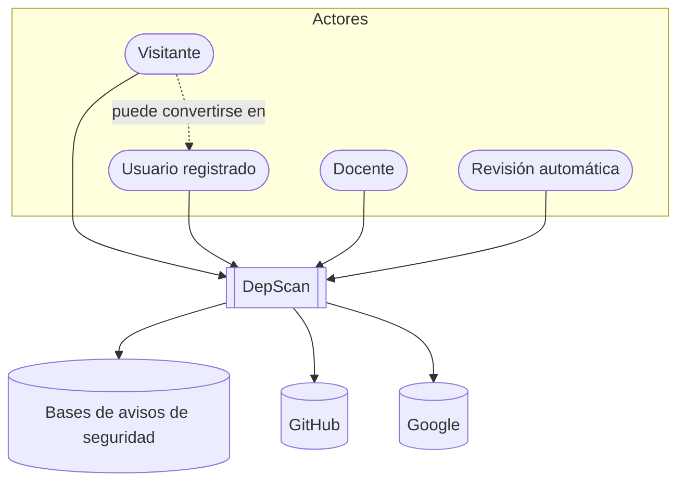

# 6. Casos de Uso Principales

## 6.1 Lista de casos de uso

| ID | Caso de uso | Actor principal | Actores de apoyo | Requerimientos |
|---|---|---|---|---|
| CU-01 | Revisar un proyecto subiendo sus archivos | Visitante / Usuario registrado | Bases de avisos de seguridad, registros de librerías | RF-01, RF-03 a RF-06, RF-19 |
| CU-02 | Revisar un repositorio de GitHub | Visitante / Usuario registrado | GitHub, bases de avisos, registros de librerías | RF-02 a RF-06, RF-19 |
| CU-03 | Consultar el resultado y el detalle de las fallas | Visitante / Usuario registrado | Bases de avisos de seguridad | RF-06, RF-07 |
| CU-04 | Ver la solución de una librería | Visitante / Usuario registrado | — | RF-08 a RF-11 |
| CU-05 | Descargar el informe | Visitante / Usuario registrado / Docente | — | RF-12 |
| CU-06 | Iniciar sesión y unir cuentas | Visitante | Google, GitHub | RF-13 |
| CU-07 | Revisar mis repositorios de GitHub | Usuario registrado | GitHub | RF-14 |
| CU-08 | Consultar, comparar y eliminar revisiones del historial | Visitante / Usuario registrado | — | RF-15, RF-16, RF-17 |
| CU-09 | Revisión automática en cada cambio | Revisión automática | Bases de avisos de seguridad | RF-18 |
| CU-10 | Cerrar sesión o desconectar GitHub | Usuario registrado | — | RF-20 |

## 6.2 Diagrama general de casos de uso

El diagrama reúne a todos los actores y las acciones que cada uno puede realizar. Las flechas punteadas indican relaciones de **inclusión** (un caso siempre usa a otro) y de **extensión** (un caso agrega una opción a otro).

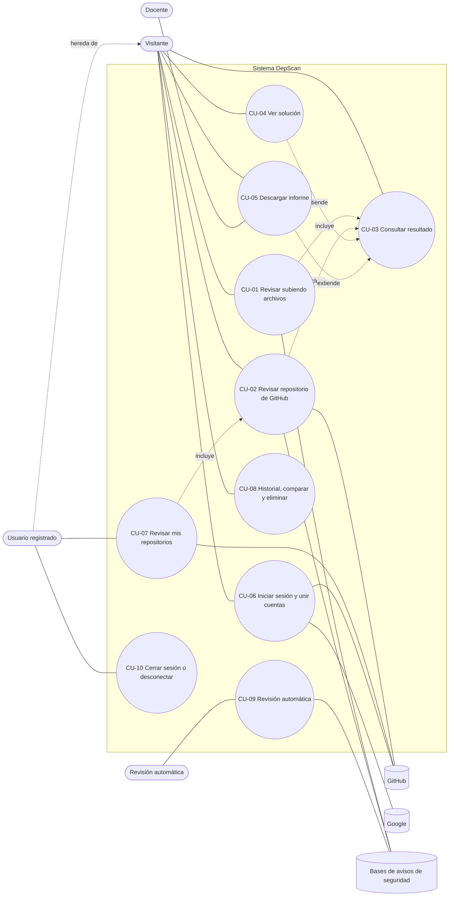

## 6.3 Diagramas de casos de uso por paquete

Para facilitar la lectura, los casos de uso se agrupan en tres paquetes: revisión de proyectos, resultados y cuenta.

**Paquete 1: Revisión de proyectos**

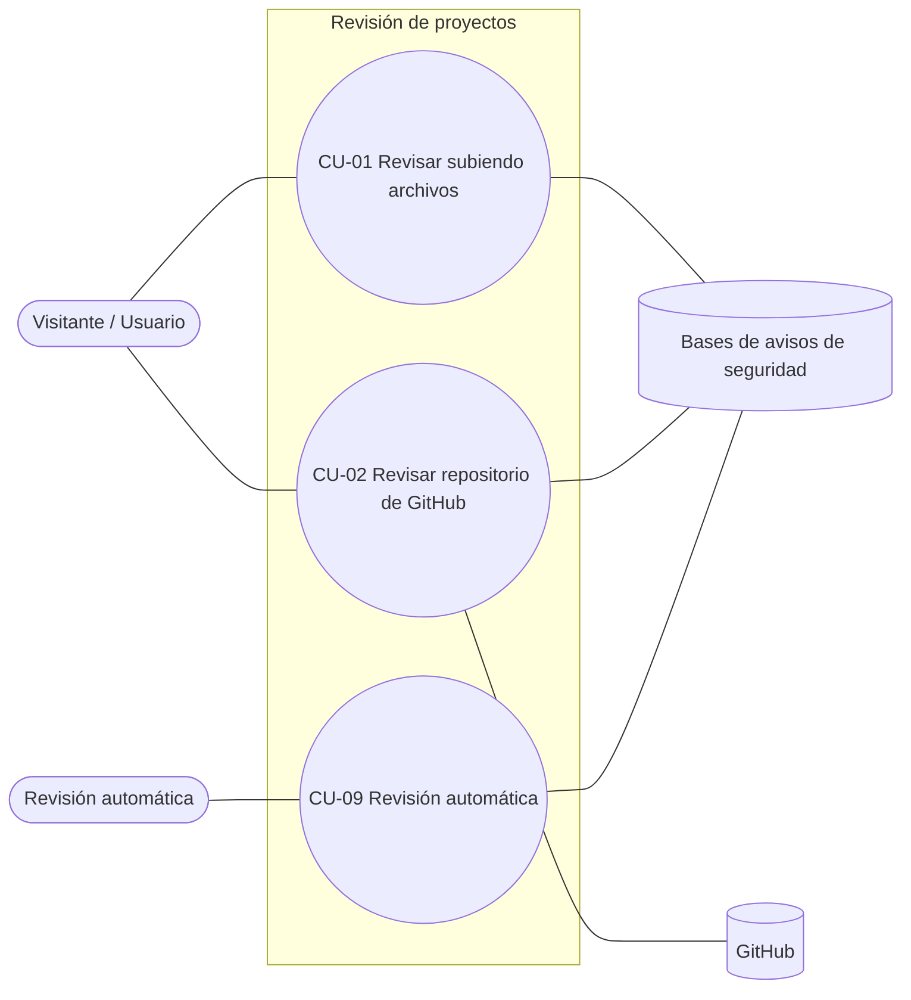

**Paquete 2: Resultados**

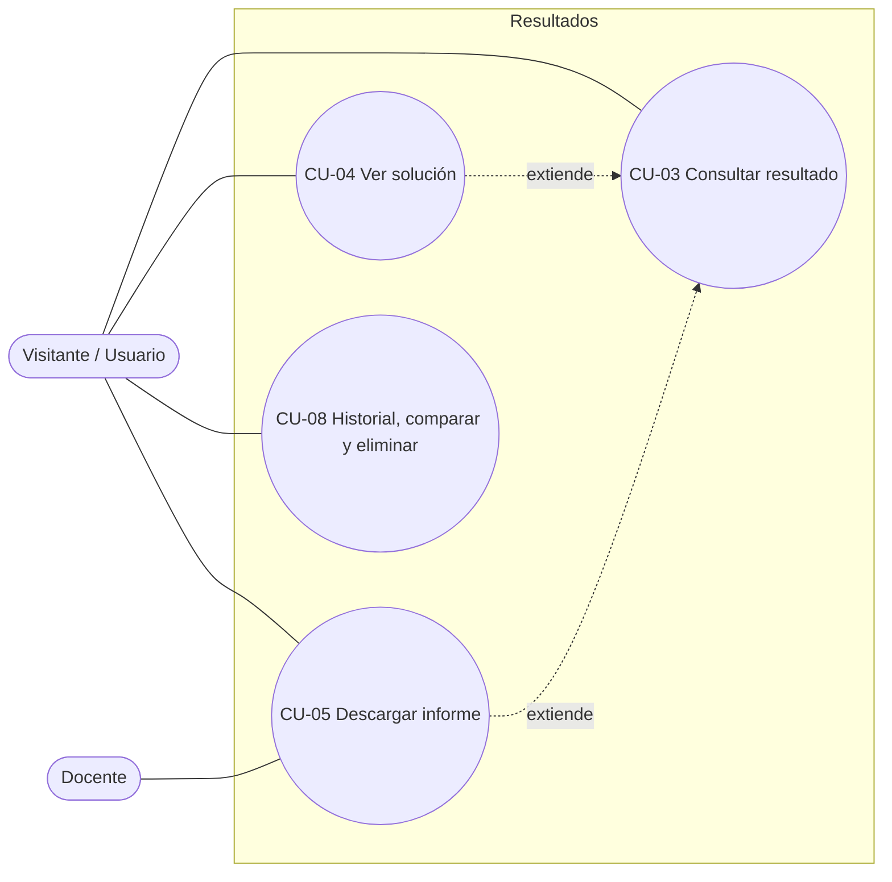

**Paquete 3: Cuenta**

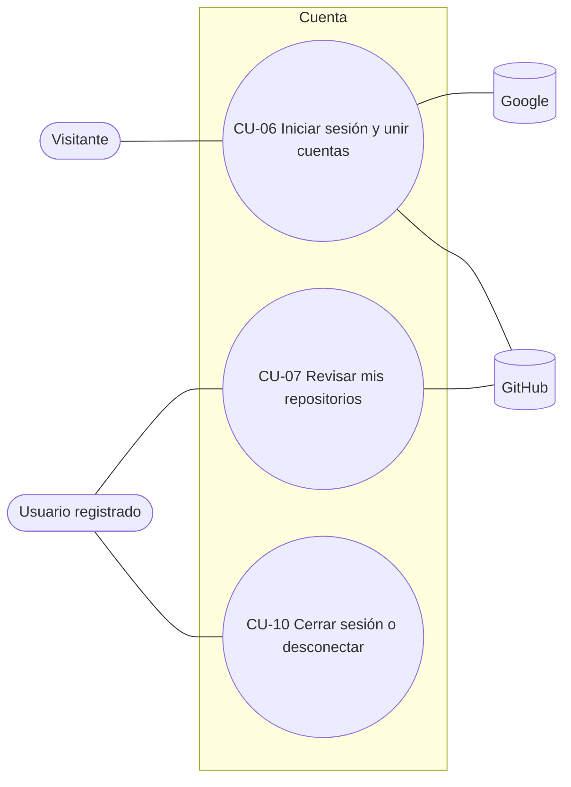

## 6.4 Especificación de los casos de uso

Cada caso de uso se describe con su **ficha**, su **diagrama de actividades** (organizado en carriles: lo que hace el usuario, lo que hace DepScan y lo que hacen los servicios externos) y su **diagrama de secuencia** (el orden de los mensajes entre los participantes).

---

### CU-01 – Revisar un proyecto subiendo sus archivos

| Elemento | Descripción |
|---|---|
| **Actor principal** | Visitante o usuario registrado |
| **Actores de apoyo** | Bases de avisos de seguridad; registros de librerías (solo si se pide estimar versiones) |
| **Objetivo** | Saber si las librerías de su proyecto tienen fallas de seguridad conocidas. |
| **Precondición** | El usuario tiene en su computadora los archivos con la lista de librerías del proyecto. |
| **Disparador** | El usuario abre la página "Nuevo escaneo". |
| **Flujo principal** | 1. El usuario abre "Nuevo escaneo" en la pestaña "Subir archivos". 2. Arrastra los archivos o pulsa "Elegir carpeta". 3. DepScan separa los archivos útiles de los que no lo son y muestra la lista aceptada. 4. El usuario escribe, si quiere, un nombre para el proyecto. 5. Elige las opciones: incluir librerías de desarrollo, estimar versiones, usar la base oficial de EE. UU. 6. Pulsa **Escanear**. 7. DepScan identifica cada librería y su versión exacta. 8. Consulta las bases de avisos de seguridad. 9. Une las fallas repetidas y calcula su gravedad. 10. Calcula las versiones seguras y los pasos de solución. 11. Guarda la revisión en el historial. 12. Muestra el resultado (continúa en CU-03). |
| **Flujos alternativos** | 3a. Ningún archivo es válido: DepScan explica qué archivos necesita y vuelve al paso 2. 3b. Falta el archivo de versiones exactas: DepScan advierte que la precisión será menor y sugiere subirlo o activar la estimación. 6a. Se superó el límite de 20 revisiones por minuto: DepScan pide esperar un momento. 8a. La base de avisos no responde: DepScan reintenta y, si no lo logra, informa que intente más tarde. |
| **Postcondición** | La revisión queda guardada en el historial del usuario (o del navegador, si no inició sesión). |
| **Reglas de negocio** | RN-01, RN-02, RN-03, RN-07, RN-08, RN-10 |

**Diagrama de actividades – CU-01**

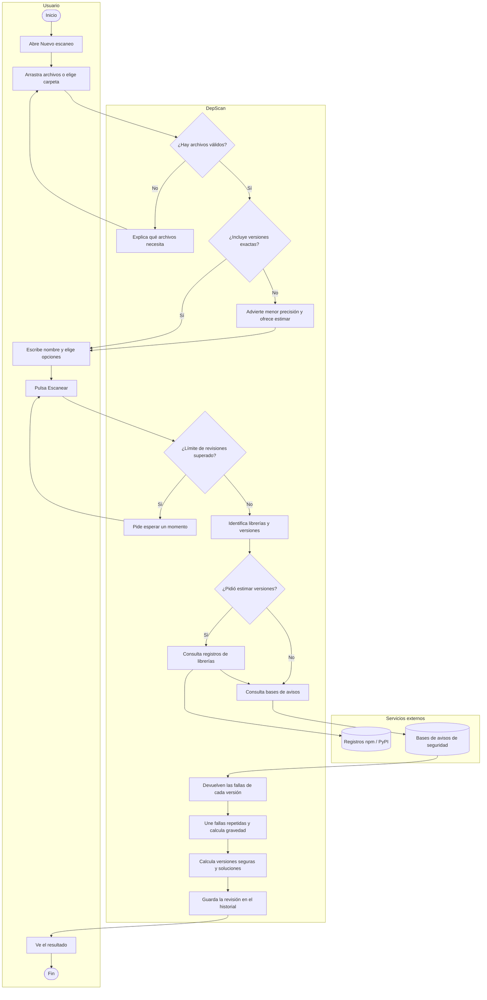

**Diagrama de secuencia – CU-01**

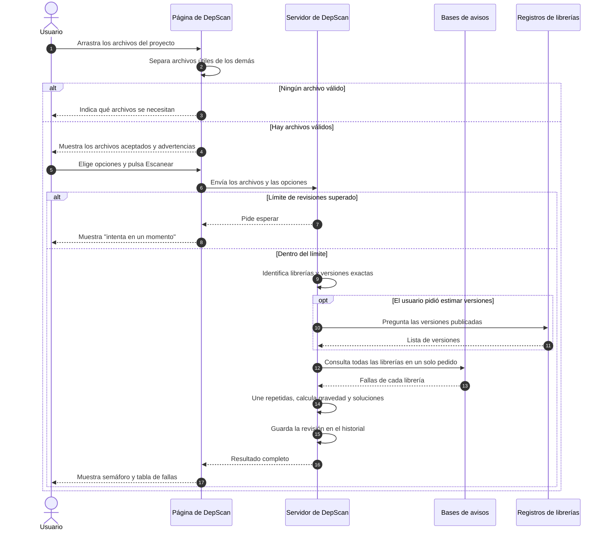

---

### CU-02 – Revisar un repositorio de GitHub

| Elemento | Descripción |
|---|---|
| **Actor principal** | Visitante o usuario registrado |
| **Actores de apoyo** | GitHub; bases de avisos de seguridad; registros de librerías |
| **Objetivo** | Revisar un proyecto publicado en GitHub sin descargarlo. |
| **Precondición** | Conocer la dirección del repositorio. Si es privado, haber conectado GitHub (CU-06). |
| **Disparador** | El usuario elige la pestaña "Repositorio de GitHub" en "Nuevo escaneo" (o pulsa Escanear en CU-07). |
| **Flujo principal** | 1. El usuario abre "Nuevo escaneo" y elige "Repositorio de GitHub". 2. Escribe la dirección (por ejemplo, `usuario/proyecto`) y, si quiere, una rama o versión. 3. Pulsa **Escanear**. 4. DepScan pregunta a GitHub por el repositorio y por la versión exacta (commit) que va a revisar. 5. Descarga solo los archivos con la lista de librerías. 6. Continúa como CU-01 desde el paso 7. 7. Guarda la revisión anotando la versión exacta del repositorio y si es privado. |
| **Flujos alternativos** | 2a. La dirección no tiene el formato correcto: DepScan lo indica. 4a. El repositorio no existe, o es privado y el usuario no conectó GitHub: DepScan lo explica y sugiere conectar GitHub. 4b. La rama o versión no existe: DepScan lo informa. 5a. El repositorio no tiene archivos de librerías: DepScan informa que no encontró qué revisar. |
| **Postcondición** | La revisión queda guardada; si el repositorio es privado, solo la ve su dueño. |
| **Reglas de negocio** | RN-01 a RN-03, RN-07, RN-09 |

**Diagrama de actividades – CU-02**

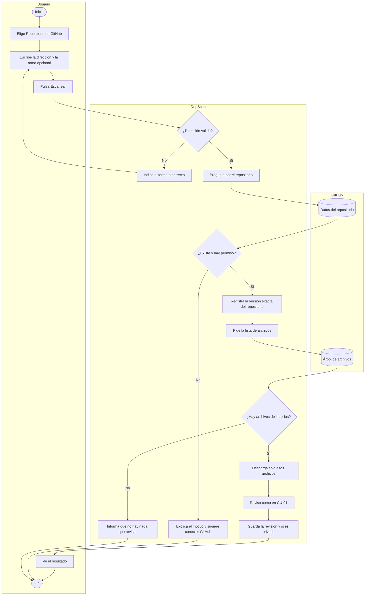

**Diagrama de secuencia – CU-02**

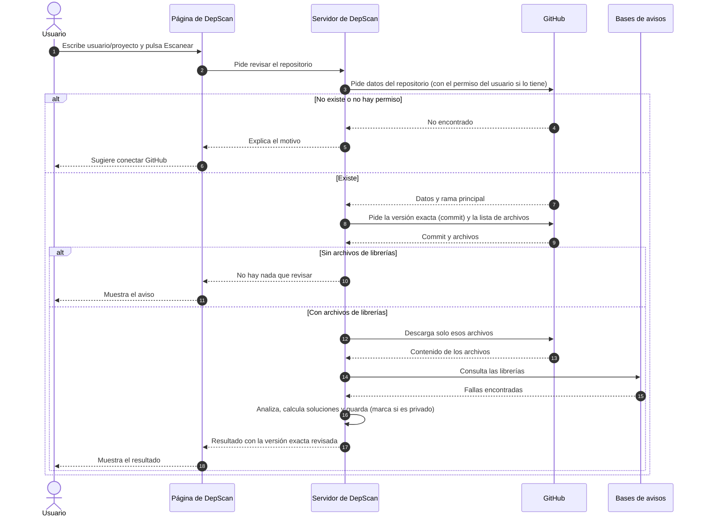

---

### CU-03 – Consultar el resultado y el detalle de las fallas

| Elemento | Descripción |
|---|---|
| **Actor principal** | Visitante o usuario registrado |
| **Actores de apoyo** | Bases de avisos de seguridad (para la descripción completa de una falla) |
| **Objetivo** | Entender el estado de seguridad del proyecto y qué atender primero. |
| **Precondición** | Existe una revisión terminada (CU-01, CU-02 o desde el historial en CU-08). |
| **Disparador** | Termina una revisión o el usuario abre una desde el historial. |
| **Flujo principal** | 1. DepScan muestra el nombre del proyecto, la fecha y la versión revisada. 2. Muestra el semáforo y las cifras: librerías en riesgo, fallas críticas y altas, directas y "de rebote". 3. Muestra un gráfico con las fallas por gravedad. 4. Muestra los archivos analizados y las advertencias. 5. Presenta la tabla de librerías en riesgo, ordenada de la más grave a la menos grave. 6. El usuario filtra por gravedad, tipo o lenguaje, o busca por nombre. 7. El usuario pulsa una falla. 8. DepScan abre un panel con la gravedad, su origen, los otros nombres de la falla, las versiones que la corrigen, la descripción y las referencias. 9. El usuario cierra el panel. |
| **Flujos alternativos** | 1a. La revisión es privada y el usuario no es su dueño: DepScan responde que no existe. 5a. No hay fallas: DepScan muestra el mensaje "No se encontraron vulnerabilidades conocidas". 6a. El usuario cambia a la pestaña "Todas las dependencias" para ver cada librería con su versión y de dónde se obtuvo. 8a. No se puede obtener la descripción completa: DepScan muestra los datos que ya tiene. |
| **Postcondición** | El usuario sabe qué librerías atender primero. |
| **Reglas de negocio** | RN-01, RN-02, RN-03, RN-08, RN-09 |

**Diagrama de actividades – CU-03**

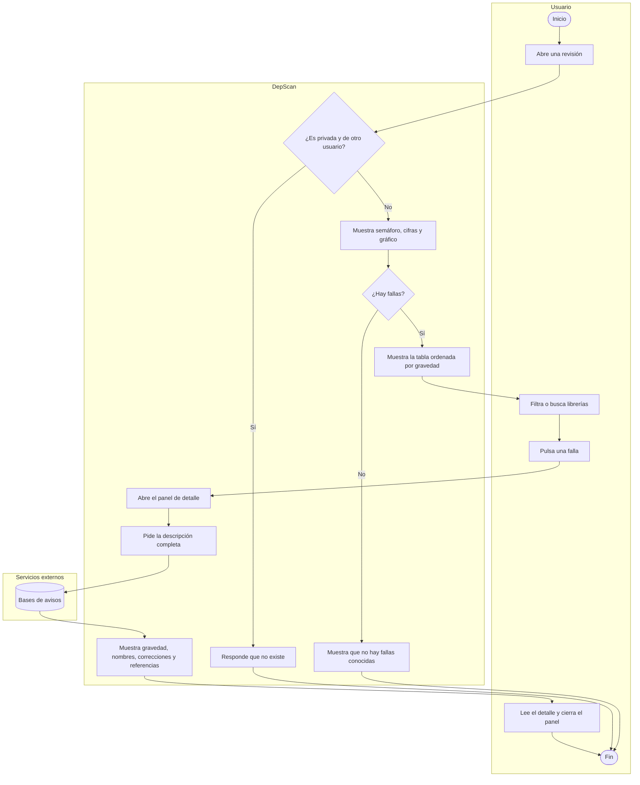

**Diagrama de secuencia – CU-03**

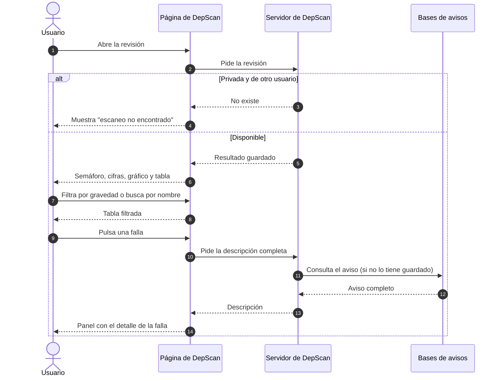

---

### CU-04 – Ver la solución de una librería

| Elemento | Descripción |
|---|---|
| **Actor principal** | Visitante o usuario registrado |
| **Objetivo** | Saber exactamente cómo resolver el riesgo de una librería, o cómo protegerse si no se puede actualizar. |
| **Precondición** | El usuario está viendo un resultado con fallas (CU-03). |
| **Disparador** | El usuario pulsa **Ver solución** en una fila de la tabla. |
| **Flujo principal** | 1. DepScan abre el panel "Cómo resolverlo" con el nombre, la versión actual y si la librería es directa o "de rebote". 2. Lista las fallas de esa librería con su gravedad. 3. Muestra la recomendación, por ejemplo "Actualizar a 7.3.7". 4. Muestra las opciones: mínima segura, más nueva sin cambio grande y más nueva disponible, indicando cuáles pueden requerir ajustes. 5. Lista todas las versiones seguras e indica si fueron verificadas contra todos los avisos. 6. Muestra los pasos para aplicar el cambio. 7. El usuario pulsa **Copiar** en un paso. 8. DepScan copia la instrucción y confirma con "Copiado". 9. Muestra las medidas temporales y los arreglos oficiales, si existen. 10. Muestra notas (por ejemplo, "solo se usa en desarrollo"). 11. El usuario cierra el panel. |
| **Flujos alternativos** | 3a. No existe versión segura: DepScan lo indica y destaca las medidas de protección. 6a. La librería llega "de rebote" y la pieza que la trae ya acepta la versión segura: el paso es "basta con actualizar". 6b. La pieza que la trae no la acepta: DepScan muestra cómo forzar la versión segura y, como alternativa, actualizar la pieza principal. 5a. Hay más de 15 versiones seguras: DepScan muestra las primeras y un enlace "ver más". |
| **Postcondición** | El usuario tiene un plan de acción concreto. |
| **Reglas de negocio** | RN-04, RN-05, RN-06, RN-08 |

**Diagrama de actividades – CU-04**

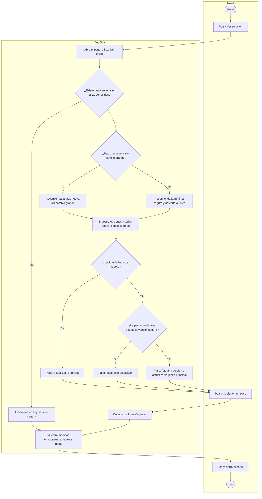

**Diagrama de secuencia – CU-04**

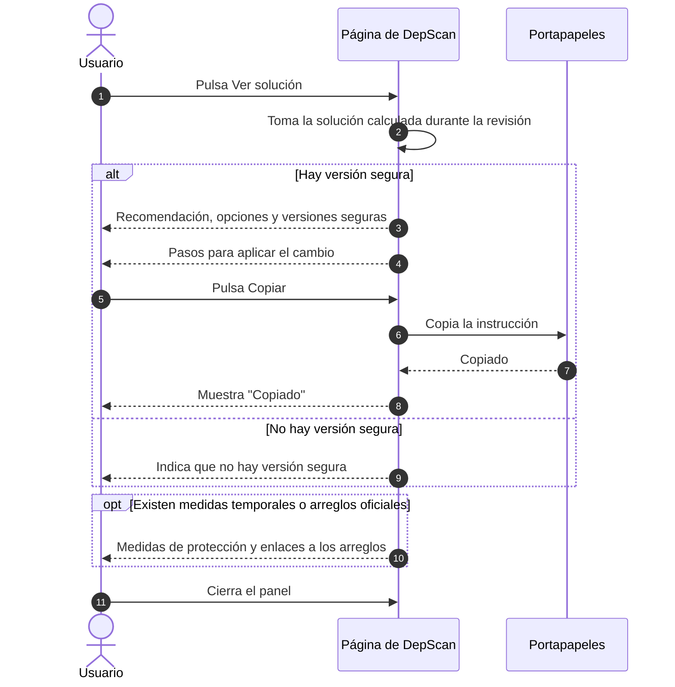

---

### CU-05 – Descargar el informe

| Elemento | Descripción |
|---|---|
| **Actor principal** | Visitante, usuario registrado o docente |
| **Objetivo** | Obtener un documento con el resultado para entregarlo o archivarlo. |
| **Precondición** | Existe una revisión terminada a la que el actor tiene acceso. |
| **Disparador** | El actor pulsa **Ver reporte**, **Descargar HTML** o **Descargar PDF**. |
| **Flujo principal** | 1. El actor pulsa el botón de descarga. 2. DepScan comprueba que la revisión exista y que tenga permiso para verla. 3. Arma el documento con la portada (proyecto, fecha, versión revisada), el semáforo, las cifras, la tabla de hallazgos, la solución de cada librería y las limitaciones. 4. Entrega el archivo con un nombre que incluye el proyecto y la fecha. 5. El navegador lo guarda en la computadora. |
| **Flujos alternativos** | 1a. Pulsa "Ver reporte": el informe HTML se abre en una pestaña nueva, en lugar de descargarse. 2a. La revisión es privada y el actor no es su dueño: DepScan responde que no existe. |
| **Postcondición** | El actor tiene el informe en su computadora. |
| **Reglas de negocio** | RN-09 |

**Diagrama de actividades – CU-05**

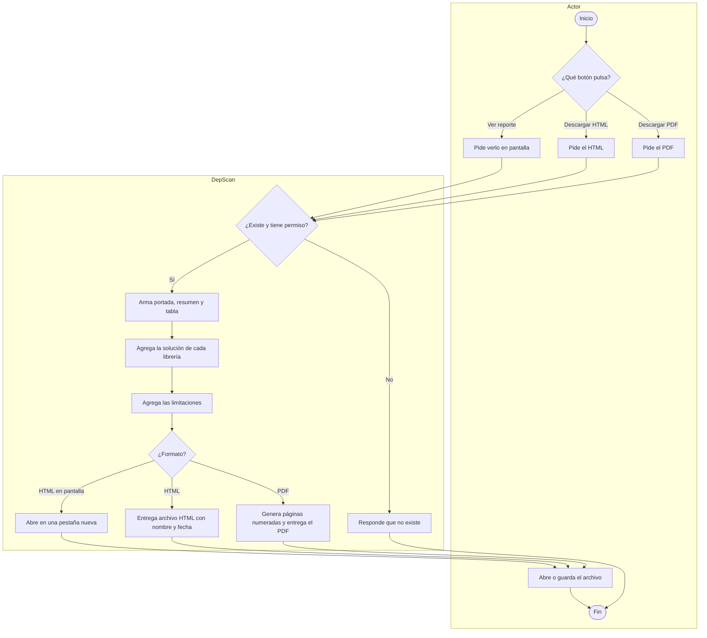

**Diagrama de secuencia – CU-05**

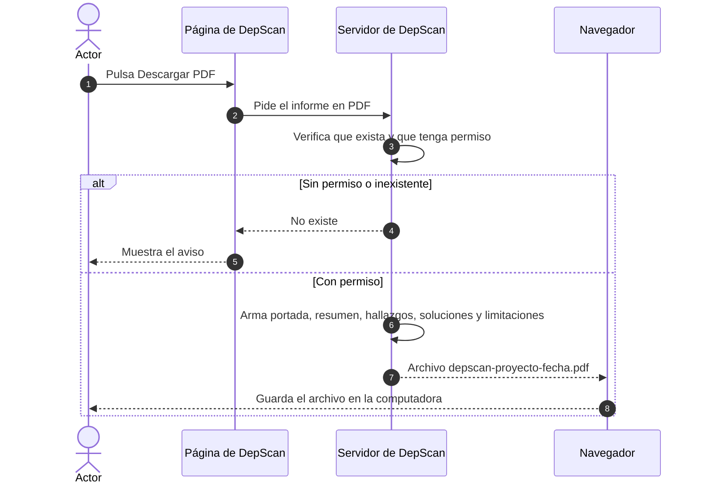

---

### CU-06 – Iniciar sesión y unir cuentas

| Elemento | Descripción |
|---|---|
| **Actor principal** | Visitante (o usuario registrado que quiere unir la otra cuenta) |
| **Actores de apoyo** | Google; GitHub |
| **Objetivo** | Tener una cuenta para conservar el historial y revisar repositorios privados. |
| **Precondición** | El actor tiene una cuenta de Google o de GitHub. El inicio de sesión está habilitado en el servidor. |
| **Disparador** | El actor pulsa **Iniciar sesión** (o **Conectar GitHub** / **Vincular Google** en su menú). |
| **Flujo principal** | 1. El actor elige "Continuar con Google" o "Continuar con GitHub". 2. DepScan prepara una solicitud única y lo envía a la página oficial del servicio. 3. El actor escribe allí su contraseña (DepScan nunca la ve). 4. El actor acepta compartir su nombre, correo y foto (y, en GitHub, el acceso a sus repositorios). 5. El servicio devuelve al actor a DepScan con un código de un solo uso. 6. DepScan comprueba que la solicitud sea la misma que preparó y que no haya vencido. 7. Canjea el código por la confirmación de identidad. 8. Busca si esa cuenta ya existe; si no, crea la cuenta del usuario. 9. Guarda cifrado el permiso de GitHub (si aplica). 10. Pasa a la cuenta las revisiones hechas antes en ese navegador. 11. Abre una sesión nueva y lleva al usuario a la página desde la que empezó. |
| **Flujos alternativos** | 4a. El actor cancela: vuelve a "Iniciar sesión" con el aviso "Cancelaste el inicio de sesión". 6a. La solicitud no coincide o venció (más de 10 minutos): DepScan pide intentarlo de nuevo. 8a. El actor ya tenía sesión con el otro servicio: ambas cuentas quedan unidas. 8b. El correo verificado coincide con una cuenta existente: se une a esa cuenta. 8c. Esa cuenta de Google/GitHub ya pertenece a otro usuario: DepScan lo informa y no la une. 1a. El inicio de sesión no está configurado: los botones aparecen desactivados con una explicación. |
| **Postcondición** | El usuario tiene sesión iniciada y su historial asociado a la cuenta. |
| **Reglas de negocio** | RN-10, RN-12 |

**Diagrama de actividades – CU-06**

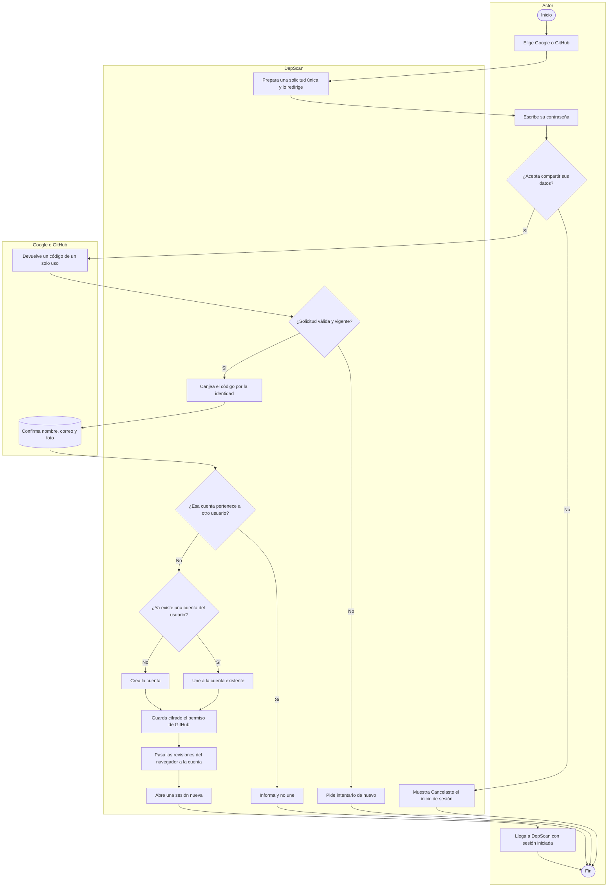

**Diagrama de secuencia – CU-06**

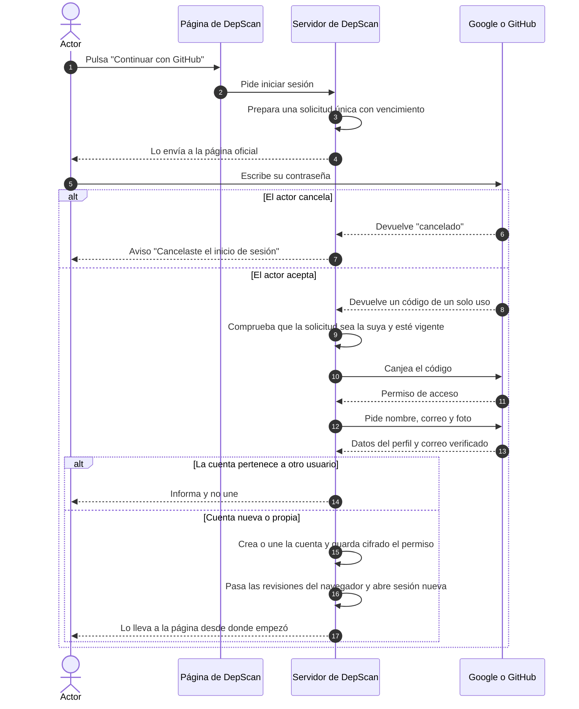

---

### CU-07 – Revisar mis repositorios de GitHub

| Elemento | Descripción |
|---|---|
| **Actor principal** | Usuario registrado |
| **Actores de apoyo** | GitHub |
| **Objetivo** | Ver todos sus proyectos de GitHub y revisar cualquiera con un clic. |
| **Precondición** | El usuario inició sesión y conectó GitHub (CU-06). |
| **Disparador** | El usuario abre **Mis repos de GitHub**. |
| **Flujo principal** | 1. El usuario abre "Mis repos de GitHub". 2. DepScan pide a GitHub la lista de repositorios del usuario (propios, de colaboración y de sus organizaciones), ordenados por fecha de actualización. 3. Muestra cada repositorio con su nombre, lenguaje, descripción, si es privado y su última actualización. 4. El usuario filtra por nombre. 5. El usuario escribe, si quiere, una rama o versión. 6. Pulsa **Escanear** junto al repositorio. 7. El botón cambia a "Escaneando…". 8. DepScan ejecuta CU-02 con ese repositorio. 9. Al terminar, lleva al usuario al resultado. |
| **Flujos alternativos** | 1a. El inicio con GitHub no está configurado: DepScan lo indica y sugiere escanear repositorios públicos desde "Nuevo escaneo". 2a. GitHub no está conectado: DepScan ofrece "Conectar GitHub" (CU-06). 2b. El permiso fue retirado desde GitHub: DepScan pide volver a conectar. 3a. Hay más de 100 repositorios: aparece el botón "Cargar más". 8a. El repositorio no tiene archivos de librerías: el aviso aparece debajo de ese repositorio. |
| **Postcondición** | La revisión del repositorio queda en el historial del usuario. |
| **Reglas de negocio** | RN-09 |

**Diagrama de actividades – CU-07**

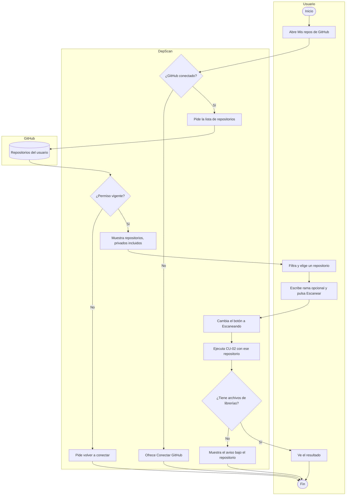

**Diagrama de secuencia – CU-07**

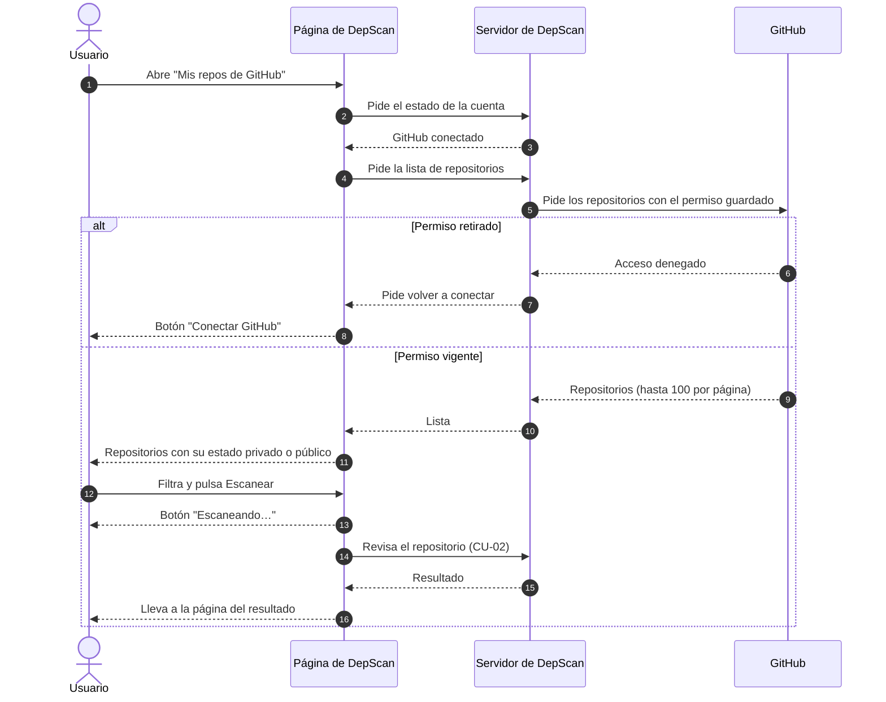

---

### CU-08 – Consultar, comparar y eliminar revisiones del historial

| Elemento | Descripción |
|---|---|
| **Actor principal** | Visitante o usuario registrado |
| **Objetivo** | Ver la evolución de la seguridad de sus proyectos y mantener ordenado su historial. |
| **Precondición** | Haber hecho al menos una revisión desde esa cuenta o ese navegador. |
| **Disparador** | El usuario abre **Historial**. |
| **Flujo principal (consultar y comparar)** | 1. El usuario abre "Historial". 2. DepScan muestra sus revisiones con proyecto, origen, fecha, semáforo, librerías en riesgo y fallas críticas y altas. 3. El usuario marca dos revisiones. 4. Pulsa **Comparar**. 5. DepScan toma la más antigua como "antes" y la más reciente como "después". 6. Muestra tres listas: fallas **nuevas**, **corregidas** y que **persisten**. |
| **Flujo alternativo (eliminar)** | E1. El usuario pulsa **Eliminar** en una revisión. E2. DepScan pide confirmación en la misma fila. E3. El usuario pulsa **Eliminar** de nuevo. E4. DepScan borra la revisión y actualiza la lista. E3a. El usuario pulsa **Cancelar**: no se borra nada. |
| **Otros flujos alternativos** | 2a. No hay revisiones: DepScan invita a crear la primera. 2b. El usuario no inició sesión: DepScan le recuerda que el historial está asociado al navegador y le sugiere iniciar sesión. 3a. Marca una tercera revisión: se desmarca la más antigua de las seleccionadas. 1a. El usuario abre una revisión: continúa en CU-03. |
| **Postcondición** | El usuario conoce la evolución de su proyecto o su historial queda actualizado. |
| **Reglas de negocio** | RN-09, RN-10 |

**Diagrama de actividades – CU-08**

```mermaid
flowchart TD
    subgraph Usuario
      A([Inicio]) --> B[Abre Historial]
      D{¿Qué desea hacer?}
      D -- Comparar --> E[Marca dos revisiones y pulsa Comparar]
      D -- Eliminar --> J[Pulsa Eliminar]
      D -- Abrir --> O[Abre una revisión: CU-03]
      L{¿Confirma?}
      I[Lee nuevas, corregidas y persistentes] --> Z([Fin])
      O --> Z
    end
    subgraph DepScan
      B --> C{¿Hay revisiones?}
      C -- No --> C1[Invita a crear la primera] --> Z
      C -- Sí --> C2[Muestra la lista con fecha y semáforo] --> D
      E --> F[Ordena: antes y después]
      F --> G[Compara las fallas de ambas]
      G --> H[Clasifica en nuevas, corregidas y persistentes] --> I
      J --> K[Pide confirmación en la fila] --> L
      L -- No --> C2
      L -- Sí --> M[Borra la revisión] --> N[Actualiza la lista] --> Z
    end
```

**Diagrama de secuencia – CU-08**

```mermaid
sequenceDiagram
    autonumber
    actor U as Usuario
    participant P as Página de DepScan
    participant S as Servidor de DepScan
    U->>P: Abre Historial
    P->>S: Pide las revisiones de este usuario o navegador
    S-->>P: Lista de revisiones
    P-->>U: Muestra la lista
    alt Comparar
        U->>P: Marca dos revisiones y pulsa Comparar
        P->>S: Pide la primera revisión
        S-->>P: Revisión A
        P->>S: Pide la segunda revisión
        S-->>P: Revisión B
        P->>P: Ordena por fecha y clasifica las fallas
        P-->>U: Nuevas, corregidas y persistentes
    else Eliminar
        U->>P: Pulsa Eliminar
        P-->>U: Pide confirmación
        alt Confirma
            U->>P: Pulsa Eliminar de nuevo
            P->>S: Borra la revisión (solo si es suya)
            S-->>P: Borrada
            P-->>U: Lista actualizada
        else Cancela
            U->>P: Pulsa Cancelar
            P-->>U: La revisión se mantiene
        end
    end
```

---

### CU-09 – Revisión automática en cada cambio

| Elemento | Descripción |
|---|---|
| **Actor principal** | Revisión automática (configurada por el equipo en su repositorio) |
| **Actores de apoyo** | Bases de avisos de seguridad |
| **Objetivo** | Impedir que se entregue una versión del proyecto con fallas graves. |
| **Precondición** | El equipo agregó la herramienta de línea de comandos de DepScan a su proceso automático y eligió el nivel de gravedad que detiene la entrega. |
| **Disparador** | Un integrante del equipo sube cambios al repositorio. |
| **Flujo principal** | 1. Se inicia el proceso automático del repositorio. 2. Se ejecutan las verificaciones del equipo (compilación y pruebas). 3. Se ejecuta DepScan sobre la carpeta del proyecto con el nivel elegido (por ejemplo, "alto"). 4. DepScan lee los archivos de librerías. 5. Consulta las bases de avisos. 6. Analiza y genera el informe. 7. No hay fallas del nivel elegido o superior: DepScan termina "sin errores" y la entrega continúa. 8. Se guarda el informe como evidencia del proceso. |
| **Flujos alternativos** | 7a. Hay fallas del nivel elegido o superior: DepScan termina "con errores", la entrega se detiene y el equipo revisa el informe. 5a. La base de avisos no responde: DepScan termina "con fallo de ejecución" y el equipo puede reintentar. |
| **Postcondición** | La entrega continúa o se detiene según la gravedad encontrada; el informe queda guardado. |
| **Reglas de negocio** | RN-01 a RN-03, RN-11 |

**Diagrama de actividades – CU-09**

```mermaid
flowchart TD
    subgraph Equipo
      A([Inicio]) --> B[Sube cambios al repositorio]
      R1[Revisa el informe y corrige] --> Z([Fin])
      R2[La entrega continúa] --> Z
    end
    subgraph Proceso automático
      B --> C[Compila y ejecuta pruebas]
      C --> D[Ejecuta DepScan con el nivel elegido]
      H{¿Fallas del nivel elegido o superior?}
      H -- Sí --> I[Termina con errores y detiene la entrega]
      H -- No --> J[Termina sin errores]
      I --> K[Guarda el informe] --> R1
      J --> K2[Guarda el informe] --> R2
      F1[Termina con fallo de ejecución] --> R1
    end
    subgraph DepScan
      D --> E[Lee los archivos de librerías]
      E --> F{¿Responden las bases de avisos?}
      F -- No --> F1
      F -- Sí --> G[Analiza y genera el informe] --> H
    end
```

**Diagrama de secuencia – CU-09**

```mermaid
sequenceDiagram
    autonumber
    actor E as Equipo
    participant R as Repositorio
    participant PA as Proceso automático
    participant D as DepScan (línea de comandos)
    participant A as Bases de avisos
    E->>R: Sube cambios
    R->>PA: Inicia el proceso automático
    PA->>PA: Compila y ejecuta pruebas
    PA->>D: Revisa el proyecto con nivel "alto"
    D->>D: Lee los archivos de librerías
    D->>A: Consulta las librerías
    alt Bases de avisos no disponibles
        A-->>D: Sin respuesta
        D-->>PA: Fallo de ejecución
    else Responden
        A-->>D: Fallas encontradas
        D->>D: Analiza y arma el informe
        alt Hay fallas altas o críticas
            D-->>PA: Termina con errores
            PA-->>E: Entrega detenida y el informe disponible
        else No hay fallas de ese nivel
            D-->>PA: Termina sin errores
            PA-->>E: Entrega aprobada y el informe disponible
        end
    end
```

---

### CU-10 – Cerrar sesión o desconectar GitHub

| Elemento | Descripción |
|---|---|
| **Actor principal** | Usuario registrado |
| **Objetivo** | Salir de su cuenta o retirar el permiso de acceso a sus repositorios. |
| **Precondición** | El usuario tiene sesión iniciada. |
| **Disparador** | El usuario abre su menú (foto en la esquina) o la página "Mis repos de GitHub". |
| **Flujo principal (cerrar sesión)** | 1. El usuario abre su menú. 2. Pulsa **Cerrar sesión**. 3. DepScan elimina la sesión. 4. Borra todos los datos de la cuenta que la página tenía en memoria. 5. Lleva al usuario a la página de inicio, sin sesión. |
| **Flujo alternativo (desconectar GitHub)** | D1. En "Mis repos de GitHub", el usuario pulsa **desconectar**. D2. DepScan borra el permiso de GitHub que tenía guardado (la cuenta sigue existiendo). D3. La página muestra "Conecta tu cuenta de GitHub". |
| **Otros flujos alternativos** | 3a. La sesión ya había vencido: DepScan igualmente muestra la página sin sesión. |
| **Postcondición** | Desde ese navegador ya no hay acceso a la cuenta o a los repositorios del usuario. |
| **Reglas de negocio** | RN-09 |

**Diagrama de actividades – CU-10**

```mermaid
flowchart TD
    subgraph Usuario
      A([Inicio]) --> B{¿Qué desea?}
      B -- Cerrar sesión --> C[Abre su menú y pulsa Cerrar sesión]
      B -- Desconectar GitHub --> G[Pulsa desconectar en Mis repos]
      Z1[Queda sin sesión] --> Z([Fin])
      Z2[Ve Conecta tu cuenta de GitHub] --> Z
    end
    subgraph DepScan
      C --> D[Elimina la sesión]
      D --> E[Borra los datos de la cuenta en la página]
      E --> F[Lleva a la página de inicio] --> Z1
      G --> H[Borra el permiso de GitHub guardado]
      H --> I[Actualiza el estado de la cuenta] --> Z2
    end
```

**Diagrama de secuencia – CU-10**

```mermaid
sequenceDiagram
    autonumber
    actor U as Usuario
    participant P as Página de DepScan
    participant S as Servidor de DepScan
    alt Cerrar sesión
        U->>P: Pulsa Cerrar sesión
        P->>S: Pide cerrar la sesión
        S->>S: Elimina la sesión
        S-->>P: Sesión cerrada
        P->>P: Borra los datos de la cuenta en memoria
        P-->>U: Página de inicio sin sesión
    else Desconectar GitHub
        U->>P: Pulsa desconectar
        P->>S: Pide retirar el permiso de GitHub
        S->>S: Borra el permiso guardado
        S-->>P: Permiso retirado
        P-->>U: Muestra "Conecta tu cuenta de GitHub"
    end
```

## 6.5 Estados de una revisión

Una revisión pasa por estos estados desde que se solicita hasta que se elimina.

```mermaid
stateDiagram-v2
    [*] --> Solicitada: el usuario pulsa Escanear
    Solicitada --> Rechazada: archivos inválidos o límite superado
    Solicitada --> EnProceso
    EnProceso --> Completada: resultado guardado
    EnProceso --> Fallida: servicio externo no disponible
    Completada --> Consultada: el usuario la abre
    Consultada --> Descargada: baja el informe
    Descargada --> Consultada
    Consultada --> Comparada: se compara con otra
    Comparada --> Consultada
    Consultada --> Eliminada: el usuario la borra
    Rechazada --> [*]
    Fallida --> [*]
    Eliminada --> [*]
```

## 6.6 Matriz de trazabilidad (requerimientos ↔ casos de uso)

| RF | CU-01 | CU-02 | CU-03 | CU-04 | CU-05 | CU-06 | CU-07 | CU-08 | CU-09 | CU-10 |
|---|---|---|---|---|---|---|---|---|---|---|
| RF-01 | X | | | | | | | | | |
| RF-02 | | X | | | | | X | | | |
| RF-03 | X | X | | | | | | | X | |
| RF-04 | X | X | | | | | | | X | |
| RF-05 | X | X | X | | | | | | X | |
| RF-06 | X | X | X | | | | | | X | |
| RF-07 | | | X | | | | | | | |
| RF-08 | | | | X | | | | | | |
| RF-09 | | | | X | | | | | | |
| RF-10 | | | | X | | | | | | |
| RF-11 | | | | X | | | | | | |
| RF-12 | | | | | X | | | | | |
| RF-13 | | | | | | X | | | | |
| RF-14 | | | | | | | X | | | |
| RF-15 | | | | | | | | X | | |
| RF-16 | | | | | | | | X | | |
| RF-17 | | | | | | | | X | | |
| RF-18 | | | | | | | | | X | |
| RF-19 | X | X | | | | | | | | |
| RF-20 | | | | | | | | | | X |

# 7. Conclusiones

1. Se definieron **20 requerimientos funcionales** y **11 no funcionales** que cubren el ciclo completo: entregar un proyecto, conocer su riesgo, saber cómo resolverlo y conservar la evidencia.
2. Las **12 reglas de negocio** garantizan resultados honestos y útiles: no se repiten fallas, no se inventan versiones y solo se recomiendan versiones sin ninguna falla conocida.
3. Los **10 casos de uso** están especificados en su totalidad: cada uno cuenta con su ficha (actores, precondición, disparador, flujo principal, flujos alternativos, postcondición y reglas aplicadas), su **diagrama de actividades** por carriles y su **diagrama de secuencia**.
4. La matriz de trazabilidad confirma que los 20 requerimientos funcionales están cubiertos por al menos un caso de uso.
5. El sistema fue diseñado para que una persona sin formación en seguridad pueda revisar su proyecto en tres pasos y entender qué hacer, lo que lo convierte también en una herramienta de aprendizaje.

# BIBLIOGRAFÍA

- Cockburn, A. (2001). *Writing effective use cases*. Addison-Wesley.
- IEEE. (1998). *IEEE Std 830-1998: Recommended practice for software requirements specifications*. IEEE.
- Pressman, R. S., y Maxim, B. R. (2020). *Ingeniería del software: un enfoque práctico* (9.ª ed.). McGraw-Hill.
- Sommerville, I. (2016). *Software engineering* (10.ª ed.). Pearson.

# WEBGRAFÍA

- Congreso de la República del Perú. (2011, 3 de julio). *Ley N.º 29733, Ley de Protección de Datos Personales*. Diario Oficial El Peruano. https://www.gob.pe
- Object Management Group. (2017). *Unified Modeling Language (UML) version 2.5.1*. https://www.omg.org/spec/UML/2.5.1
- OWASP Foundation. (2021). *OWASP Top 10: 2021*. https://owasp.org/Top10/
