UNIVERSIDAD PRIVADA DE TACNA

FACULTAD DE INGENIERIA

Escuela Profesional de Ingeniería de Sistemas

**DepScan: Sistema Web de Detección y Remediación de Dependencias Vulnerables**

**Integrante:**

Angel Gadiel Hernandez Cruz

Tacna – Perú

2026

---

## INDICE GENERAL

- INTRODUCCIÓN
    - 1. Propósito
    - 2. Alcance
    - 3. Definiciones, Acrónimos y Abreviaturas
    - 4. Referencias
- I. REPRESENTACIÓN ARQUITECTÓNICA
    - Metas y Restricciones Arquitectónicas
- II. VISTA DE CASOS DE USO
    - Secuencia de CU-01: Revisar un proyecto subiendo sus archivos
    - Secuencia de CU-02: Revisar un repositorio de GitHub
    - Secuencia de CU-03: Consultar el resultado y el detalle de las fallas
    - Secuencia de CU-04: Ver la solución de una librería
    - Secuencia de CU-05: Descargar el informe
    - Secuencia de CU-06: Iniciar sesión y unir cuentas
    - Secuencia de CU-07: Revisar mis repositorios de GitHub
    - Secuencia de CU-08: Consultar, comparar y eliminar revisiones del historial
    - Secuencia de CU-09: Revisión automática en cada cambio
    - Secuencia de CU-10: Cerrar sesión o desconectar GitHub
- III. VISTA LÓGICA
    - 1. Estilo Arquitectónico
    - 2. Diagrama de Paquetes
    - 3. Descripción de las Capas
    - 4. Diagrama de Clases de Dominio
    - 5. Diagrama de Interfaces de la Capa de Servicios
- IV. VISTA DE PROCESOS
- V. VISTA DE DESPLIEGUE
- VI. VISTA DE IMPLEMENTACIÓN
- VII. VISTA DE DATOS
- VIII. PATRONES DE DISEÑO APLICADOS
- IX. DECISIONES ARQUITECTÓNICAS
- X. ATRIBUTOS DE CALIDAD
- CONCLUSIONES
- RECOMENDACIONES
- BIBLIOGRAFÍA
- WEBGRAFÍA

---

# INTRODUCCIÓN

## 1. Propósito

El presente Documento de Arquitectura de Software (SAD) describe la arquitectura de DepScan mediante el modelo de vistas 4+1 de Kruchten: la vista de casos de uso, que articula a las demás, y las vistas lógica, de procesos, de despliegue y de implementación, complementadas con la vista de datos. Explica cómo se organizan los componentes, cómo colaboran durante un escaneo, cómo se persisten los datos, cómo se despliega el sistema y qué patrones y decisiones de diseño se adoptaron, con su justificación.

El documento está dirigido al docente evaluador, a los desarrolladores que mantengan o extiendan el sistema y a quien deba operarlo en producción.

## 2. Alcance

Cubre el motor de análisis (`packages/core`), la API web (`apps/api`), la interfaz web (`apps/web`), la CLI (`apps/cli`) y la infraestructura de despliegue en Railway. Los requerimientos que la arquitectura satisface se especifican en FD03 (RF-01 a RF-20 y RNF-01 a RNF-11). Quedan fuera de este documento el detalle de la interfaz gráfica y los procedimientos de gestión del proyecto, tratados en FD02 y FD05.

**Stack tecnológico**

| Capa | Tecnología | Versión |
|---|---|---|
| Lenguaje | TypeScript (ESM, `strict`) | 5.9 |
| Runtime | Node.js LTS | 24 |
| Motor | TypeScript puro, **cero dependencias de runtime** | — |
| API | Fastify, `@fastify/cookie`, `@fastify/rate-limit`, `@fastify/static` | 5.x |
| Persistencia | SQLite nativo (`node:sqlite`, `DatabaseSync`) | Node 24 |
| PDF | pdfkit (generación en el servidor) | 0.17 |
| Web | React, Vite, Tailwind CSS, TanStack Query, Recharts | 19 / 7 / 4 / 5 / 3 |
| Pruebas | Vitest | 4.1 |
| Calidad | ESLint 9, Prettier 3, `tsc -b` con *project references* | — |
| Monorepo | npm workspaces | npm 11 |
| CI | GitHub Actions | — |
| Despliegue | Docker multi-etapa (`node:24-alpine`) en Railway + volumen | — |

## 3. Definiciones, Acrónimos y Abreviaturas

| Término | Definición |
|---|---|
| SAD | *Software Architecture Document*, documento de arquitectura de software. |
| API REST | Interfaz de programación que expone recursos mediante HTTP y JSON. |
| SPA | *Single Page Application*: aplicación web que se carga una vez y actualiza la vista en el navegador. |
| CLI | *Command Line Interface*: herramienta de línea de comandos. |
| OSV | *Open Source Vulnerabilities*, base de avisos de Google. |
| NVD | *National Vulnerability Database* del NIST (EE. UU.). |
| CVE / GHSA / PYSEC | Identificadores de avisos de seguridad (MITRE, GitHub y Python). |
| CVSS | *Common Vulnerability Scoring System*: puntaje de gravedad de 0 a 10. |
| CWE | *Common Weakness Enumeration*: catálogo de tipos de debilidad. |
| OAuth 2.0 / PKCE | Protocolo de autorización delegada y su extensión contra el robo del código de autorización. |
| ADR | *Architecture Decision Record*: registro de una decisión arquitectónica. |
| CI | Integración continua. |
| Puerto | Interfaz TypeScript que el núcleo define para hablar con el exterior (`VulnSource`, `CveEnricher`, `RegistrySource`, `Cache`). |
| Adaptador | Implementación concreta de un puerto (`OsvClient`, `NvdClient`, `RegistryClient`, caché SQLite). |
| Pipeline de escaneo | Secuencia `resolve → query → fetch → dedupe → enrich → analyze → remediate → report`. |
| Owner key | Identificador del dueño de un escaneo: `user:<id>` o `anon:<sesión>`. |

## 4. Referencias

| Documento | Descripción |
|---|---|
| FD01 – Informe de Factibilidad | Riesgos, costos y viabilidad del proyecto. |
| FD02 – Documento de Visión | Problema, interesados, alcance y características del producto. |
| FD03 – Especificación de Requerimientos | RF, RNF, reglas de negocio y casos de uso CU-01 a CU-10. |
| `docs/ARQUITECTURA.md` y `docs/decisiones/` | Descripción técnica y ADR del repositorio. |
| Kruchten (1995) | Modelo de vistas 4+1 (ver Bibliografía). |

# I. REPRESENTACIÓN ARQUITECTÓNICA

La arquitectura se representa con el modelo 4+1 de Kruchten, porque separa las preocupaciones de cada interesado y es el modelo de referencia de RUP. Cada vista se documenta con diagramas UML o equivalentes en notación Mermaid.

| Vista | Interesado principal | Qué muestra | Sección |
|---|---|---|---|
| Casos de uso (+1) | Todos | Realización técnica de CU-01 a CU-10 | II |
| Lógica | Desarrolladores | Estilo, paquetes, capas, clases e interfaces | III |
| Procesos | Integradores | Pipeline de escaneo, autenticación y concurrencia | IV |
| Despliegue | Operación | Railway, contenedor, volumen y servicios externos | V |
| Implementación | Desarrolladores | Estructura del monorepo y del código | VI |
| Datos | Desarrolladores y operación | Modelo entidad-relación y migraciones | VII |

## Metas y Restricciones Arquitectónicas

**Metas (atributos de calidad dominantes)**

| ID | Objetivo | Táctica arquitectónica | RNF |
|---|---|---|---|
| OA-01 | **Corrección** de versiones y avisos | Comparadores semver y PEP 440 propios con pruebas de especificación; evaluación OSV por eventos `introduced/fixed/last_affected`. | RNF-07 |
| OA-02 | **Rendimiento** | Consulta en lote (`/v1/querybatch`, ≤ 1000 consultas), concurrencia limitada (`mapLimit`), caché persistente de 24 h. | RNF-01 |
| OA-03 | **Mantenibilidad y testabilidad** | Arquitectura hexagonal: núcleo puro sin E/S directa; adaptadores inyectables; 97 pruebas sin red. | RNF-10 |
| OA-04 | **Seguridad** | OAuth 2.0 con `state` y PKCE, sesión opaca hasheada, cookies `HttpOnly/SameSite=Lax/Secure`, tokens AES-256-GCM, control de acceso por dueño, rate limiting, validación con JSON Schema. | RNF-04, RNF-05 |
| OA-05 | **Resiliencia ante servicios externos** | Timeouts, reintentos con *backoff* exponencial y `Retry-After`, limitador de ventana deslizante para NVD. | RNF-06 |
| OA-06 | **Reproducibilidad** | Cada reporte guarda fecha, versión del escáner y SHA del commit analizado. | RNF-08 |
| OA-07 | **Portabilidad y despliegue simple** | Un único contenedor que sirve API y web; configuración solo por variables de entorno. | RNF-06 |

**Restricciones**

| Tipo | Restricción | Impacto en la arquitectura |
|---|---|---|
| Herramientas | Solo Visual Studio Code | Todo se ejecuta con scripts npm, sin generadores de IDE. |
| Tecnología | Frontend React; backend Node/TypeScript | Tipos compartidos: la web importa `@depscan/core` solo con `import type`. |
| Plataforma | Railway, una réplica | SQLite en volumen `/data`; no hay escritores concurrentes. |
| Externa | NVD: 5 req/30 s (50 con clave) | Enriquecimiento opcional y limitado. |
| Externa | GitHub: 60 req/h sin token | Uso del token OAuth del usuario o `GITHUB_TOKEN`. |
| Seguridad | Volúmenes Railway montados como root | El contenedor se ejecuta como root (documentado en ADR-07). |

# II. VISTA DE CASOS DE USO

Cada caso de uso de FD03 se realiza con los componentes indicados en la tabla siguiente y se detalla con su ficha y su diagrama de secuencia técnico, que muestra los objetos de frontera (páginas React), control (rutas Fastify y orquestador), servicio (clientes OSV, NVD, registros y GitHub) y persistencia (clase `Database`).

**Realización de los casos de uso por componente**

| CU | Componentes de presentación | Rutas / comandos | Componentes de núcleo e infraestructura |
|---|---|---|---|
| CU-01 | `NewScan.tsx`, `lib/manifests.ts` | `POST /api/scans` (`files`) | `cleanPath`, `isManifestPath`, `ensureSession`, `scanProject`, `Database.saveScan` |
| CU-02 | `NewScan.tsx` | `POST /api/scans` (`github`) | `parseGithubRepo`, `githubTokenOf`, `fetchGithubProject`, `scanProject` |
| CU-03 | `ScanResult.tsx`, `FindingsTable.tsx`, `VulnDrawer.tsx` | `GET /api/scans/:id`, `GET /api/vulns/:id` | `readable()`, `OsvClient.getVulnerability`, caché SQLite |
| CU-04 | `RemediationDrawer.tsx` | — (datos del reporte) | `buildRemediation` (calculado en el escaneo), API Clipboard |
| CU-05 | `ScanResult.tsx` | `GET /api/scans/:id/report.html?download=1`, `GET /api/scans/:id/report.pdf` | `renderHtml`, `renderPdf` (pdfkit) |
| CU-06 | `Login.tsx`, `UserMenu.tsx`, `lib/auth.ts` | `GET /api/auth/:provider/login`, `GET /api/auth/:provider/callback` | `authorizeUrl`, `exchangeCode`, `fetchProfile`, `TokenCipher`, `Database` |
| CU-07 | `GithubRepos.tsx` | `GET /api/auth/me`, `GET /api/github/repos`, `POST /api/scans` | `listGithubRepos`, `githubTokenOf` |
| CU-08 | `History.tsx`, `Compare.tsx` | `GET /api/scans`, `GET /api/scans/:id`, `DELETE /api/scans/:id` | `Database.listScans`, `Database.deleteScan`, `ownerKey` |
| CU-09 | GitHub Actions (`ci.yml`) | `node apps/cli/dist/index.js . --fail-on high` | `readProjectDirectory`, `scanProject`, `renderHtml`, `shouldFail` |
| CU-10 | `UserMenu.tsx`, `GithubRepos.tsx` | `POST /api/auth/logout`, `DELETE /api/auth/github` | `Database.deleteSession`, `Database.clearIdentityToken` |

## Secuencia de CU-01: Revisar un proyecto subiendo sus archivos

| Atributo | Detalle |
|---|---|
| Actores | Visitante / Usuario registrado; bases de avisos (OSV, NVD); registros npm y PyPI |
| Módulo / Componentes | Web: `NewScan.tsx`, `lib/manifests.ts`. API: `POST /api/scans`. Núcleo: `scanProject`. Persistencia: `Database.saveScan` |
| Requerimientos relacionados | RF-01, RF-03, RF-04, RF-05, RF-06, RF-19; RNF-01, RNF-05, RNF-09 |

La página filtra en el navegador los manifiestos válidos y envía su contenido a `POST /api/scans`. La API aplica el límite de tasa por IP, valida el cuerpo con JSON Schema, normaliza las rutas, asegura una sesión (anónima si no hay login) y delega el análisis al orquestador `scanProject` del núcleo, que consulta OSV en lote. El reporte se guarda con su dueño y se devuelve con estado 201.

**Diagrama de secuencia del CU-01**

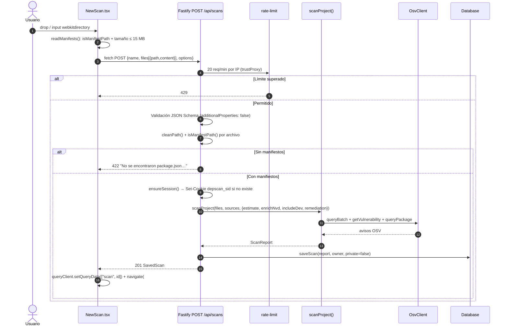

## Secuencia de CU-02: Revisar un repositorio de GitHub

| Atributo | Detalle |
|---|---|
| Actores | Visitante / Usuario registrado; GitHub (API y raw); bases de avisos |
| Módulo / Componentes | Web: `NewScan.tsx`, `GithubRepos.tsx`. API: `POST /api/scans` (`github`). Infraestructura: `fetchGithubProject`, `githubTokenOf`. Núcleo: `scanProject` |
| Requerimientos relacionados | RF-02, RF-03, RF-04, RF-05, RF-06, RF-19; RNF-05, RNF-08 |

La API interpreta `owner/repo@ref`, obtiene el token del usuario (descifrado con AES-256-GCM) o el token del servidor, fija el commit exacto (SHA), recorre el árbol del repositorio y descarga solo los manifiestos con concurrencia 6. El escaneo queda marcado como privado si el repositorio lo es, lo que restringe su lectura al dueño.

**Diagrama de secuencia del CU-02**

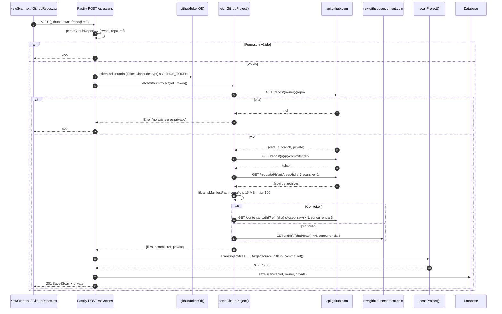

## Secuencia de CU-03: Consultar el resultado y el detalle de las fallas

| Atributo | Detalle |
|---|---|
| Actores | Visitante / Usuario registrado; OSV |
| Módulo / Componentes | Web: `ScanResult.tsx`, `FindingsTable.tsx`, `VulnDrawer.tsx`. API: `GET /api/scans/:id`, `GET /api/vulns/:id`. Infraestructura: `OsvClient`, caché SQLite |
| Requerimientos relacionados | RF-06, RF-07; RNF-03, RNF-05 |

El cliente reutiliza el reporte guardado por TanStack Query; si no lo tiene, lo pide a la API, que aplica `readable()` para ocultar escaneos privados ajenos. El detalle de cada aviso se obtiene bajo demanda desde OSV a través de la caché de 24 horas (patrón cache-aside).

**Diagrama de secuencia del CU-03**

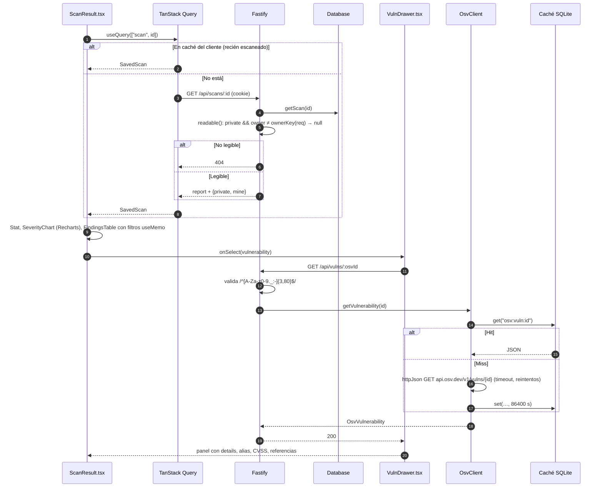

## Secuencia de CU-04: Ver la solución de una librería

| Atributo | Detalle |
|---|---|
| Actores | Visitante / Usuario registrado |
| Módulo / Componentes | Web: `RemediationDrawer.tsx`, API Clipboard. Núcleo (en tiempo de escaneo): `buildRemediation` |
| Requerimientos relacionados | RF-08, RF-09, RF-10, RF-11; RNF-07 |

La remediación se calcula durante el escaneo y viaja dentro del reporte (`Finding.remediation`); el panel no hace llamadas al servidor. El cálculo ocurre en `buildRemediation`: se obtienen todos los avisos del paquete y todas sus versiones publicadas, y cada versión estable se evalúa contra todos los avisos.

**Diagrama de secuencia del CU-04**

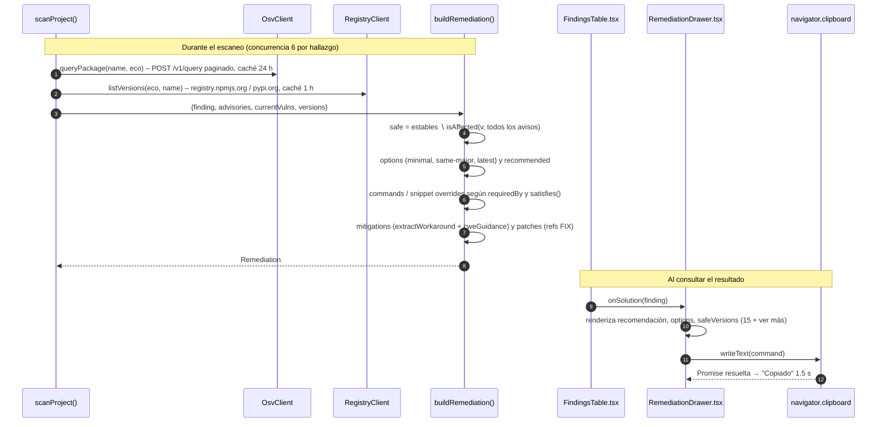

## Secuencia de CU-05: Descargar el informe

| Atributo | Detalle |
|---|---|
| Actores | Visitante / Usuario registrado / Docente |
| Módulo / Componentes | Web: `ScanResult.tsx`. API: `GET /api/scans/:id/report.html`, `GET /api/scans/:id/report.pdf`. Reportes: `renderHtml` (núcleo), `renderPdf` (pdfkit) |
| Requerimientos relacionados | RF-12; RNF-08 |

La API verifica el acceso al escaneo y genera el documento en el servidor: HTML autocontenido con `renderHtml` del núcleo o PDF con pdfkit. Ambos incluyen fecha, versión del escáner y commit analizado, y se entregan con `Content-Disposition: attachment`.

**Diagrama de secuencia del CU-05**

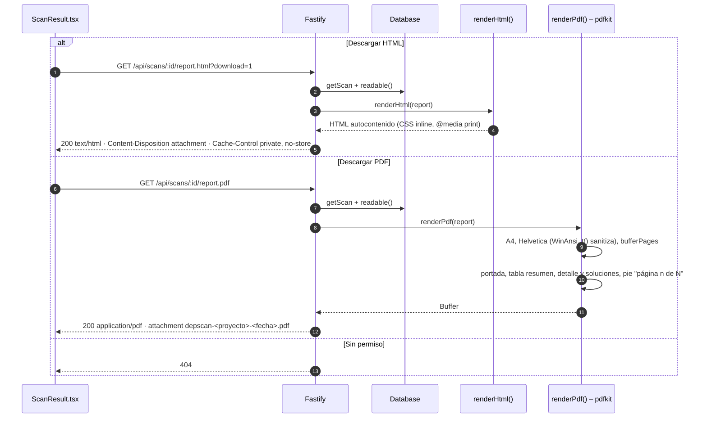

## Secuencia de CU-06: Iniciar sesión y unir cuentas

| Atributo | Detalle |
|---|---|
| Actores | Visitante; Google OAuth; GitHub OAuth |
| Módulo / Componentes | Web: `Login.tsx`, `UserMenu.tsx`, `lib/auth.ts`. API: `GET /api/auth/:provider/login`, `/callback`. Seguridad: `TokenCipher`. Persistencia: `Database` |
| Requerimientos relacionados | RF-13; RNF-04, RNF-11 |

Flujo OAuth 2.0 *authorization code* implementado sin librerías externas: `state` ligado a la sesión, PKCE S256 en Google, intercambio del código en el servidor, resolución del usuario (identidad, sesión o correo verificado), cifrado del token de GitHub, transferencia de los escaneos anónimos y rotación del identificador de sesión.

**Diagrama de secuencia del CU-06**

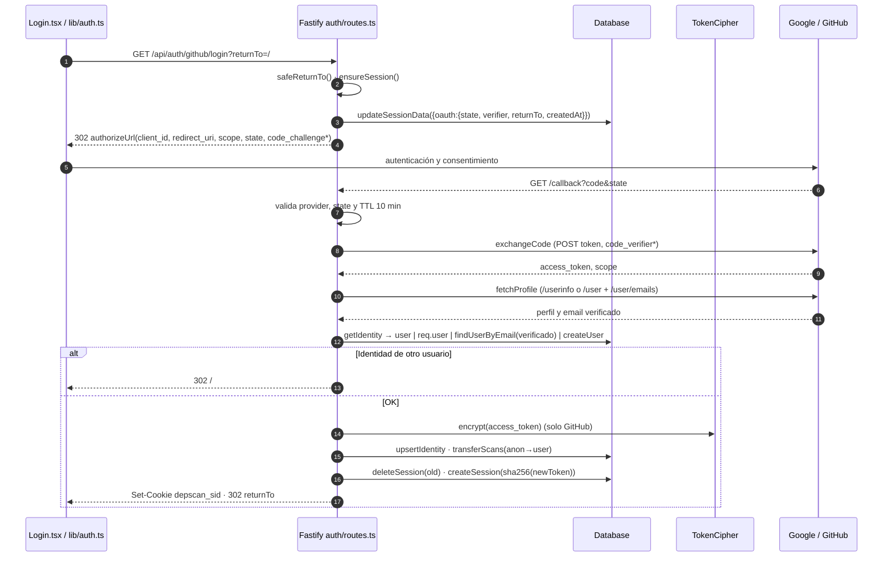

## Secuencia de CU-07: Revisar mis repositorios de GitHub

| Atributo | Detalle |
|---|---|
| Actores | Usuario registrado; GitHub |
| Módulo / Componentes | Web: `GithubRepos.tsx`. API: `GET /api/auth/me`, `GET /api/github/repos`, `POST /api/scans`. Infraestructura: `listGithubRepos`, `githubTokenOf` |
| Requerimientos relacionados | RF-14, RF-02; RNF-04, RNF-05 |

Con la identidad de GitHub vinculada, la API lista los repositorios del usuario (incluidos privados) con su token cifrado y, al elegir uno, reutiliza el flujo técnico del CU-02.

**Diagrama de secuencia del CU-07**

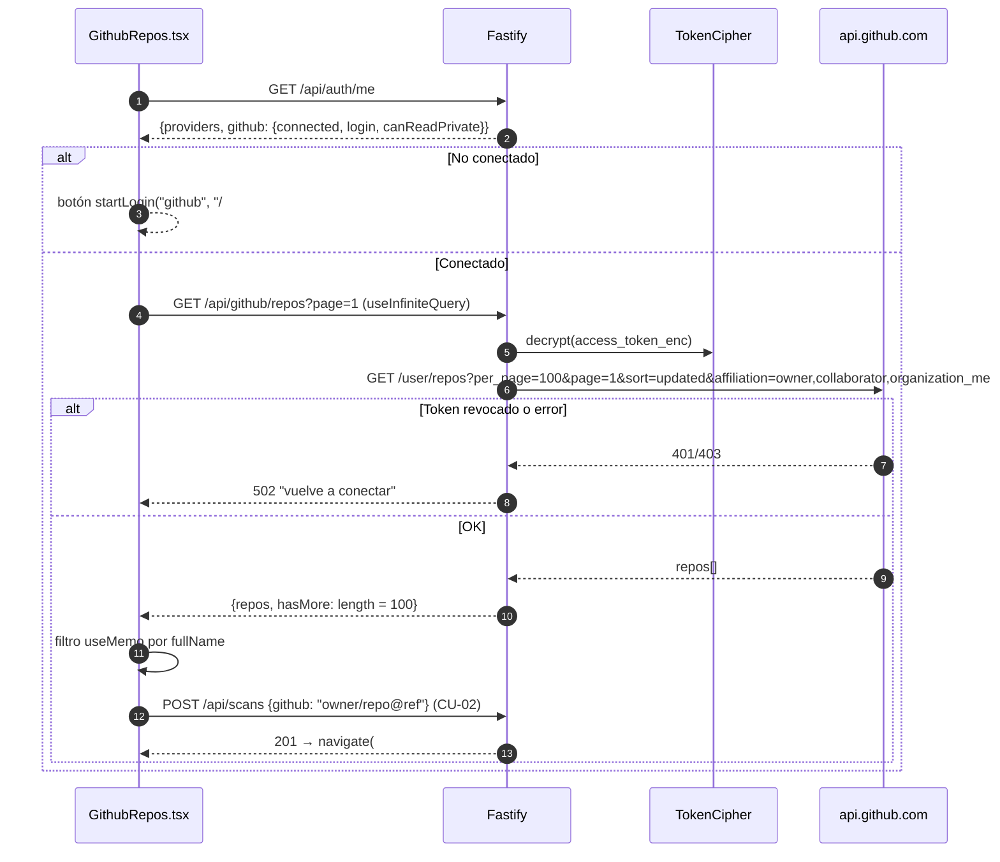

## Secuencia de CU-08: Consultar, comparar y eliminar revisiones del historial

| Atributo | Detalle |
|---|---|
| Actores | Visitante / Usuario registrado |
| Módulo / Componentes | Web: `History.tsx`, `Compare.tsx`. API: `GET /api/scans`, `GET /api/scans/:id`, `DELETE /api/scans/:id`. Persistencia: `Database.listScans`, `deleteScan`, `ownerKey` |
| Requerimientos relacionados | RF-15, RF-16, RF-17; RNF-05 |

El historial se filtra por la clave de dueño (`user:<id>` o `anon:<sesión>`). La comparación se calcula en el cliente a partir de dos reportes (fallas nuevas, corregidas y persistentes) y el borrado solo procede si el solicitante es el dueño.

**Diagrama de secuencia del CU-08**

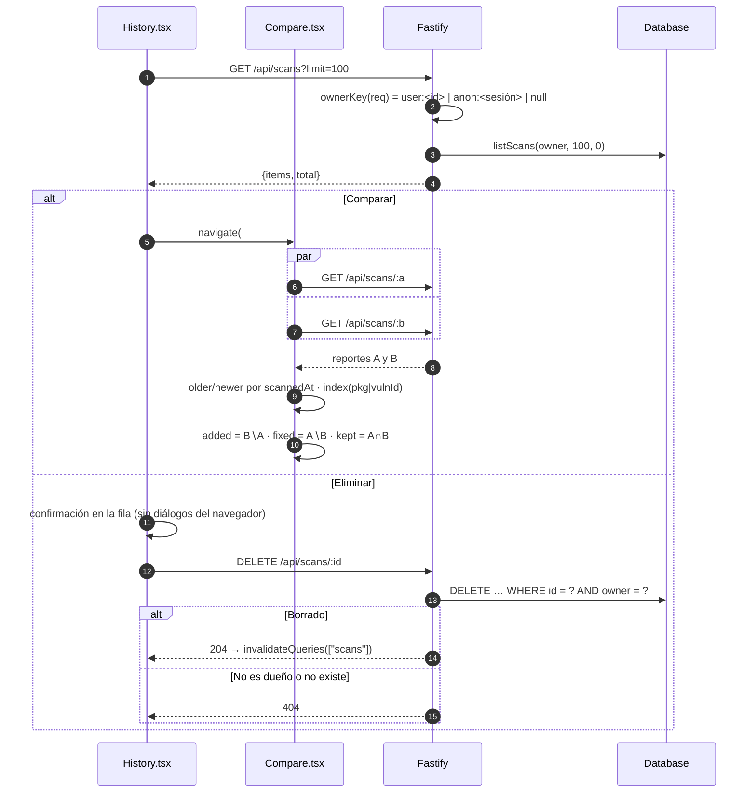

## Secuencia de CU-09: Revisión automática en cada cambio

| Atributo | Detalle |
|---|---|
| Actores | Revisión automática (GitHub Actions); bases de avisos |
| Módulo / Componentes | CI: `.github/workflows/ci.yml`. CLI: `apps/cli` (`readProjectDirectory`, `shouldFail`). Núcleo: `scanProject`, `renderHtml` |
| Requerimientos relacionados | RF-18; RNF-10 |

El flujo de integración continua compila el proyecto y ejecuta la CLI sobre el propio repositorio con `--fail-on`. La CLI lee los manifiestos del disco, usa el mismo núcleo que la API y termina con código de salida 1 cuando existe una falla igual o más grave que el umbral, lo que detiene la entrega.

**Diagrama de secuencia del CU-09**

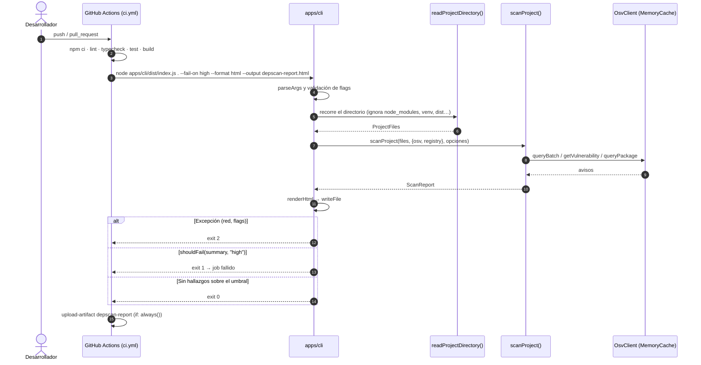

## Secuencia de CU-10: Cerrar sesión o desconectar GitHub

| Atributo | Detalle |
|---|---|
| Actores | Usuario registrado |
| Módulo / Componentes | Web: `UserMenu.tsx`, `GithubRepos.tsx`. API: `POST /api/auth/logout`, `DELETE /api/auth/github`. Persistencia: `deleteSession`, `clearIdentityToken` |
| Requerimientos relacionados | RF-20; RNF-04 |

El cierre de sesión elimina el registro de sesión y la cookie; la desconexión de GitHub borra el token cifrado de la identidad sin eliminar la cuenta ni el historial.

**Diagrama de secuencia del CU-10**

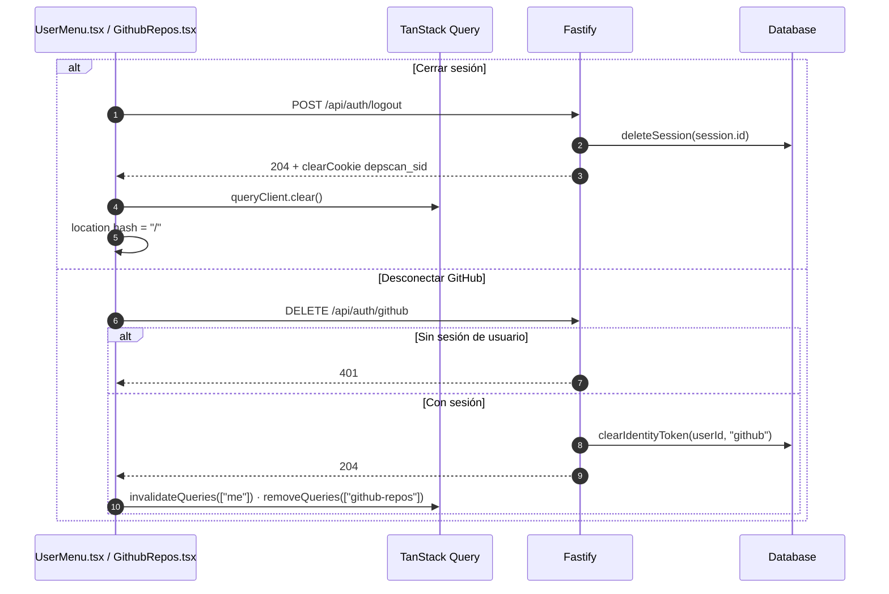

# III. VISTA LÓGICA

## 1. Estilo Arquitectónico

DepScan adopta un **monolito modular cliente-servidor** cuyo núcleo sigue la **arquitectura hexagonal (puertos y adaptadores)**. La SPA en React consume una API REST en Fastify; ambas se sirven desde el mismo proceso. El núcleo (`packages/core`) concentra las reglas del dominio y no depende de ninguna tecnología de entrada o salida: define puertos que implementan los adaptadores de infraestructura.

Se eligió este estilo porque permite reutilizar el mismo motor en la web, la CLI y el benchmark; probarlo sin red; y desplegar un único servicio, lo que reduce el costo y la operación (ver ADR-06 y ADR-07).

## 2. Diagrama de Paquetes

El sistema se organiza en capas concéntricas: el dominio y los casos de uso no dependen de ninguna tecnología de entrada/salida.

**Diagrama de paquetes del sistema**

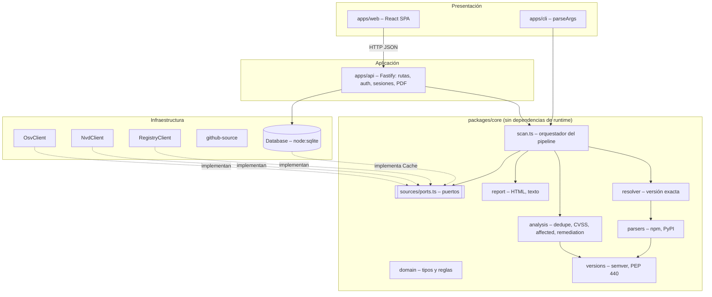

## 3. Descripción de las Capas

| Capa | Responsabilidad | Componentes |
|---|---|---|
| Presentación | Interacción con el usuario: carga de archivos, resultados, remediación, historial, login; y ejecución por consola. | `apps/web` (páginas, componentes, `lib/api`), `apps/cli` |
| Aplicación | Exponer la API REST, validar entradas, autenticar, controlar acceso por dueño, generar PDF y servir la SPA. | `apps/api` (`app.ts`, `auth/`, `report/pdf`) |
| Dominio (núcleo) | Resolver versiones, detectar y deduplicar avisos, calcular severidad, riesgo y remediación, y generar reportes. | `packages/core` (`scan.ts`, `domain`, `analysis`, `versions`, `parsers`, `resolver`, `report`) |
| Infraestructura | Acceso a servicios externos y persistencia mediante adaptadores de los puertos del núcleo. | `OsvClient`, `NvdClient`, `RegistryClient`, `github-source`, `Database` (SQLite) |

## 4. Diagrama de Clases de Dominio

El reporte de escaneo (`ScanReport`) es la raíz del agregado: contiene el objetivo analizado, el resumen, las dependencias y los hallazgos; cada hallazgo agrupa los avisos deduplicados de una dependencia y su remediación.

**Diagrama de clases de dominio**

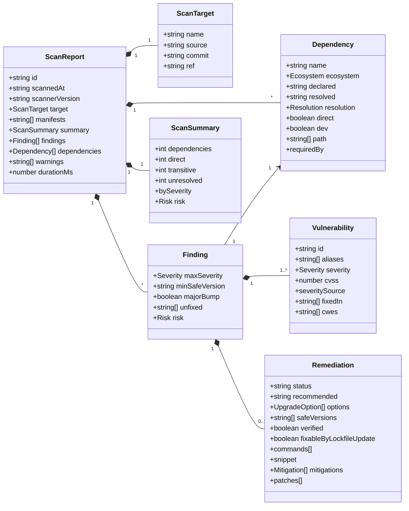

| Entidad | Descripción |
|---|---|
| `ScanReport` | Resultado completo de un escaneo, con fecha, versión del escáner y duración. |
| `ScanTarget` | Proyecto analizado: nombre, origen (archivos o GitHub), commit y rama. |
| `Dependency` | Librería con su ecosistema, versión declarada y resuelta, forma de resolución y cadena de dependencia. |
| `Finding` | Hallazgo de una dependencia vulnerable: severidad máxima, versión mínima segura y riesgo. |
| `Vulnerability` | Aviso normalizado y deduplicado, con alias, CVSS, versiones corregidas y CWE. |
| `Remediation` | Versión recomendada, alternativas seguras, comandos, fragmentos y mitigaciones. |
| `ScanSummary` | Totales por tipo de dependencia y por severidad, y semáforo de riesgo. |

## 5. Diagrama de Interfaces de la Capa de Servicios

Los puertos del núcleo son los contratos de la capa de servicios; cada uno tiene uno o más adaptadores intercambiables.

**Diagrama de interfaces (puertos y adaptadores)**

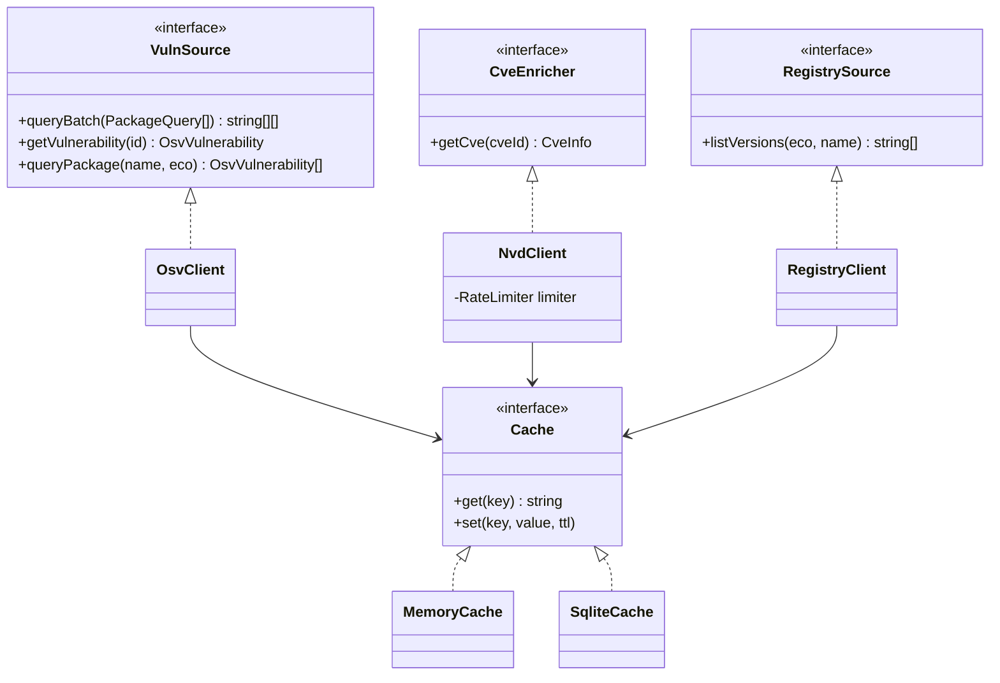

| Interfaz (puerto) | Contrato | Adaptadores |
|---|---|---|
| `VulnSource` | Consultar avisos en lote, el detalle de un aviso y todos los avisos de un paquete. | `OsvClient` |
| `CveEnricher` | Obtener el CVSS oficial de un CVE. | `NvdClient` (con `RateLimiter`) |
| `RegistrySource` | Listar las versiones publicadas de un paquete. | `RegistryClient` (npm y PyPI) |
| `Cache` | Leer y escribir valores con tiempo de vida. | `MemoryCache`, caché SQLite |

**Interfaz REST de la API**

| Método | Ruta | Responsabilidad | Acceso |
|---|---|---|---|
| POST | `/api/scans` | Escanear archivos (`files`) o repositorio (`github`) | Público, 20/min por IP |
| GET | `/api/scans` | Historial del dueño actual | Sesión |
| GET | `/api/scans/:id` | Reporte completo | Dueño si es privado |
| GET | `/api/scans/:id/report.html` · `.pdf` | Descargas | Dueño si es privado |
| DELETE | `/api/scans/:id` | Eliminar | Solo dueño |
| GET | `/api/vulns/:id` | Detalle OSV (con caché) | Público |
| GET | `/api/auth/me` | Usuario, proveedores y estado de GitHub | Público |
| GET | `/api/auth/:provider/login` · `/callback` | Flujo OAuth | Público |
| POST | `/api/auth/logout` · DELETE `/api/auth/github` | Cerrar sesión / desconectar | Sesión |
| GET | `/api/github/repos` | Repositorios del usuario | Usuario con GitHub |
| GET | `/api/health` | Healthcheck de Railway | Público |

# IV. VISTA DE PROCESOS

DepScan se ejecuta como un único proceso Node.js. Las operaciones de entrada/salida son asíncronas y la concurrencia hacia servicios externos se limita con `mapLimit` para respetar sus cuotas.

**Pipeline de escaneo**

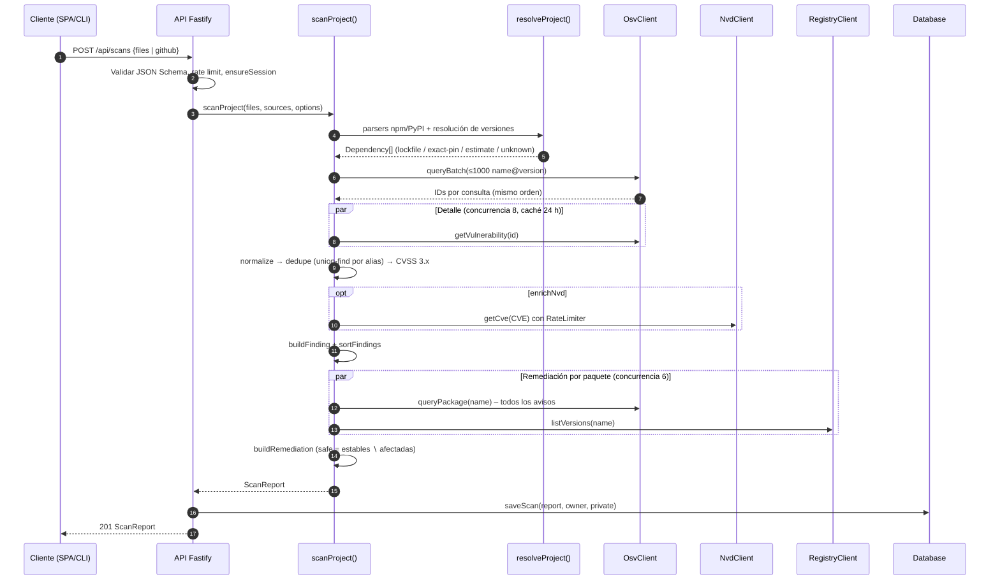

**Algoritmo de versiones seguras.** Para un paquete *p* con versiones estables *V* y avisos *A*, la versión *v* es segura si para todo *a ∈ A* `isAffected(v, a.affected) = false`. La evaluación recorre los eventos OSV ordenados: `introduced` abre el intervalo, `fixed` lo cierra de forma exclusiva y `last_affected` de forma inclusiva. La recomendada es `max{v ∈ seguras : v > actual ∧ mayor(v) = mayor(actual)}`; si no existe, `min{v ∈ seguras : v > actual}` marcada como `breaking`.

**Autenticación OAuth**

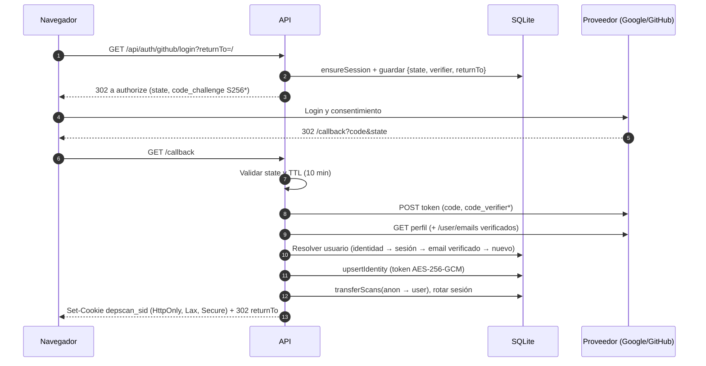

\* PKCE se aplica en Google; en GitHub la protección es `state` + secreto de cliente.

| Proceso | Tipo | Concurrencia / periodicidad |
|---|---|---|
| Atención de solicitudes HTTP | Asíncrono (bucle de eventos) | Ilimitado, con 20 escaneos/min por IP |
| Detalle de avisos OSV | Asíncrono con caché | 8 en paralelo, caché 24 h |
| Remediación por paquete | Asíncrono con caché | 6 en paralelo |
| Descarga de manifiestos de GitHub | Asíncrono | 6 en paralelo, máx. 100 archivos |
| Enriquecimiento NVD | Secuencial limitado | 5 (o 50 con clave) solicitudes cada 30 s |
| Purga de caché y sesiones vencidas | Temporizador | Cada 6 horas |

# V. VISTA DE DESPLIEGUE

El sistema se despliega como un único contenedor en Railway con un volumen persistente; el navegador y la integración continua son los clientes, y OSV, NVD, los registros, GitHub y Google son servicios externos consumidos por HTTPS.

**Diagrama de despliegue**

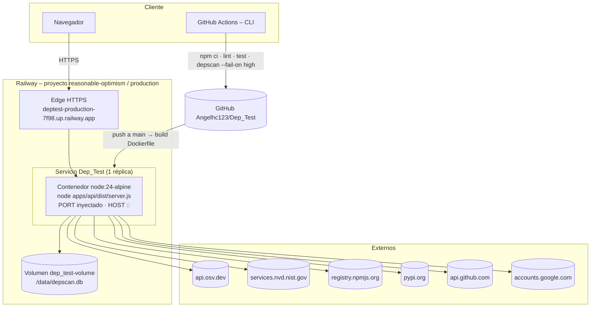

**Pipeline de construcción (Dockerfile multi-etapa)**

| Etapa | Acción |
|---|---|
| `build` | Copia los `package.json` (capa cacheable), `npm ci`, copia el código, `npm run build` (`tsc -b` + `vite build`), `npm prune --omit=dev`. |
| `runtime` | Copia solo `node_modules` de producción y los `dist/` de core, api, cli y web. `CMD node --disable-warning=ExperimentalWarning apps/api/dist/server.js`. |

**Configuración (variables de entorno)**

| Variable | Uso | Obligatoria |
|---|---|---|
| `PORT` | Puerto HTTP (inyectado por Railway) | Sí (automática) |
| `DATA_DIR` | Ruta del volumen (`/data`) | Sí |
| `SESSION_SECRET` | Derivación de clave AES para tokens OAuth | Sí, con login |
| `GOOGLE_CLIENT_ID/SECRET` | OAuth Google | Opcional |
| `GITHUB_CLIENT_ID/SECRET` | OAuth GitHub | Opcional |
| `PUBLIC_URL` | URL de retorno OAuth (por defecto `RAILWAY_PUBLIC_DOMAIN`) | No |
| `NVD_API_KEY`, `GITHUB_TOKEN` | Límites de API ampliados | No |

**Ciclo de vida.** Railway espera a que `/api/health` responda (timeout 60 s) antes de enrutar tráfico a la nueva versión y envía `SIGTERM` a la anterior; el servidor cierra Fastify y la base de datos ordenadamente. Política de reinicio `ON_FAILURE` con 5 reintentos.

# VI. VISTA DE IMPLEMENTACIÓN

El código se organiza como un monorepo de npm workspaces; cada paquete se compila con `tsc -b` y *project references*, lo que fija los límites de dependencia entre ellos.

**Diagrama de componentes**

```mermaid
flowchart LR
    subgraph Browser
      SPA[SPA React<br/>pages, components, lib/api]
    end
    subgraph Contenedor["Contenedor Node 24"]
      subgraph Fastify
        R1[/api/scans/]
        R2[/api/auth/*/]
        R3[/api/github/repos/]
        R4[/api/vulns/:id/]
        R5[/api/health/]
        ST[@fastify/static – SPA]
      end
      AUTH[auth: routes, providers, crypto]
      PDF[report/pdf – pdfkit]
      CORE[@depscan/core]
      SQL[(depscan.db)]
    end
    SPA --> R1 & R2 & R3 & R4
    R1 --> CORE
    R1 --> PDF
    R1 --> SQL
    R2 --> AUTH --> SQL
    R3 --> AUTH
    CORE --> EXT[(OSV · NVD · npm · PyPI · GitHub)]
    AUTH --> IDP[(Google · GitHub OAuth)]
```

| Carpeta | Componente lógico | Contenido principal |
|---|---|---|
| `packages/core/src/parsers` | Parsers | Lectura de `package.json`, `package-lock.json` (v1–v3) y `requirements*.txt` |
| `packages/core/src/versions` | Comparadores | SemVer y PEP 440 propios (fachada `index.ts`) |
| `packages/core/src/resolver` | Resolución | Versión exacta: lockfile, pin exacto, estimación o desconocida |
| `packages/core/src/sources` | Puertos y adaptadores | `ports.ts`, `OsvClient`, `NvdClient`, `RegistryClient`, `github-source`, `httpJson` |
| `packages/core/src/analysis` | Análisis | Deduplicación, CVSS, rangos afectados, CWE y remediación |
| `packages/core/src/report` | Reportes | HTML y texto |
| `packages/core/src/scan.ts` | Orquestador | Pipeline `scanProject` |
| `apps/api/src` | Aplicación | `app.ts` (rutas), `auth/`, `db.ts`, `report/` (PDF), `server.ts` |
| `apps/web/src` | Presentación web | `pages/`, `components/`, `lib/` |
| `apps/cli/src` | Presentación CLI | `index.ts` |
| `benchmark/` | Validación | Comparación contra `npm audit` |

# VII. VISTA DE DATOS

La persistencia usa SQLite con cinco tablas. Un usuario puede tener varias identidades (Google y GitHub); los escaneos pertenecen a un usuario o, si no inició sesión, a una sesión anónima.

**Modelo entidad-relación**

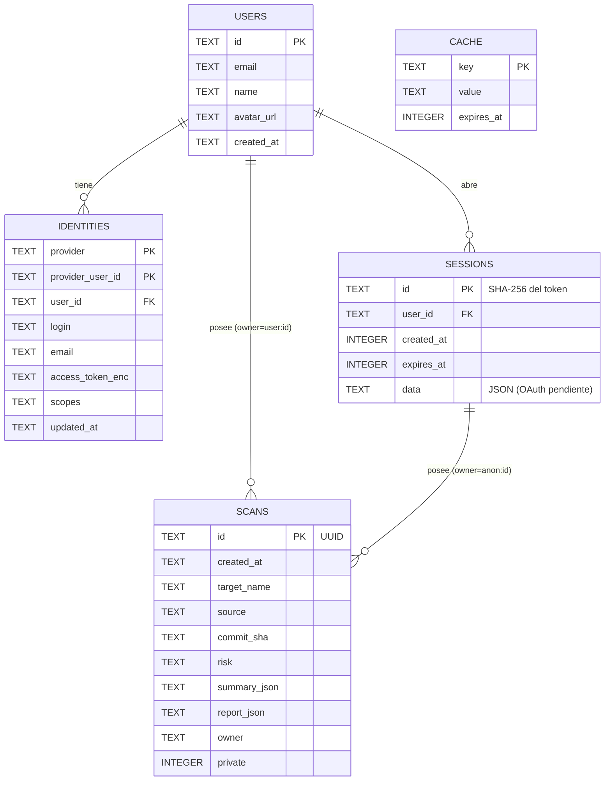

| Tabla | Propósito |
|---|---|
| `users` | Cuenta de usuario con correo, nombre y avatar. |
| `identities` | Identidad por proveedor (Google o GitHub); guarda el token de GitHub cifrado. |
| `sessions` | Sesiones activas; el identificador es el hash SHA-256 del token de la cookie. |
| `scans` | Escaneos con su resumen, el reporte completo en JSON, el dueño y la marca de privado. |
| `cache` | Respuestas de servicios externos con fecha de expiración. |

Las migraciones son versionadas con `PRAGMA user_version` y se aplican en una transacción al iniciar. El modo `WAL` mejora la lectura concurrente; la tabla `cache` se purga cada 6 horas junto con las sesiones vencidas.

# VIII. PATRONES DE DISEÑO APLICADOS

| Patrón | Dónde | Propósito |
|---|---|---|
| **Arquitectura hexagonal (puertos y adaptadores)** | `packages/core/src/sources/ports.ts` y adaptadores | El dominio no conoce HTTP ni SQLite; las fuentes se sustituyen por dobles en las pruebas. |
| **Inyección de dependencias** | `scanProject(files, sources, opts)`, `buildApp({ sources, fetchImpl })` | Probar el pipeline y el OAuth completos sin red. |
| **Pipeline** | `scan.ts` | Etapas encadenadas con progreso (`onProgress`). |
| **Fachada** | `versions/index.ts` (`compareVersions`, `satisfies`, `maxSatisfying`) | Ocultar la diferencia entre semver y PEP 440 al resto del motor. |
| **Estrategia** | Comparador según ecosistema; formato de reporte (HTML, texto, PDF, JSON) | Elegir el algoritmo en tiempo de ejecución. |
| **Repositorio** | Clase `Database` (`saveScan`, `listScans`, `getIdentity`…) | Aislar el acceso a datos; facilita migrar a PostgreSQL. |
| **Decorador / Cache-aside** | `cached(cache, key, ttl, load)` | Añadir caché a cualquier consulta externa. |
| **Retry con backoff** | `httpJson` | Tolerar errores 429/5xx transitorios. |
| **Rate limiter (ventana deslizante)** | `RateLimiter` para NVD; `@fastify/rate-limit` en la API | Respetar cuotas externas y proteger el servicio. |
| **Union-Find** | `dedupe()` | Agrupar avisos que comparten alias de forma transitiva. |
| **SPA con enrutado por hash** | `lib/router.ts` | Rutas del cliente sin configuración del servidor. |
| **Monorepo con *project references*** | `tsc -b` | Compilación incremental y límites claros entre paquetes. |

# IX. DECISIONES ARQUITECTÓNICAS

Las decisiones se registran con el formato ADR (Contexto, Decisión y Consecuencias). Las versiones completas de ADR-01, ADR-02, ADR-07, ADR-09 y ADR-10 se encuentran en `docs/decisiones/` del repositorio.

## ADR-01: OSV como fuente principal y NVD solo para enriquecer por CVE

### Contexto

Se necesita una base de vulnerabilidades consultable por paquete y versión para npm y PyPI. NVD busca por CPE, con cobertura pobre para paquetes de npm, y sin clave permite solo 5 solicitudes cada 30 segundos.

### Decisión

OSV es la fuente de verdad: `/v1/querybatch` (hasta 1000 consultas por lote) y `/v1/vulns/{id}` para el detalle. NVD se consulta solo por identificador CVE para obtener el CVSS oficial, es opcional y respeta su límite de uso. La severidad se toma en el orden: CVSS de NVD, CVSS 3.x calculado desde el vector de OSV, etiqueta de GHSA y "sin dato". Se descartaron NVD por nombre de paquete y la consulta directa a GitHub Advisory Database.

### Consecuencias

Un proyecto de 1000 dependencias se resuelve con una llamada en lote más una llamada por aviso único, con caché. La calculadora CVSS 3.x es código propio y probado. CVSS 4.0 no se calcula localmente; si OSV solo trae ese vector, se usa la etiqueta de GHSA o NVD.

## ADR-02: Comparadores de versiones propios (semver y PEP 440)

### Contexto

Para resolver rangos sin lockfile, decidir si una versión cae en un rango afectado y calcular versiones seguras es necesario comparar versiones de npm (SemVer 2.0.0 y rangos de npm) y de Python (PEP 440).

### Decisión

Se implementaron `semver.ts` y `pep440.ts` en `packages/core/src/versions/`, con rangos `^`, `~`, x-ranges, guiones y `||`, y especificadores `==`, `!=`, `~=`, `>=`, `<=`, `>`, `<`, `===` y `.*`. Se descartó el uso de la librería `semver` y de un port de `packaging`.

### Consecuencias

El núcleo mantiene cero dependencias de runtime y las pruebas usan los casos de las especificaciones oficiales. El riesgo de casos borde no cubiertos se mitiga con el benchmark contra `npm audit`.

## ADR-03: TypeScript en todo el stack

### Contexto

El proyecto debe desarrollarse solo con Visual Studio Code, con frontend en React, y la web debe mostrar exactamente los tipos que produce el motor.

### Decisión

Se usa TypeScript (ESM, modo `strict`) en el núcleo, la API, la CLI y la web, organizado como monorepo con npm workspaces y *project references*. Se descartaron Python o Java para el backend.

### Consecuencias

Los tipos del dominio se comparten sin duplicación (la web los importa con `import type`), hay una sola cadena de herramientas (`tsc`, ESLint, Prettier, Vitest) y la compilación es incremental.

## ADR-04: Fastify como framework HTTP

### Contexto

La API necesita validación estricta de entradas, limitación de tasa, cookies y servir la SPA, con bajo consumo de memoria en un plan pequeño de Railway.

### Decisión

Se eligió Fastify 5 con `@fastify/cookie`, `@fastify/rate-limit` y `@fastify/static`, y validación por JSON Schema. Se descartaron Express y NestJS.

### Consecuencias

Validación declarativa con `additionalProperties: false`, buen rendimiento y pocas dependencias. A cambio, la estructura modular debe mantenerse por convención, sin el andamiaje de un framework mayor.

## ADR-05: SQLite nativo en volumen persistente

### Contexto

Se debe persistir el historial, las sesiones, las identidades y la caché de consultas externas con el menor costo de operación posible.

### Decisión

Se usa `node:sqlite` (`DatabaseSync`) en modo WAL sobre el volumen `/data` de Railway, con migraciones versionadas por `PRAGMA user_version`. Se descartó PostgreSQL por requerir un servicio adicional.

### Consecuencias

No hay servidor de base de datos que administrar ni costo extra. La restricción es operar con una sola réplica; el acceso está aislado en la clase `Database` (patrón repositorio), lo que permite migrar a PostgreSQL si el uso crece.

## ADR-06: Arquitectura hexagonal en el núcleo

### Contexto

El mismo motor de análisis debe servir a la API, a la CLI y al benchmark, y debe poder probarse sin acceso a red.

### Decisión

El núcleo define puertos (`VulnSource`, `CveEnricher`, `RegistrySource`, `Cache`) y recibe sus adaptadores por inyección de dependencias (`scanProject(files, sources, opts)`). Se descartó ubicar la lógica dentro de la API.

### Consecuencias

El núcleo no conoce HTTP ni SQLite; las 97 pruebas automatizadas sustituyen las fuentes por dobles. Agregar una nueva fuente de avisos solo requiere un adaptador nuevo.

## ADR-07: Despliegue como un solo servicio en Railway

### Contexto

El sistema tiene una API, una web estática y necesita persistir datos; se despliega en Railway.

### Decisión

Una sola imagen Docker multi-etapa: Fastify sirve `/api/*` y el build de React en `/`, con healthcheck en `/api/health`, cierre ordenado ante `SIGTERM` y `trustProxy` para obtener la IP real. Se descartaron dos servicios separados y Nixpacks sin Dockerfile.

### Consecuencias

Un solo dominio, sin configuración CORS y con un único despliegue por `git push`. El contenedor se ejecuta como root por los permisos del volumen montado.

## ADR-08: Escaneo de repositorios de GitHub por commit exacto

### Contexto

En un servidor no existe la carpeta local del usuario, y un resultado debe poder reproducirse aunque el repositorio cambie después.

### Decisión

Se agregó el escaneo de repositorios de GitHub: se fija el SHA del commit de la rama solicitada y se descargan solo los manifiestos de ese commit. Se descartó admitir únicamente la subida de archivos.

### Consecuencias

Cada reporte de GitHub registra el commit analizado, lo que lo hace reproducible y verificable. Se depende de la disponibilidad y de los límites de la API de GitHub (60 solicitudes por hora sin token).

## ADR-09: OAuth propio con Google y GitHub

### Contexto

Se requiere iniciar sesión con Google y GitHub y acceder a repositorios privados, sin manejar contraseñas.

### Decisión

Flujo OAuth 2.0 *authorization code* implementado en `apps/api/src/auth/` con `fetch` nativo, `state` contra CSRF y PKCE S256 en Google. Sesión opaca en cookie `HttpOnly`/`SameSite=Lax`/`Secure` cuyo hash SHA-256 se guarda en la base; token de GitHub cifrado con AES-256-GCM. Se descartaron Passport/Auth.js y una GitHub App.

### Consecuencias

Sin credenciales configuradas, la aplicación funciona sin login. Si cambia `SESSION_SECRET`, los tokens guardados dejan de servir y el usuario debe reconectar GitHub. GitHub requiere el scope `repo`, más amplio que solo lectura.

## ADR-10: Versiones seguras verificadas contra todos los avisos

### Contexto

No basta con indicar que una librería es vulnerable: se debe recomendar a qué versión pasar, listar todas las versiones seguras e indicar cómo protegerse si no se puede actualizar.

### Decisión

El módulo `remediation.ts` obtiene todos los avisos del paquete y todas sus versiones publicadas, y evalúa cada versión estable contra todos los avisos. La recomendada es la más nueva sin fallas dentro de la misma versión mayor; si no existe, la mínima segura, marcada como salto mayor. Se descartó usar solo la versión "fixed" de un aviso aislado.

### Consecuencias

Se hacen N consultas extra a OSV y N al registro por cada paquete vulnerable (concurrencia 6 y caché); en NodeGoat, unos 18 segundos la primera vez. "Seguro" significa "sin avisos conocidos hoy", y el reporte lo declara.

## ADR-11: Generación de PDF con pdfkit

### Contexto

El usuario y el docente necesitan un informe PDF descargable como evidencia formal.

### Decisión

El PDF se genera en el servidor con pdfkit, dibujando directamente el contenido del reporte. Se descartó Chrome headless.

### Consecuencias

La imagen del contenedor es mucho más liviana y el consumo de memoria es bajo. El diseño del PDF se programa a mano y no reutiliza los estilos del HTML.

## Decisiones de seguridad

| Amenaza | Control |
|---|---|
| CSRF en OAuth | Parámetro `state` aleatorio ligado a la sesión, con expiración de 10 minutos. |
| Robo del código de autorización | PKCE S256 (Google) y secreto de cliente en el servidor. |
| Fijación de sesión | Rotación del token de sesión tras autenticar. |
| Robo de cookies | `HttpOnly`, `SameSite=Lax`, `Secure` en HTTPS; en la base solo se guarda el SHA-256 del token. |
| Fuga de tokens OAuth | AES-256-GCM con clave derivada de `SESSION_SECRET`. |
| Redirección abierta | `returnTo` solo acepta rutas internas (`/…`, nunca `//`). |
| Acceso a escaneos ajenos | `owner` y `private` validados en cada lectura y borrado. |
| *Path traversal* en archivos subidos | Normalización de rutas y lista blanca de nombres de manifiestos. |
| Abuso del servicio | 20 escaneos/min por IP, `bodyLimit` 25 MB, máx. 200 archivos. |
| Vinculación indebida de cuentas | Unión por email solo si el proveedor lo marca como verificado. |

# X. ATRIBUTOS DE CALIDAD

| Atributo | Escenario | Métrica / Criterio |
|---|---|---|
| Rendimiento (RNF-01) | Se escanea un proyecto de más de 1000 dependencias con remediación. | Menos de 60 s; consulta OSV en un solo lote. |
| Usabilidad (RNF-02) | Un estudiante revisa su proyecto por primera vez. | Máximo tres pasos; interfaz en español. |
| Adaptabilidad (RNF-03) | Se abre el resultado en un celular. | Diseño responsivo con Tailwind; modo claro y oscuro. |
| Seguridad (RNF-04) | Un atacante intenta robar la sesión o el token de GitHub. | Cookie `HttpOnly`/`Secure`, hash SHA-256 de sesión, AES-256-GCM, `state` y PKCE. |
| Privacidad (RNF-05) | Un tercero intenta abrir el escaneo de un repositorio privado. | Respuesta 404; solo se leen manifiestos. |
| Disponibilidad (RNF-06) | El proceso falla o se publica una nueva versión. | Healthcheck `/api/health`, reinicio `ON_FAILURE` (5 intentos), cierre ordenado. |
| Corrección (RNF-07) | No hay lockfile para una dependencia. | Se marca "no determinable" o "estimada"; nunca se inventa una versión. |
| Trazabilidad (RNF-08) | Un docente verifica un informe semanas después. | Fecha, versión del escáner y SHA del commit en cada reporte. |
| Protección del servicio (RNF-09) | Un cliente envía escaneos masivos. | 20 escaneos/min por IP, cuerpo máx. 25 MB, máx. 200 archivos. |
| Mantenibilidad (RNF-10) | Se modifica el comparador de versiones. | 97 pruebas automatizadas, lint y typecheck en CI antes de desplegar. |
| Cumplimiento (RNF-11) | Se almacenan datos de una cuenta. | Solo correo, nombre y avatar; tratamiento según la Ley N.º 29733. |

# CONCLUSIONES

1. Los **10 casos de uso** de FD03 tienen su realización técnica con diagrama de secuencia propio, trazada a rutas, componentes y funciones reales del código.
2. La **arquitectura hexagonal** aísla el motor de análisis de toda tecnología externa; gracias a ello, el mismo núcleo sirve a la API, a la CLI y al benchmark, y se prueba completamente sin acceso a red (97 pruebas).
3. El **pipeline de escaneo** combina consulta en lote, concurrencia limitada y caché persistente, lo que permite analizar proyectos de más de 1000 dependencias en segundos.
4. El diseño de la **remediación** es la principal contribución técnica: evalúa cada versión publicada contra todos los avisos del paquete, en lugar de confiar en la versión "corregida" de un aviso aislado.
5. La **seguridad** se abordó por capas: OAuth con `state` y PKCE, sesiones opacas hasheadas, tokens cifrados, control de acceso por dueño y limitación de tasa.
6. El **despliegue** en un único contenedor con volumen persistente reduce la operación a un `git push`, con healthcheck y cierre ordenado. La principal restricción, el uso de una sola réplica por SQLite, está aislada en la clase `Database`, lo que permite migrar a PostgreSQL si el uso crece.

# RECOMENDACIONES

1. Migrar la persistencia a PostgreSQL cuando se requiera más de una réplica; el cambio se limita a la clase `Database`.
2. Sustituir la OAuth App de GitHub por una GitHub App para obtener permisos de solo lectura más finos sobre los repositorios.
3. Incorporar nuevos ecosistemas (Maven, Go, Cargo) agregando parsers y comparadores de versiones, sin modificar el resto del núcleo.
4. Implementar el cálculo local de CVSS 4.0 cuando su adopción en OSV sea mayoritaria.
5. Agregar análisis de alcanzabilidad para reducir los falsos positivos de dependencias que no se ejecutan.
6. Ejecutar el contenedor con un usuario sin privilegios cuando Railway permita ajustar los permisos del volumen.

# BIBLIOGRAFÍA

- Bass, L., Clements, P., y Kazman, R. (2021). *Software architecture in practice* (4.ª ed.). Addison-Wesley.
- Cockburn, A. (2005). Hexagonal architecture. En *Alistair Cockburn*. https://alistair.cockburn.us/hexagonal-architecture/
- Kruchten, P. (1995). The 4+1 view model of architecture. *IEEE Software*, *12*(6), 42–50. https://doi.org/10.1109/52.469759
- Kruchten, P. (2003). *The Rational Unified Process: An introduction* (3.ª ed.). Addison-Wesley.

# WEBGRAFÍA

- Fastify. (2026). *Fastify documentation*. https://fastify.dev/docs/latest/
- Google. (2026). *OSV API*. Open Source Vulnerabilities. https://google.github.io/osv.dev/api/
- IETF. (2015). *RFC 7636: Proof Key for Code Exchange by OAuth Public Clients*. https://www.rfc-editor.org/rfc/rfc7636
- National Institute of Standards and Technology. (2026). *NVD CVE API 2.0*. https://nvd.nist.gov/developers/vulnerabilities
- OWASP Foundation. (2021). *A06:2021 – Vulnerable and Outdated Components*. https://owasp.org/Top10/A06_2021-Vulnerable_and_Outdated_Components/
- Railway. (2026). *Railway documentation*. https://docs.railway.com/
