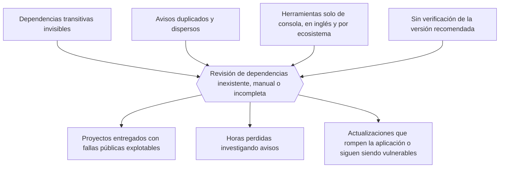
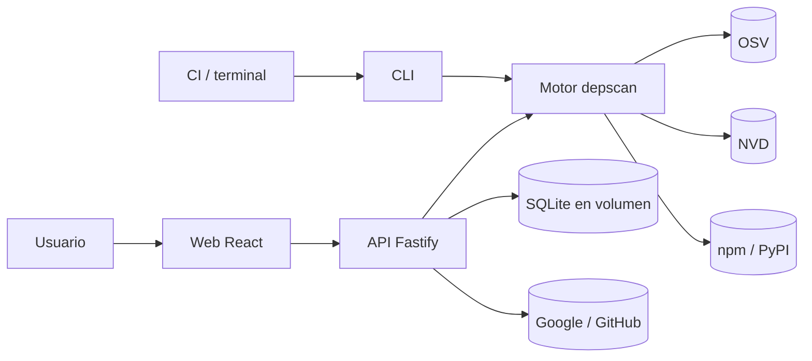
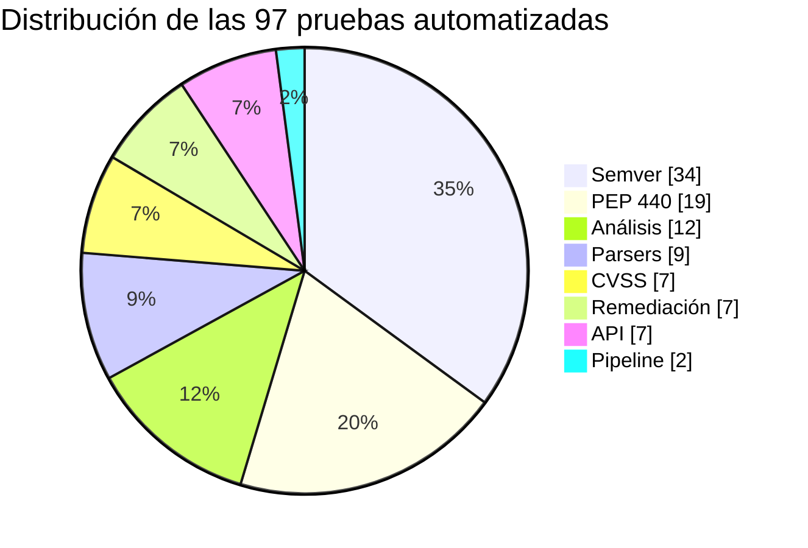
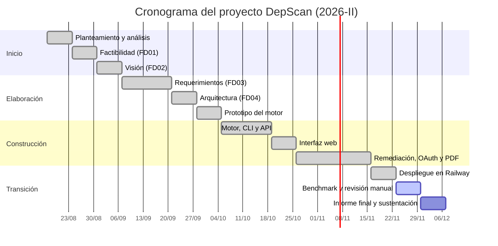

UNIVERSIDAD PRIVADA DE TACNA

FACULTAD DE INGENIERIA

Escuela Profesional de Ingeniería de Sistemas

**DepScan: Sistema Web de Detección y Remediación de Dependencias Vulnerables**

**Integrante:**

Angel Gadiel Hernandez Cruz

Tacna – Perú

2026

---

## INDICE GENERAL

- 1. Antecedentes
- 2. Planteamiento del Problema
- 3. Objetivos
- 4. Desarrollo de la Solución
- 5. Cronograma
- 6. Presupuesto
- 7. Conclusiones
- 8. Recomendaciones
- 9. Bibliografía

---

# 1. Antecedentes

**Incidentes que motivan el proyecto**

| Año | Caso | Componente vulnerable | Consecuencia |
|---|---|---|---|
| 2017 | Equifax | Apache Struts (CVE-2017-5638) | Filtración de datos de ~147 millones de personas; el parche existía dos meses antes del ataque. |
| 2018 | event-stream (npm) | Dependencia transitiva comprometida (`flatmap-stream`) | Código malicioso distribuido a millones de descargas, dirigido a billeteras de criptomonedas. |
| 2021 | Log4Shell | Apache Log4j (CVE-2021-44228, CVSS 10.0) | Ejecución remota de código en miles de sistemas en todo el mundo. |

**Herramientas existentes**

| Herramienta | Tipo | Limitación principal |
|---|---|---|
| `npm audit` | CLI, gratuita | Solo npm; no verifica que la versión sugerida sea segura respecto de otros avisos. |
| `pip-audit` | CLI, gratuita | Solo PyPI. |
| OSV-Scanner (Google) | CLI, gratuita | Lista fallas pero no propone una versión segura verificada ni mitigaciones; en inglés. |
| Snyk, Mend, Sonatype | Plataformas comerciales | Costo por desarrollador; planes gratuitos limitados. |

**Antecedente académico.** El planteamiento original del proyecto (documento `proyecto.md`) identificó que reconstruir solo "leer y consultar" duplicaría una herramienta gratuita. Por eso el proyecto se justifica en el **motor propio**, la **lógica de remediación** y la **medición de resultados reales** contra herramientas reconocidas.

# 2. Planteamiento del Problema

**Problema general.** ¿Cómo detectar, de forma rápida y confiable, las dependencias con vulnerabilidades conocidas en proyectos npm y PyPI, y orientar al desarrollador sobre cómo corregirlas sin introducir nuevas fallas?

**Problemas específicos**

1. Las dependencias transitivas no son visibles en los manifiestos y rara vez se revisan.
2. Los avisos se publican con varios identificadores (CVE, GHSA, PYSEC), lo que infla y confunde los reportes.
3. La "versión corregida" de un aviso puede estar afectada por otro aviso.
4. No existe orientación cuando no hay versión corregida o cuando actualizar implica un cambio mayor.
5. No queda evidencia formal de la revisión para docentes o clientes.

**Árbol de problemas**

# 3. Objetivos

**Objetivo general.** Desarrollar un sistema web que detecte dependencias con vulnerabilidades conocidas en proyectos npm y PyPI y proponga acciones de remediación verificadas.

**Objetivos específicos y grado de cumplimiento**

| N.º | Objetivo específico | Indicador | Resultado | Estado |
|---|---|---|---|---|
| OE1 | Motor propio de lectura de manifiestos y resolución de versiones | Soporte lockfile v1/v2/v3, *workspaces*, `requirements.txt` | Implementado y probado (parsers, resolver, semver, PEP 440) | Cumplido |
| OE2 | Consulta OSV en lote, NVD opcional y deduplicación | Lote ≤ 1000; cero duplicados | Implementado; 4 avisos duplicados de `npm audit` unificados en NodeGoat | Cumplido |
| OE3 | Remediación verificada | Versiones evaluadas contra todos los avisos | 133/133 hallazgos de NodeGoat con remediación verificada | Cumplido |
| OE4 | Interfaz web con login, historial y reportes HTML/PDF | Flujo completo en producción | Desplegado en Railway; login con Google y GitHub probado | Cumplido |
| OE5 | Validación contra herramientas reconocidas | Benchmark reproducible | Coincidencia total con `npm audit` en 3 repositorios npm | Cumplido (PyPI pendiente de comparar) |

# 4. Desarrollo de la Solución

El proyecto se desarrolló con la metodología **RUP**, organizada en cuatro fases.

## 4.1 Fase de Inicio

- Análisis del planteamiento, del caso Equifax y de las APIs de OSV y NVD.
- Estudio de factibilidad (FD01) y documento de visión (FD02).
- Decisión de alcance: npm y PyPI, OSV como fuente principal (ADR-01 de FD04).

## 4.2 Fase de Elaboración

- Especificación de requerimientos (FD03): 20 RF, 11 RNF, 12 reglas de negocio y 10 casos de uso.
- Arquitectura (FD04): monorepo TypeScript con núcleo hexagonal, Fastify, SQLite y React.
- Prototipo del motor: comparadores semver y PEP 440 y parsers.

## 4.3 Fase de Construcción

| Iteración | Entregable | Evidencia |
|---|---|---|
| C1 | Motor: parsers, resolución de versiones, cliente OSV, deduplicación, CVSS | 83 pruebas iniciales |
| C2 | CLI y reporte de texto/HTML/JSON con código de salida | Escaneo del propio repositorio |
| C3 | API Fastify + SQLite, historial | Pruebas de rutas con `inject` |
| C4 | Interfaz React (escaneo, resultados, historial, comparación) | Build de producción |
| C5 | Remediación: versiones seguras, comandos, *overrides*, mitigaciones por CWE, parches | Pruebas de remediación con datos reales |
| C6 | Login OAuth Google/GitHub, repositorios privados, reporte PDF | Flujo OAuth simulado en pruebas y real en producción |

**Arquitectura resultante**

## 4.4 Fase de Transición

- Repositorio publicado en `github.com/Angelhc123/Dep_Test`.
- Despliegue en Railway: un servicio Docker con volumen persistente en `/data`, healthcheck y despliegue automático desde la rama `main`.
- Configuración de las credenciales OAuth en Google Cloud y GitHub con las URLs de producción.
- URL de producción: **https://deptest-production-7f98.up.railway.app**.

## 4.5 Resultados

**a) Pruebas automatizadas**

| Módulo | Archivo de pruebas | Casos |
|---|---|---|
| Semver | `semver.test.ts` | 34 |
| PEP 440 | `pep440.test.ts` | 19 |
| CVSS 3.x | `cvss.test.ts` | 7 |
| Parsers npm y PyPI | `parsers.test.ts` | 9 |
| Análisis (afectación, deduplicación, versión segura) | `analysis.test.ts` | 12 |
| Remediación | `remediation.test.ts` | 7 |
| Pipeline completo | `scan.test.ts` | 2 |
| API (escaneo, privacidad, OAuth, PDF) | `api.test.ts` | 7 |
| **Total** | | **97 (100 % aprobadas)** |

**b) Benchmark contra `npm audit`** (13 de octubre de 2026, repositorios fijados por commit)

| Repositorio | Dependencias | DepScan | npm audit | Coincidentes | Solo DepScan | Solo npm audit |
|---|---|---|---|---|---|---|
| OWASP/NodeGoat | 1091 | 193 | 197 | 193 | 0 | 0 |
| snyk-labs/nodejs-goof | 980 | 228 | 232 | 228 | 0 | 0 |
| cr0hn/vulnerable-node | 124 | 5 | 5 | 5 | 0 | 0 |

No hubo fallas omitidas ni falsos positivos frente a `npm audit`. La diferencia de 4 avisos en dos repositorios se debe a la deduplicación de DepScan: avisos GHSA distintos que comparten el mismo CVE se cuentan una sola vez.

```mermaid
xychart-beta
    title "Hallazgos por repositorio: DepScan vs npm audit"
    x-axis ["NodeGoat", "nodejs-goof", "vulnerable-node"]
    y-axis "Hallazgos" 0 --> 250
    bar [193, 228, 5]
    bar [197, 232, 5]
```

**c) Rendimiento y remediación en un proyecto real (NodeGoat)**

| Métrica | Valor |
|---|---|
| Paquetes vulnerables | 133 |
| Con versión segura publicada | 119 |
| Sin versión segura (se ofrecen mitigaciones) | 14 |
| Remediaciones verificadas contra todos los avisos | 133 (100 %) |
| Transitivas resolubles con `npm update` | 38 |
| Transitivas que requieren `overrides` | 74 |
| Hallazgos con mitigaciones | 120 |
| Hallazgos con enlace a parche | 125 |
| Tiempo total del escaneo con remediación | ≈ 18 s |

**d) Validación en producción**

| Prueba | Resultado |
|---|---|
| Healthcheck `/api/health` | `ok`, base de datos operativa |
| Login con GitHub | Lista de repositorios propios, privados y de colaboración |
| Escaneo de un repositorio privado | 53 de 525 dependencias vulnerables, 15 críticas y 123 altas, en 22 s |
| Login con Google | Cuenta vinculada a la de GitHub |
| Descarga de PDF y HTML | Archivos válidos con nombre por proyecto y fecha |

# 5. Cronograma

Semestre académico 2026-II (16 semanas). El estado corresponde a la fecha de emisión de este informe.

| Fase RUP | Actividades principales | Inicio | Fin | Semanas | Estado |
|---|---|---|---|---|---|
| Inicio | Planteamiento, factibilidad, visión | 17/08/2026 | 06/09/2026 | 3 | Completada |
| Elaboración | Requerimientos, arquitectura, prototipo del motor | 07/09/2026 | 04/10/2026 | 4 | Completada |
| Construcción | Motor, CLI, API, web, remediación, OAuth, PDF | 05/10/2026 | 15/11/2026 | 6 | Completada (adelantada) |
| Transición | Despliegue, benchmark, documentación final, sustentación | 16/11/2026 | 06/12/2026 | 3 | En curso |

# 6. Presupuesto

**Presupuesto planificado frente al ejecutado** (S/, tipo de cambio US$ 1 = S/ 3.75)

| Rubro | Planificado | Ejecutado | Variación |
|---|---|---|---|
| Costos generales | 400.00 | 400.00 | 0.00 |
| Costos operativos | 480.00 | 480.00 | 0.00 |
| Costos del ambiente (Railway, 4 meses) | 75.00 | 75.00 | 0.00 |
| Costos de personal | 6,000.00 | 6,000.00 | 0.00 |
| **Total** | **6,955.00** | **6,955.00** | **0.00** |

Todo el software utilizado es gratuito y de código abierto, y las APIs de OSV, NVD, Google y GitHub no tienen costo. El único gasto recurrente de infraestructura es el plan de Railway. La operación anual estimada es de **S/ 3,540.00** (hosting y mantenimiento), según FD01.

**Indicadores financieros (FD01):** VAN S/ 1,834.70 · TIR ≈ 26.8 % · B/C 1.12 · recuperación ≈ 1.9 años.

# 7. Conclusiones

1. Se cumplió el objetivo general: DepScan detecta dependencias vulnerables en npm y PyPI y propone remediaciones verificadas. Funciona en producción y se accede desde la web.
2. El motor propio igualó a `npm audit` en los tres repositorios npm del benchmark, sin fallas omitidas, y además eliminó avisos duplicados.
3. La remediación es el principal aporte: el 100 % de los hallazgos de NodeGoat recibió una recomendación verificada contra todos los avisos del paquete. El sistema además distingue cuándo basta un `npm update` (38 casos) y cuándo se requiere `overrides` (74).
4. Las 97 pruebas automatizadas y la arquitectura hexagonal permitieron incorporar el login OAuth, el PDF y la remediación sin regresiones.
5. El proyecto se ejecutó dentro del presupuesto previsto de S/ 6,955.00, con todo el software gratuito y una infraestructura de bajo costo.

# 8. Recomendaciones

1. Instalar OSV-Scanner y completar el benchmark para PyPI, junto con la revisión manual de una muestra de diferencias.
2. Solicitar la verificación de la app OAuth en Google para habilitar el login a todos los usuarios.
3. Regenerar los secretos OAuth de producción y mantenerlos solo en las variables de Railway.
4. Implementar la renovación de tokens de GitHub para reactivar su vencimiento automático.
5. Agregar otros ecosistemas (Maven, Go) y la creación automática de *pull requests* de actualización.
6. Si el uso crece, migrar de SQLite a PostgreSQL para permitir varias réplicas.

# 9. Bibliografía

- Kruchten, P. (2003). *The Rational Unified Process: An Introduction* (3.ª ed.). Addison-Wesley.
- Sommerville, I. (2016). *Software Engineering* (10.ª ed.). Pearson.
- Pressman, R. y Maxim, B. (2020). *Ingeniería del software: un enfoque práctico* (9.ª ed.). McGraw-Hill.
- Martin, R. C. (2017). *Clean Architecture*. Prentice Hall.
- Cockburn, A. (2005). *Hexagonal Architecture (Ports and Adapters)*. https://alistair.cockburn.us/hexagonal-architecture/
- U.S. Government Accountability Office (2018). *Data Protection: Actions Taken by Equifax and Federal Agencies in Response to the 2017 Breach* (GAO-18-559).
- OWASP Foundation (2021). *OWASP Top 10*. https://owasp.org/Top10/
- Google. *OSV – Open Source Vulnerabilities*. https://osv.dev
- NIST. *National Vulnerability Database*. https://nvd.nist.gov
- FIRST (2019). *CVSS v3.1 Specification Document*. https://www.first.org/cvss/
- Hardt, D. (2012). *RFC 6749: The OAuth 2.0 Authorization Framework*. IETF.
- Sakimura, N. et al. (2015). *RFC 7636: Proof Key for Code Exchange*. IETF.
