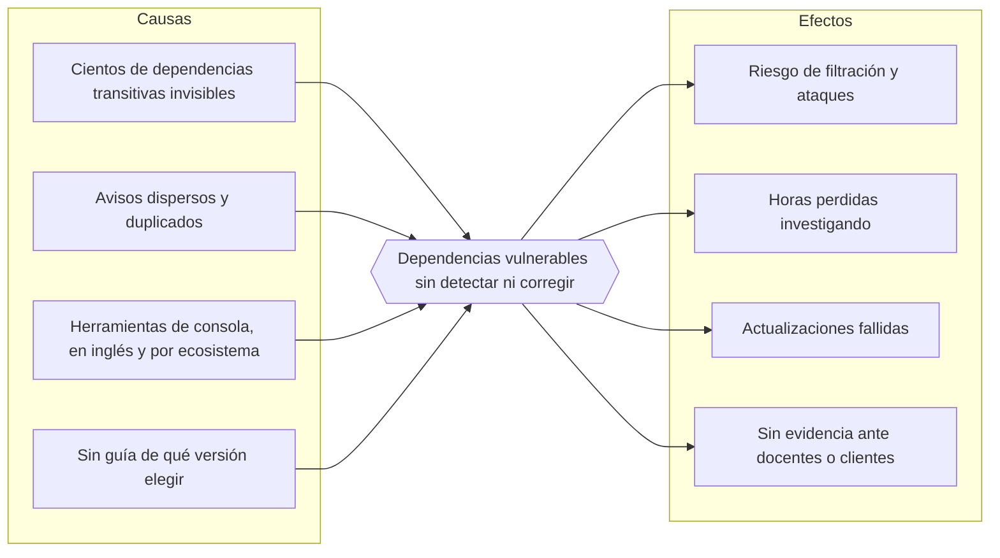
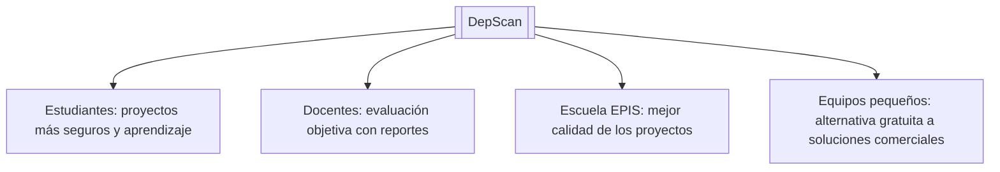
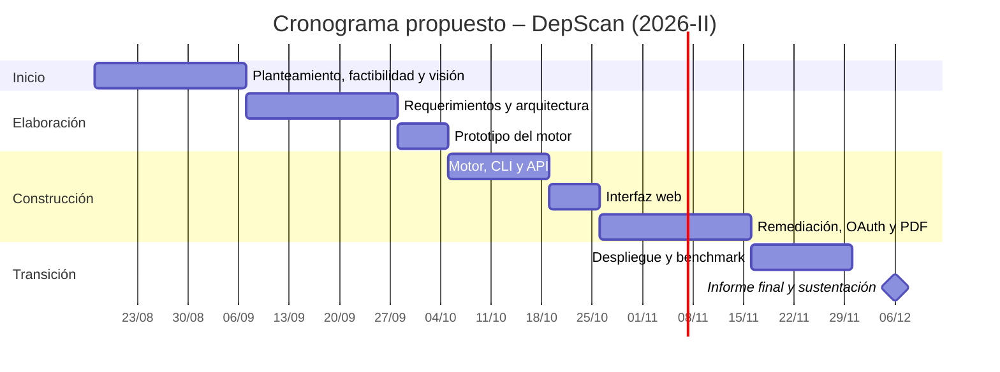
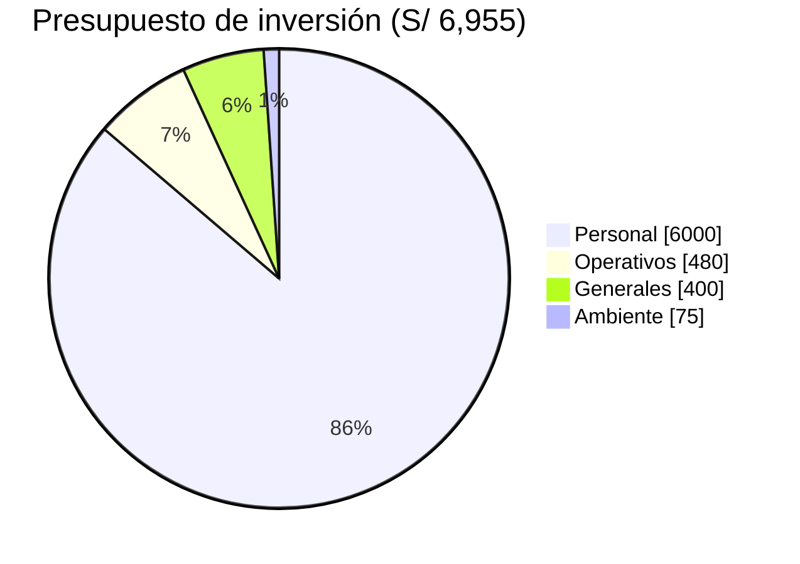

UNIVERSIDAD PRIVADA DE TACNA

FACULTAD DE INGENIERIA

Escuela Profesional de Ingeniería de Sistemas

**DepScan: Sistema Web de Detección y Remediación de Dependencias Vulnerables**

**Integrante:**

Angel Gadiel Hernandez Cruz

Tacna – Perú

2026

---

## INDICE GENERAL

- 1. Resumen Ejecutivo
- 2. Planteamiento del Problema y Justificación
- 3. Objetivo General y Específicos
- 4. Beneficios
- 5. Alcance y Restricciones
- 6. Cronograma
- 7. Presupuesto
- BIBLIOGRAFÍA
- WEBGRAFÍA

---

# 1. Resumen Ejecutivo

Según los informes de la industria sobre software de código abierto, la mayor parte del código de una aplicación moderna proviene de librerías de terceros, y una sola librería desactualizada basta para comprometer un sistema completo, como ocurrió en Equifax (2017) y con Log4Shell (2021). Sin embargo, la mayoría de los proyectos estudiantiles y de equipos pequeños **no revisan sus dependencias**, porque hacerlo a mano es lento y las herramientas gratuitas son de consola, en inglés, y se limitan a enumerar fallas.

**DepScan** propone resolverlo con un sistema web que, a partir de los archivos de dependencias de un proyecto (o directamente desde un repositorio de GitHub), **detecta en segundos las librerías con vulnerabilidades conocidas en npm y PyPI**. Además, para cada una indica **la versión segura recomendada, todas las alternativas seguras, los comandos exactos para actualizar y cómo protegerse si no es posible hacerlo**. El resultado queda en reportes HTML y PDF que sirven como evidencia formal.

| Aspecto | Propuesta |
|---|---|
| Producto | Aplicación web + herramienta de línea de comandos para CI |
| Usuarios | Estudiantes de la EPIS, docentes evaluadores y equipos de desarrollo pequeños |
| Diferencial | Remediación verificada contra todos los avisos, en español, con reportes PDF y soporte de npm y PyPI en un solo análisis |
| Duración | 16 semanas (semestre 2026-II) |
| Inversión | **S/ 6,955.00** |
| Rentabilidad estimada | VAN S/ 1,834.70 · TIR 26.8 % · B/C 1.12 |
| Estado | Prototipo funcional desplegado en https://deptest-production-7f98.up.railway.app |

# 2. Planteamiento del Problema y Justificación

**Problema.** Los equipos de desarrollo no saben, de forma rápida y confiable, si las librerías que usan tienen vulnerabilidades conocidas, ni a qué versión deben actualizar sin romper el proyecto o caer en otra falla.

**Causas y efectos**

**Justificación**

| Dimensión | Justificación |
|---|---|
| Técnica | Las bases OSV y NVD son públicas y gratuitas. El valor del proyecto está en procesarlas correctamente: versiones exactas, deduplicación y verificación de versiones seguras. |
| Académica | Aplica de forma integrada ingeniería de requerimientos, arquitectura de software, seguridad, pruebas y despliegue en la nube, bajo la metodología RUP. |
| Social | Promueve una cultura de desarrollo seguro y enseña, en español, por qué cada falla importa y cómo resolverla. |
| Económica | Ahorra horas de revisión manual con una inversión baja y una operación menor a S/ 300 mensuales. |
| Normativa | Responde a la categoría A06 del OWASP Top 10 (componentes vulnerables y desactualizados). |

# 3. Objetivo General y Específicos

**Objetivo general.** Desarrollar e implantar, en el semestre 2026-II, un sistema web que detecte dependencias con vulnerabilidades conocidas en proyectos npm y PyPI y proponga acciones de remediación verificadas.

**Objetivos específicos (SMART)**

| N.º | Objetivo | Medible | Alcanzable | Relevante | Plazo |
|---|---|---|---|---|---|
| OE1 | Construir un motor que obtenga la versión exacta de todas las dependencias, incluidas las transitivas. | Soporte de lockfile npm v1–v3, *workspaces* y `requirements.txt` | Con TypeScript y Node.js 24 | Base de todo el análisis | Semana 8 |
| OE2 | Detectar vulnerabilidades consultando OSV en lote y NVD de forma opcional, sin avisos duplicados. | Lotes de hasta 1000 paquetes; 0 duplicados | APIs públicas y gratuitas | Reportes claros | Semana 9 |
| OE3 | Recomendar para cada librería vulnerable una versión verificada contra todos sus avisos, junto con comandos y mitigaciones. | 100 % de hallazgos con remediación | Datos de OSV y registros | Principal aporte | Semana 12 |
| OE4 | Ofrecer una interfaz web con login (Google y GitHub), historial y reportes HTML/PDF. | Flujo completo en producción | React, Fastify y Railway | Facilidad de uso y evidencia | Semana 13 |
| OE5 | Validar los resultados frente a `npm audit` en al menos 3 repositorios reales. | 0 fallas omitidas | Benchmark reproducible | Credibilidad | Semana 15 |

# 4. Beneficios

**Beneficios tangibles**

| Beneficio | Estimación |
|---|---|
| Ahorro de tiempo de revisión | ~4 horas por proyecto (escenario: 5 proyectos/mes ≈ S/ 7,200 anuales) |
| Rapidez | Proyectos de más de 1000 dependencias analizados en menos de 20 segundos |
| Costo para el usuario | S/ 0, frente a planes comerciales con costo por desarrollador |
| Cobertura | npm y PyPI en un solo análisis, incluidas las dependencias transitivas |

**Beneficios intangibles**

- Menor riesgo de incidentes de seguridad en los proyectos de la Escuela.
- Aprendizaje práctico de seguridad del software en español.
- Evidencia objetiva (PDF con fecha y commit) para la evaluación docente.
- Integración con los hábitos del estudiante (GitHub) y con la integración continua.
- Proyecto de código abierto reutilizable por otros cursos y universidades.

**Beneficiarios**

# 5. Alcance y Restricciones

**Alcance**

| Incluye | No incluye |
|---|---|
| Ecosistemas npm y PyPI | Maven, Go, Cargo, NuGet, Composer, RubyGems |
| Lectura de `package.json`, `package-lock.json` (v1–v3), `requirements*.txt` | Análisis del código fuente propio |
| Fuentes OSV y NVD | Descubrimiento de vulnerabilidades nuevas (*zero-day*) |
| Detección, deduplicación, severidad y semáforo | Análisis de si el código vulnerable realmente se ejecuta |
| Versión recomendada, todas las seguras, comandos y mitigaciones | Aplicación automática de las correcciones en el repositorio |
| Web, CLI para CI y reportes HTML/PDF | Aplicación móvil nativa |
| Login con Google y GitHub y repositorios privados | Otros proveedores de identidad (Microsoft, GitLab) |
| Despliegue en Railway | Instalación on-premise con alta disponibilidad |

**Restricciones**

| Tipo | Restricción |
|---|---|
| Tiempo | Un semestre académico (16 semanas). |
| Presupuesto | Inversión máxima de S/ 7,000. |
| Tecnología | Solo Visual Studio Code; frontend React; backend Node.js/TypeScript. |
| Infraestructura | Una réplica en Railway (base SQLite en volumen). |
| Servicios externos | Disponibilidad y límites de uso de OSV, NVD y GitHub. |
| Login con Google | Modo prueba (hasta 100 usuarios) hasta que Google verifique la app. |
| Precisión | Menor sin lockfile; se declara en el reporte. |

# 6. Cronograma

| Fase RUP | Actividades | Inicio | Fin | Hito |
|---|---|---|---|---|
| Inicio | Planteamiento, factibilidad, visión | 17/08/2026 | 06/09/2026 | FD01 y FD02 aprobados |
| Elaboración | Requerimientos, arquitectura, prototipo del motor | 07/09/2026 | 04/10/2026 | FD03 y FD04 aprobados |
| Construcción | Motor, CLI, API, web, remediación, OAuth, PDF | 05/10/2026 | 15/11/2026 | Versión funcional con pruebas |
| Transición | Despliegue, benchmark, informe final, sustentación | 16/11/2026 | 06/12/2026 | Sistema en producción y FD05 |

# 7. Presupuesto

Tipo de cambio de referencia: US$ 1 = S/ 3.75. Fuente: estudio de factibilidad (FD01).

| Rubro | Detalle | Monto (S/) |
|---|---|---|
| Costos generales | Depreciación de equipo, útiles, impresión | 400.00 |
| Costos operativos | Internet y energía (4 meses) | 480.00 |
| Costos del ambiente | Railway plan Hobby (4 meses); software y APIs gratuitos | 75.00 |
| Costos de personal | Analista-desarrollador, 20 h/semana × 4 meses | 6,000.00 |
| **Total de inversión** | | **6,955.00** |

**Operación anual posterior:** S/ 3,540.00 (hosting S/ 540 y mantenimiento S/ 3,000).

**Evaluación financiera (3 años, tasa 12 %)**

| Indicador | Valor | Decisión |
|---|---|---|
| VAN | S/ 1,834.70 | > 0, aceptable |
| TIR | ≈ 26.8 % | > 12 %, rentable |
| B/C | 1.12 | > 1, conveniente |
| Recuperación | ≈ 1.9 años | Dentro del horizonte |

Por su bajo costo, su viabilidad técnica ya demostrada con un prototipo en producción y su impacto en la formación en desarrollo seguro, **se solicita la aprobación del proyecto DepScan**.

# BIBLIOGRAFÍA

- Kruchten, P. (2003). *The Rational Unified Process: An introduction* (3.ª ed.). Addison-Wesley.
- Sapag Chain, N., Sapag Chain, R., y Sapag Puelma, J. M. (2014). *Preparación y evaluación de proyectos* (6.ª ed.). McGraw-Hill.
- U.S. Government Accountability Office. (2018). *Data protection: Actions taken by Equifax and federal agencies in response to the 2017 breach* (GAO-18-559). https://www.gao.gov/products/gao-18-559

# WEBGRAFÍA

- Apache Software Foundation. (2021). *Apache Log4j security vulnerabilities*. https://logging.apache.org/log4j/2.x/security.html
- Google. (2026). *OSV: Open Source Vulnerabilities*. https://osv.dev
- OWASP Foundation. (2021). *A06:2021 – Vulnerable and Outdated Components*. https://owasp.org/Top10/A06_2021-Vulnerable_and_Outdated_Components/
